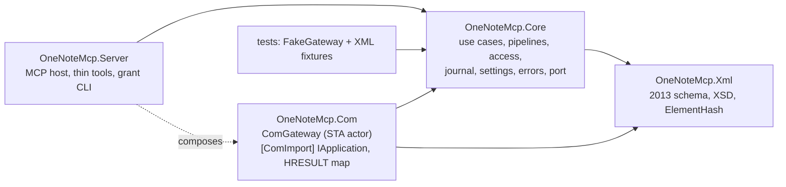
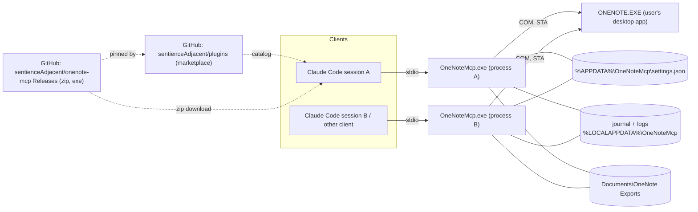

# Architecture Spine — onenote-mcp

## Design Paradigm

Hexagonal:
- **MCP tools** are the driving adapter.
- **Use cases** in Core own all policy.
- **`IOneNoteGateway`** is the one driven port.
- **`ComGateway`** is its only real adapter. It runs as an actor on one STA thread per process.
- **The XML model** is pure, with no COM or MCP dependency.

The same exe also serves a `grant` CLI subcommand over the same Core.



The arrows are the only dependencies allowed. Core never references Com or Server.

## Invariants & Rules

### AD-1 — Runtime and COM binding [ADOPTED]

- **Binds:** all
- **Prevents:** a host that mixes languages; IDispatch late binding, which fails for 64-bit hosts on this build; shipping a PIA that can't be embedded.
- **Rule:**
  - Use C# on .NET 10 with the ModelContextProtocol SDK.
  - OneNote is bound early, through a hand-declared `[ComImport]` `IApplication` matching the vtable of the OneNote 15 type library.
  - The first build story proves the vtable with a smoke test. If that fails, the fallback is the GAC PIA, decided at that point.

### AD-2 — Only ComGateway touches COM [ADOPTED]

- **Binds:** all
- **Prevents:** stories creating their own COM objects or threads; COM calls made off the STA thread.
- **Rule:**
  - Each process has one live `ComGateway` STA thread at a time, with a message pump, owning one COM reference. It serialises every call through its queue.
  - The COM interop types are `internal` to `OneNoteMcp.Com`. Inside it, only `ComGateway` and its `StaThread` worker reference them: `ComGateway` creates the `IApplication` and makes every call; the worker holds and releases it, on its own STA thread. The test projects also see them through `InternalsVisibleTo`, for the vtable smoke test and `FakeApplication` (AD-16).

### AD-3 — Gateway lifecycle [ADOPTED]

- **Binds:** Com, Core
- **Prevents:** hangs; OneNote starting silently; the server disturbing the user's OneNote; OneNote kept running after the user closes it.
- **Rule:**
  - **Timeouts:**
    - Every COM call has a timeout: 30 s by default, 300 s for `Publish`.
    - Activation has its own timeout, 10 s.
    - The 30 s default stays for every write, cloud creates included (Phill, 2026-11-12, 2.7 plan Q1). On MCP Test Cloud an `OpenHierarchy` create took 3.6–6.4 s, once 12.8 s in a burst, and a create that timed out at a 2 s test limit still landed about 3 s later (spike 5.1 constraint 12). So a timed-out create is `outcomeUnknown` like any write, and the caller re-reads before retrying. Whether 30 s covers every cloud create wasn't probed (see Deferred). Hierarchy calls other than create took under 0.4 s.
  - **A call that times out:**
    - It returns `Timeout`.
    - The STA thread is marked poisoned and abandoned, and a fresh thread and COM reference replace it.
    - Calls already queued fail fast with `ComBusy`.
    - A write that timed out reports `outcomeUnknown: true`.
    - While an abandoned write is still outstanding, new non-read pipelines return `ComBusy`.
    - An abandoned thread releases its COM reference if its call ever returns.
    - After 2 abandoned threads, the gateway returns `ComUnavailable` until OneNote is reachable again.
  - **Disconnects (`RPC_S_SERVER_UNAVAILABLE` or `RPC_E_DISCONNECTED`):**
    - Drop the reference. Reactivation follows the same rules as a first activation.
    - A read is retried once. A write is never retried automatically, and returns `ComUnavailable` with `outcomeUnknown: true`.
  - **Busy (`RPC_E_CALL_REJECTED` or `RETRYLATER`):** retry with backoff, up to the call's timeout, then return `ComBusy`. `0x8004201D` hrNotYetSynchronized is not a busy code for this rule: it returns `ComBusy` at once, with no backoff, because a notebook sync can take longer than one call (AD-9). Nor is `0x80042024` hrRecordingInProgress, remapped to `ComBusy` (AD-9): it also returns at once, with no backoff. That is the conservative reading: OneNote returned it after receiving the call, so a retry would repeat a write, which is never retried automatically, and a recording can outlast one call.
  - **Activation:**
    - If `ONENOTE.EXE` is not running, return `OneNoteNotRunning`, unless `allowSilentActivation` is set.
    - An `ONENOTE.EXE` that has crashed doesn't count as running, though it stays listed while Windows Error Reporting writes its dump. Without that rule, a reconnect's activation started a hidden `ONENOTE.EXE -Embedding` that the user had to end before OneNote would start (spike 2.2, Failure modes). Story 2.7 built the detection: an `ONENOTE.EXE` that a `WerFault.exe` or `WerFaultSecure.exe` in this session targets (`-p <pid>`) isn't running, and a live reference to it is dropped. A WER process whose command line can't be read counts every OneNote as crashing only when connecting (a first activation or a reconnect); a live reference's per-call check ignores it, so a working connection keeps going (Phill, 2026-11-12, 2.7 plan Q3). The exception: with `allowSilentActivation` on, a reconnect after a crash may start a windowless instance, as that setting allows for any activation.
    - **No open window** (Phill, 2026-11-16, backlog 3). Unless `allowSilentActivation` is on, OneNote counts as running only while some `ONENOTE.EXE` in this session has an open window.
      - What counts as an open window: `Process.MainWindowHandle` isn't zero, meaning a top-level window of the process that has no owner and is visible. A minimised window counts. An `ONENOTE.EXE` without one is closing, still starting, or was started for COM.
      - Why: a call made while a closed OneNote shuts down (about 12 s) would otherwise connect to it and keep it alive. It might also start a hidden copy; that is unprobed (see Deferred).
      - The connecting check refuses with `OneNoteNotRunning`, before the integrity check and `CoCreateInstance`. Its message says that OneNote is closing or starting. Its `userAction` says to wait, then make sure OneNote is open in a window.
      - A live reference's per-call check drops the reference, and the call then fails the same way. That check adds one process listing and one window enumeration to every call while a reference is held: an estimated 2–3 ms, not measured in the server.
      - The rule fails open, so a doubt never refuses a normally open OneNote:
        - a window that can't be read counts as open;
        - when this process can see no top-level windows at all (a server on another desktop or window station), every `ONENOTE.EXE` counts as having one (Fable F4, Phill 2026-11-16).
      - The check covers the whole session. The window may belong to a different `ONENOTE.EXE` from the one the running check counted: a crashed one, or a new one started while an old one is still closing (see Deferred).
      - The memlog records the signals not used: a window class, `-Embedding` on the command line, and the ROT.
    - Check the integrity level at startup and at every activation. A mismatch returns `IntegrityMismatch` and never calls COM.
  - **Modal dialogs:** with File > Options open, of the page methods only `UpdatePageContent` failed, with `0x80042030` (`ModalDialogOpen`, AD-9). `DeletePageContent`, `CreateNewPage`, `GetPageContent`, `FindPages` and `GetHierarchy` went through (spike 2.2 constraint 8). No pipeline checks for a dialog up front; the error comes from the call.
    - Hierarchy methods (spike 5.1 constraint 11), with File > Options or a section's password dialog open, alike: `UpdateHierarchy` failed `0x80042030` and applied nothing; `GetHierarchy`, `OpenHierarchy` create and `DeleteHierarchy` soft and permanent went through and applied (only page deletes were tried); `Publish` returned `0x80042006`, which came from the empty section it was sent, not from the dialog: under File > Options `Publish` of a section with pages succeeded (story 5.6 sitting P5, P9). So, of the methods tried, only the two update methods returned `ModalDialogOpen` under these dialogs.
    - Round-2 methods (spike 3.1 Implication 13): with File > Options open, a page move by `UpdateHierarchy` returned `0x80042030` in 258 ms and moved nothing (one run), while `Publish(pfPDF)`, `OpenPackage` and `MergeSections` went through (repeated), agreeing with 5.6's finding that 5.1's `0x80042006` under a dialog was an empty section's. So `ExternalWrite` and merges can't use `0x80042030` to detect a dialog, and needn't wait for one; a move gets a clean, retryable `ModalDialogOpen`.
    - Two dialogs block the call instead of returning an error: "OneNote is syncing changes" and "We couldn't find that file." (`Publish` into a missing folder; AD-7 creates the folder first). Each surfaces as `Timeout`, so a write is `outcomeUnknown` (AD-9).
    - A move can raise OneNote's own dialog and block (spike 3.1 Implications 5 and 16): a local section moved to another notebook's root raised "hasn't finished downloading" first; a cloud section moved into a group and straight on to another cloud notebook blocked 180 s behind "can't copy or move this section because it has been deleted by a user of this notebook" (one run each). A move keeps the 30 s call limit; a blocked one is `Timeout` with `outcomeUnknown`. The second case came straight after a group move inside the same cloud notebook, and AD-7's settle after every section or group move touching a cloud notebook covers it: with a 10 s settle the same move ran clean (one run).
    - Other dialogs weren't tried (see Deferred).
  - **Idle:** release the COM reference after `timeouts.idleReleaseSeconds` with no call: 5 s by default (Phill, 2026-11-16, backlog 3).
    - Why: a held reference keeps `ONENOTE.EXE` alive after the user closes its window. Restarting OneNote then starts a second `ONENOTE.EXE`, which shows "OneNote is cleaning up" and exits.
      - Source: the 2026-11-16 sitting, recorded in the backlog 3 ticket's Notes. One machine, one run, observed with clock times, not logged.
      - With no server, OneNote ended about 12 s after its window closed. When the server was ended, the pinned process ended within 1 s.
    - At 5 s, the server is expected to let a closed OneNote end within its own ~12 s shutdown. That hasn't been checked at a sitting yet (see Deferred). Two exceptions:
      - a call in flight holds the reference until it returns, up to 30 s (300 s for `Publish`);
      - an abandoned thread holds its own reference until its call returns.

      One tool's COM calls come milliseconds apart, so they still share one activation.
    - Cost of a re-activation against a running OneNote: it runs every activation rule above, an estimated 15–20 ms in all. 9 ms is `CoCreateInstance` (spike 1, logged); the rest, the process checks and the integrity check, wasn't measured.
    - With `allowSilentActivation` on and OneNote closed, each gap may instead start a windowless instance (511 ms in spike 1); see Deferred.
    - The setting keeps its range: whole seconds, from 1 to 2,147,483 (AD-10). Values above about 10 s can bring the dialog back. The write probes set a day, to pin one activation.
  - Never kill or close OneNote.

### AD-4 — Raw XML is the content contract [ADOPTED]

- **Binds:** every tool that returns or accepts hierarchy or page XML
- **Prevents:** a different format per tool; lossy round trips; the server quietly changing content.
- **Rule:**
  - Tools take and return OneNote 2013-schema XML. Every COM call passes `xs2013`, and no tool offers a schema choice: a `GetPageContent` in `xs2007` of a page just rewritten in `xs2010` crashed OneNote (spike 2.2, Failure modes).
    - `xs2013` stays safe for tables with merged cells when an Outline is sent back as read: a 2013 round trip of an unchanged merged table kept the merge, and `0x80042022` hrFutureContentLoss never appeared (spike 2.2 constraint 12). The undocumented `xs2026` isn't used. Editing inside a merged table in `xs2013` wasn't probed (see Deferred).
    - A page write's XML is merged by OneNote, not applied as a diff: a sent Outline's OE list replaces the one on the page (AD-7 `PageWrite`).
  - The server never adds, changes or removes elements or attributes in the XML it returns. The exceptions:
    - Search may remove whole `one:Page` elements, and each one removed is listed in `meta.filtered`, except pages withheld under AD-21, which are never listed.
    - A read without a read grant removes the whole `one:Page` elements of a protected section, and lists the section in `meta.withheld` (AD-21).
    - An oversized result is delivered as an index plus parts (AD-20). The stored result is the body the tool would have returned inline, after every removal above. Each part is an exact substring of that body, never re-serialised, so its prefixes rely on the root's namespace declarations, which come in `meta.result` with every `read_result` response.
  - Degraded results go only in `meta` and `warnings`. Examples: an image that has no local binary, which is detected by comparing image counts against a basic read, and a locked section.
  - Page reads exclude binary content unless the caller asks for it.
  - OneNote IDs are opaque strings: never parsed, never built from parts.
  - Dates sent to COM are UTC.

### AD-5 — Thin tools, layered tasks [ADOPTED]

- **Binds:** Server, Core
- **Prevents:** task tools drifting away from the COM surface, or getting around policy.
- **Rule:**
  - There is roughly one MCP tool per COM method. Each tool is backed by one use case, holds no policy, and declares one `OperationClass` (AD-7).
  - Task-shaped behaviour starts as a recipe in the skill.
  - A task promoted into the server becomes a Core use case built from the thin use cases. It runs each of their pipelines and claims no atomicity: on failure it returns `meta.completedSteps`.
  - **`UpdateHierarchy` tools** (Phill, 2026-11-12, epic 3 decision Q2; story 5.4 Q1): Core builds the XML from IDs and a name or a page level, so no caller-written XML reaches `UpdateHierarchy`. `rename_hierarchy_object` and `reorder_hierarchy_children` (epic 5), the move tool, `move_hierarchy_object(objectId, parentId, position?, basis?)` (epic 3), `set_page_level(pageId, level, basis?)` (story 3.14) and `restore_from_recycle_bin(objectId, parentId?, entryId?, position?)` (story 3.5) are each one `HierarchyWrite` pipeline (AD-7), except a section restored into another notebook, which runs the section move as a second pipeline (AD-8, 3.5 Q7) and reports a move that didn't complete as the warning `restoredNotMoved` rather than `meta.completedSteps`: the restore itself succeeded, and Phill asked that the result say the move didn't happen and why. The move is its own tool, not an argument on the others, so the model never writes XML spanning two notebooks.
  - **`merge_sections(sourceId, destinationId, basis?)`** (story 3.6) is one `HierarchyWrite` pipeline (AD-7 Merges) whose step 7 is one `MergeSections`, never an `UpdateHierarchy`: Core sends the two IDs only, so no caller-written XML reaches OneNote.
  - **`open_package`** is a promoted task (spike 3.1 Implication 10; Phill, 2026-11-12, epic 3 decision Q6): `OpenPackage` (`ExternalWrite`) unpacks into the folder it is given and opens no notebook, so the task then opens that folder with `OpenHierarchy` (`AppState`, no grant given). It returns the folder and the opened notebook, or `meta.completedSteps` on failure.

### AD-6 — Server-enforced write grants [ADOPTED]

- **Binds:** Core (access), every write use case, every read use case through AD-21, the `grant` CLI
- **Prevents:** a gate that lives only in the skill or that the model can grant itself; writes from clients that don't have the skill.
- **Rule:**
  - **Who can do what:**
    - Reads are allowed on every notebook, except content in password-protected sections, which needs a read grant (AD-21).
    - Writes need a write grant for each notebook they touch.
    - A write inside a password-protected section, by one of the tools AD-21 lists under Writes, needs only that notebook's write grant, never the section's read grant (Phill, 2026-11-10, 2.3 plan Q3 option c, superseding inception decision 3's "both grants"). The write's own reads (AD-7 step 3, the read-back, the snapshot) run under the write grant and never return content to the model. A write grant never opens a protected section to the read tools (AD-21): without the section's read grant, the model can't read the page, and its basis may carry only the date, or it writes with `noBasis` (AD-17).
    - Deletes in or of a password-protected section follow the same rule: the notebook's write grant alone, never the section's read grant (Phill, 2026-11-12, 5.2 plan Q6). So do `rename_hierarchy_object` and `reorder_hierarchy_children` renaming or reordering a protected section (Phill, 2026-11-12, 5.2 Fable F2). Reordering the pages inside one is an exception, listed below (Phill, 2026-11-17, backlog 7, superseding 5.2 Fable F2 for page reorders and N6). AD-21 lists them under Writes, with what it still refuses there.
    - The exceptions, which need the section's read grant as well, held at the call's start and never prompted for (AD-21): `delete_page_content` in a protected section (Phill, 2026-11-12, story 2.10 Q1); a page write there whose basis carries any hash, `pageHash` or an element's, or whose sent XML carries any `objectID` attribute, or that names any `removeObjectIds` entry (Phill, 2026-11-12, story 2.9 security review; AD-17); a page permanent delete there whose basis carries a hash (Phill, 2026-11-12, 5.2 Fable N1); `reorder_hierarchy_children` reordering the pages of a protected section, refused before any check of the list (Phill, 2026-11-17, backlog 7); `move_hierarchy_object` placing a page at a `position` in a protected section (Phill, 2026-11-17, story 3.4 security review); and `set_page_level` there, and `create_page` there with `parentPageId` (Phill, 2026-11-17, 3.14 plan Q1 a). The reorder checks it in step 4, after `SectionLocked`; the move's `position`, `set_page_level` and `create_page` with `parentPageId` check it in step 1, after a locked section and before the write grant (AD-7 step 1.2).
    - A permanent delete also needs a permanent-delete grant, which counts only alongside a write grant.
    - A page write that sends a new file path also needs the user's acceptance of each path, in a dialog no grant replaces (AD-7 `PageWrite`; Phill, 2026-11-12, story 2.9 security review).
  - **How a grant is created:**
    - Through an MCP elicitation dialog in which the user types the notebook's name. The typed text is matched against each open notebook's displayed name (`nickname`, else `name`). If it matches more than one notebook, or none, no grant is made and the write returns `WriteNotGranted`. So does a name that matches exactly one open notebook other than the one the write targets ("the name typed in the grant dialog didn't match this notebook"; Phill, 2026-11-12, 2.6 plan Q2). AD-7 step 1 raises the dialog itself when the client declares elicitation. If the user declines or cancels, or the client lacks the capability, the write returns `WriteNotGranted`, with `userAction` naming the CLI. Time spent waiting on the dialog doesn't count against the pipeline deadline.
    - Or through the interactive `OneNoteMcp grant` CLI, which refuses to run when there is no interactive terminal. It uses the same name matcher as elicitation, and lists the candidates when a name is ambiguous. `grant --revoke` removes a grant. It also runs on a `settings.json` that is invalid only because of duplicate grant keys (below), and then removes every entry matching the key, so the user can fix the file.
    - Or automatically, when a notebook is created at a path the server checked was empty (AD-7 `Create`), recorded as `grantedVia: created`.
    - No tool can create a grant. The read-only `list_grants` tool shows grants, read grants included, and how each was created.
    - The plugin blocks the model from changing `settings.json` or anything else in its folder or in the default `%APPDATA%\OneNoteMcp` (blocked even when the settings path is overridden), from running the grant CLI, and from running `OneNoteMcp uninstall`, whose `--purge` deletes `settings.json` and every grant in it (AD-19).
  - **Notebook resolution:**
    - The owning notebook is resolved through the gateway, never from the ID string: a `GetHierarchyParent` chain, where the empty string OneNote returns at the notebook marks the end of the chain, or a hierarchy lookup. An exception from `GetHierarchyParent` is an ordinary error (AD-9) and never ends the chain. (Observed 2026-11-04 on the local MCP Test notebook, `tests/OneNoteMcp.Tests/Fixtures/mcp-test/parent/notebook.txt`. Microsoft's documentation says it throws.) Resolution ends by reading that notebook's `one:Notebook@path` live from `GetHierarchy`.
    - A payload with several IDs, such as a move or a merge, needs a grant for every notebook it touches.
  - **Grant key:**
    - A grant is keyed by the notebook's path, never by its ID, because closing and reopening a notebook regenerates every ID.
    - One Core function, `NotebookKey`, computes the key, and every unit uses it: the access check, elicitation, the CLI, the `Create` auto-grant, the journal and restore.
      - Its only input is the `one:Notebook@path` attribute read live from `GetHierarchy`. That means never a section's `path`, and never a path argument passed to COM. On create, the path is read back after the call.
      - The transform is to trim trailing `\` and `/`, and nothing else: no decoding, no `GetFullPath`.
      - Keys compare `OrdinalIgnoreCase`. Two keys in `notebooks{}`, or two in `protectedSections{}`, that are equal, exactly or ignoring case, make the file `SettingsInvalid` (Phill, 2026-11-10, 2.3 plan Q7). `grant --revoke` still runs on such a file, as above.
    - The notebook's `name` and its ID at grant time (`idAtGrant`, never refreshed) are stored for information only, and are never compared for access.
    - **Path stability**, measured on a local and a OneDrive notebook (spike 2.2 constraint 9):
      - Close and reopen gives every notebook, section and section group a new ID and keeps every `path`. Exception (3.8 sitting S2, 2026-11-18): a notebook opened from a local folder inside a OneDrive-synced folder came back after a OneNote restart with `https://d.docs.live.net/<cid>/…` paths and new IDs (AD-21, Web addresses).
      - Renaming a notebook in OneNote changes only its `nickname`; its `name`, `path` and ID stay.
      - Moving or renaming a local notebook's folder (with a reopen) changes its `name`, every `path` and every ID. Renaming the OneDrive item while the notebook is open changes its `name` and every `path`, live and with no sync error, and keeps the IDs.
      - Password-protecting a section in OneNote gives the section and every page in it new IDs, local and OneDrive; names, paths, page `dateTime` and the pages' hierarchy `lastModifiedTime` stay (spike 5.1 constraint 15). OneNote writes a new `.one` in place of the old one. Grants survive it, because they are keyed by path; `idAtGrant` goes stale, which doesn't matter, since it is informational.
      - So a grant survives close, reopen, protecting a section and display renames, where an ID wouldn't. A folder move or a OneDrive rename changes the key: `list_grants` shows the grant as `notebookNotOpen`, and the user grants again. That fails closed.
    - **Path forms:** a local notebook `C:\…\<notebook>`, with no trailing separator; a OneDrive notebook `https://d.docs.live.net/<cid>/Documents/<notebook>/`, with a trailing slash, which the transform trims. Sections end in `.one` in both forms; section groups end like their notebook form (spike 2.2 constraint 9).
  - **Limits** (they apply to AD-21's read grants too): the README says plainly that this guards against accidents and casual misuse, not against a hostile local process. Elicitation hooks can answer the dialog automatically, and headless runs cancel elicitation. A grant follows its path: a different notebook that later appears at a granted path inherits the grant without a prompt. This is an accepted risk, stated in the README. The plugin guard (the `PreToolUse` hook) is best effort and Claude Code only: a disguised shell command gets past it, and nothing stops another program from editing OneNoteMcp's files; the README says so.

### AD-7 — One write pipeline per operation class [ADOPTED]

- **Binds:** every use case that changes OneNote or the file system
- **Prevents:** writes that skip checks or run them in a different order; each story inventing what to snapshot.
- **Rule:**
  - Every non-read use case runs these steps in order. Any failed step aborts with its error (AD-9), and no write path exists outside the pipeline.
    1. Access check (AD-6). In a password-protected section, for the tools AD-21 lists under Writes, the notebook's write grant alone lets the write run, this pipeline's own reads included (step 3, the read-backs, the snapshot). Those reads never return content to the model (AD-21). The order inside step 1 is fixed (Phill, 2026-11-12, 5.2 Fable N3):
       1. Parse any sent XML with DTD processing prohibited; a DOCTYPE is `InvalidXml` (AD-16), and XML that doesn't parse is `InvalidXml` too. An empty `objectId` argument is `InvalidArgument` here, before the lock (story 2.10).
       2. In a protected section, the read-grant check for the writes that need one (AD-6, AD-17, AD-21), at the call's start and never prompting; missing, `ReadNotGranted`. It runs before the locked-section check, in the same order as the read tools (AD-21), so a locked protected section without a read grant answers `ReadNotGranted` (story 2.10). One check runs later, in step 4 after `SectionLocked`, against the call's start all the same: a page reorder's (`HierarchyWrite` validation, backlog 7), so a locked section there answers `SectionLocked`. Three writes check locked first and then the read grant, both from the section's own attributes, in step 1 before the write grant at 1.3, and again in step 4: `set_page_level`, `create_page` with `parentPageId`, and `move_hierarchy_object` with a `position` in a protected target (Page levels, `Create` validation, Moves). A locked section's attributes reveal nothing about its pages, so a locked section answers `SectionLocked` there, and the user is never shown the write-grant dialog for a call the read-grant check will refuse (Phill, 2026-11-17, 3.14 Fable review; this moves 3.4's `position` check from step 4 into step 1).
       3. The write grant, raising AD-6's grant dialog if it is missing.
       4. For a `PageWrite`, the HTML check, then, if it sends file paths, the path dialog (`PageWrite` validation, below), so the path dialog is never raised for a call the HTML check refuses (story 2.9 plan, Follow-up "Step-1 order").
    2. Take the write lock (AD-18).
    3. Read the current state.
    4. Validate. For a `PageWrite`, the HTML check runs again against step 3's read, and a new file path the user didn't accept in step 1 (the page changed in between) is `WriteNotGranted` here, retryable (story 2.9 plan, Follow-up item 3).
    5. Optimistic check (AD-17). The server compares the basis date and hashes against step 3's read itself, for every class AD-17 binds. It also passes the date to the COM methods that take one: `UpdatePageContent`, `DeletePageContent` and `DeleteHierarchy`. The date each method checks is AD-17's: a page delete's caller basis is still the page XML's, compared here, but `DeleteHierarchy` is sent the page's hierarchy `lastModifiedTime` from step 3's read (Phill, 2026-11-12, 5.2 plan Q4; spike 5.1 constraint 1). `UpdateHierarchy` takes no date, so its check is the server's comparison alone.
    6. Snapshot (AD-8).
    7. COM call. A failure here with `Timeout`, `ComUnavailable` or `Cancelled`, or with HRESULT `0x800706BE`, sets `outcomeUnknown` (AD-9), and so do `0x80042004` on a move and `0x8004201F` on a merge (Moves and Merges, below).
    8. Release the lock.
  - Creating a notebook adds a step between 7 and 8: write the automatic grant (AD-6) under `Local\OneNoteMcp.Settings`. The lock order is always `Local\OneNoteMcp.Write` outside and `Local\OneNoteMcp.Settings` inside. If the path can't be read back, the result is `ok: true` with the warning `createdNotGranted`, and its `userAction` names the grant CLI.
  - Each pipeline has a deadline: 120 s by default, 600 s for classes that publish (`PermanentDelete` and `ExternalWrite`).
  - **Results are checked against the hierarchy, never the file system** (spike 5.1 constraint 10). Straight after a soft or permanent delete, a section's `.one` was still at its old path, and a recycled section's file appeared late or not at all.
  - **Stored IDs can vanish.** Protecting a section gives it and its pages new IDs (AD-6; spike 5.1 constraint 15), as a reopen does. So no step assumes an ID it stored still exists: a journal entry's `parentId` and `recycleBinId`, and the IDs inside a snapshot or backup, are used only with the fallbacks AD-8 gives them (`parentNamePath`, `SectionKey`, the page's name). An ID the caller sends that is gone is `ObjectNotFound`, and the caller re-reads (AD-9).
  - **A write's notebook is re-resolved under the lock** (epic 3 E5; deferred-work, story 2.4). Step 1 resolves the target's notebook before the lock; once a move can take a section to another notebook, step 3 walks to the notebook again, and if it isn't the one step 1 granted, the write is refused with `WriteNotGranted`, retryable, before COM. So a section moved between notebooks can't take another write's grant. Story 3.4 builds it for the move tool, which re-resolves both notebooks; story 3.12 extends it to every other write, `create_page` included.
  - A write drops the written page's entry from the search page-text cache (AD-12) before it returns, whatever the COM call's outcome.
  - Every call has exactly one class. Where a method appears in more than one row, the class comes from explicit arguments: `DeleteHierarchy` from `permanent`; `OpenHierarchy` from whether the target exists, checked under the write lock.
  - "XSD" in the table means the AD-16 gate.
  - **`PageWrite` validation** (spike 2.2 constraints 1 and 2):
    - **Recycled pages** (Phill, 2026-11-16, 3.2 plan J6; spike 3.1 Implication 7): a page in the recycle bin (`isInRecycleBin`, or in Deleted Pages) is refused with `ObjectNotFound` before COM, with a `userAction` to restore it first, as `create_page` refuses a recycle-bin parent. `UpdatePageContent` on one returned `0x8004200C` hrPageReadOnly, local and cloud, whose triage `userAction` ("make it editable") misleads there. Backlog item 6 builds it.
    - **Whole Outlines:** `UpdatePageContent` replaces the OE list of every Outline it is sent: an OE left out is deleted, and an Outline left out is kept. So every Outline sent with an `objectID` must list every OE that step 3 read under it, nested OEs included, with their `objectID`s, except OEs the caller names for removal in `removeObjectIds` (story 2.9); removing an OE removes the OEs nested under it. Anything else is refused with `InvalidArgument` before COM. An OE without an `objectID` is added, and an Outline without one is added beside the others.
    - **No moves between Outlines** (Phill, 2026-11-12, 2.9 plan Q4): an OE sent under a different Outline from the one step 3 read it in is refused with `InvalidArgument` before COM. The `userAction` says to send it without its `objectID` in the new Outline and name it in `removeObjectIds` for the old one. OneNote deletes and re-creates a moved OE under a new `objectID` (read-back, below); spike 2.2 tried that only with both Outlines sent.
    - **Removal:** removing an OE means resending its Outline without it. `DeletePageContent` on an OE fails with `0x8004200E` and the OE stays.
    - **`delete_page_content`** deletes Outlines only in v1 (Phill, 2026-11-10, 2.3 plan Q8). Any other target, an OE included, is refused with `InvalidArgument` before COM. Image and ink deletes are deferred (see Deferred). One Outline per call: one `DeletePageContent` call and one journal entry (Phill, 2026-11-12, 2.10 plan Q2).
    - **Protected sections:** with no read grant for the section, a refusal names no `objectID` or anything else inside the page (AD-21 Messages). Without that grant, held at the call's start and never prompted for, `delete_page_content` is refused, and so is any write whose basis carries any hash, or whose sent XML carries any `objectID` attribute, or that names any `removeObjectIds` entry, all with `ReadNotGranted` before the page is read (AD-17, AD-21).
    - **File paths are user-gated** (Phill, 2026-11-12, story 2.9 security review; 5.2 Fable N2, N7, N8). OneNote reads a file named in page XML into the page, so a sent path is a way to copy any file the user can read into a notebook.
      - The paths covered: `path` on every `one:File` element, whatever its parent (`one:Image`, `one:InkDrawing`, `one:InkWord`, `one:XPSFile`, `one:HTMLBlock`), and `pathSource` and `pathCache` on `one:InsertedFile` and `one:MediaFile`. `pathCache` is gated like the others.
      - A path is exempt from the dialog only when it is unchanged on the same existing element, with the same attribute and the same value. The `objectID` that identifies that element is its own; for a `one:File`, its parent's; for a `one:InsertedFile` or `one:MediaFile` without one, as OneNote writes them, the OE holding it (Phill, 2026-11-12, after the live sitting's B3; 2.9 plan "Attachments resent unchanged"). Step 1's read of the page must hold that `objectID`. Every other path is new: any path whose element has no such `objectID`, any changed value, and, in a protected section without a read grant, every path sent.
      - **`pathCache` values the server returned aren't new** (same source). OneNote names a new temp copy of an attachment on every read, so a resent attachment never matches step 1's read. A `pathCache` that one of this process's `get_page_content` reads returned for that page, sent on the same OE and the same kind of file element, is exempt. The server remembers only `pathCache`, in memory, at most 4,096 values, oldest forgotten first, never in messages or logs. A new, moved or changed attachment still raises the dialog.
      - Each new path is made canonical first (`GetFullPath`; links and junctions followed one hop at a time, each hop classified before it is touched, at most 8 hops). Refused with `InvalidArgument`, with no dialog: a UNC path (`\\server\share\…`), a mapped network drive, a link or junction that leads to a network or device path, a device path (`\\?\…`, `\\.\…`), anything not fully qualified (relative, drive-relative `C:x`, rooted `\x`, a URL), more than 8 hops or a loop, and control, invisible or wildcard characters (story 2.9 plan, Follow-up item 3 and "Link resolution").
      - The rest go to one elicitation dialog, raised last in step 1 from a read of the page made there, before the lock. It names each canonical path and asks the user to accept or decline. Time on it doesn't count against the deadline, and AD-6's Limits apply: an elicitation hook can answer it. Under the lock, step 4 returns `WriteNotGranted` if any path is new that the user didn't accept.
      - Declined or cancelled: `WriteNotGranted`, retryable, with a `userAction` to have the user accept the path, or to send the image as inline `one:Data`. A client without elicitation: `WriteNotGranted` with `retryable: false`, and the `userAction` "send the image as inline one:Data, or insert the file in OneNote yourself". `WriteNotGranted` fits because what is missing is the user's permission.
      - Images otherwise go only as inline `one:Data`.
    - **HTML** (Phill, 2026-11-12; story 2.9 plan, "HTML stopgap, now an allowlist" and "Probe"). OneNote imports HTML from page XML, and HTML can name a local file.
      - **A new or changed `one:HTMLBlock` is refused** with `InvalidArgument`, with a `userAction` to send text or inline `one:Data`. OneNote fetches a local file an `HTMLBlock` references, past the path dialog (joint 2.9 + 2.10 sitting; memlog).
      - **A new or changed `one:T` is held to an allowlist**, the current stopgap: tags and attributes of OneNote's own formatting only; links only to absolute `http`, `https` or `mailto` URLs, in-page `onenote:#` links, or `onenote:` links to OneDrive or SharePoint; CSS with no function but a colour; no `<!`, `<?`, backtick or unknown entity, at every stage of entity decoding. Anything else is `InvalidArgument`. It stays while it is unknown whether OneNote decodes entities twice (see Deferred).
      - Both are checked in step 1, before the path dialog, and again in step 4. An unchanged one on the same existing element is allowed, so other edits to such a page still work; without a read grant every one counts as new. Messages give counts only.
  - **`PageWrite` read-back**, a step between 7 and 8, under the lock, after a successful COM call (spike 2.2 constraint 7). OneNote silently ignores some edits: a changed `quickStyleIndex` on an existing OE is dropped with the page hash unchanged, and an OE moved to another Outline is deleted and re-created under a new `objectID`.
    - The step re-reads the page and compares its attributes and `objectID`s with what was sent, not its text. It exempts two normalisations OneNote is known to make (spike 2.2, Results, Side effects rows): an OE `style` equal to its QuickStyleDef is dropped (`side-local-style-duplicate`), and every `&nbsp;` form reads back as the text `&nbsp;` (`side-nbsp-*`).
    - For `DeletePageContent`, it checks only that the deleted Outline is gone, and warns `readBackDiffers` if it isn't.
    - It reports as warnings: an attribute OneNote didn't apply (`readBackDiffers`); an OE re-created under a new `objectID` (`readBackDiffers`, with old and new IDs); an image in a sent Outline that is gone (`imageLost`; Phill, 2026-11-10, 2.3 plan Q1).
    - It skips what `ElementHash` excludes (AD-17), so an auto-sized column width or a `pathCache` isn't reported.
    - It never fails the write, which already happened. A read-back that fails gives the warning `readBackFailed`.
    - Its warnings carry `objectID`s and attribute names, never content (AD-9). In a protected section with no read grant, they carry only counts (AD-21), and the result adds one count-free `readBackWithheld` warning and no `meta.basis` (story 2.9 plan, Follow-up item 4). "No read grant" means no grant that would let a read of that section pass at the call's start, a `once` grant included.
  - **`Create` validation for `CreateNewPage`** (story 2.4 Q8): the parent must be a live section, not locked. A non-section ID, or a section with `isInRecycleBin` or `isDeletedPages`, is refused with `ObjectNotFound` before COM, with a `userAction` asking for a section's ID; a locked one is `SectionLocked`.
    - **With `parentPageId`** (Phill, 2026-11-17, 3.14 plan Q1, Q4, Q5): `sectionId` stays required, and an empty `parentPageId` counts as none, so a create without one is unchanged.
      - **Step 1, before the write grant** (step 1.2's exception): a locked section is `SectionLocked`; then a protected section without its read grant held at the call's start is `ReadNotGranted`, never prompted for (AD-21).
      - **Refused before COM**, after the write grant and again in step 4: a parent that isn't a live page of the section, or isn't at level 1 or 2, is `InvalidArgument`, and no page is created.
      - **Step 6:** a `hierarchy` entry of the section (`meta.journalEntryId`).
      - **Step 7:** after `CreateNewPage`, still under the lock, the section is re-read and one `UpdateHierarchy` sends every page at its level, with the new page just after the parent's block at the parent's level plus one (Page levels, below; the XSD gate applies). The placement is part of this one `Create` pipeline, deliberately not a promoted task (AD-5): the page already exists, so the call never fails over the placement.
      - **A failed placement** (Q4): the result is `ok: true` with `meta.pageId` and the warning `subpageNotPlaced`. When nothing was sent (an exception before the `UpdateHierarchy`, or the parent gone), the page is last in the section at level 1. When the `UpdateHierarchy` was sent and failed as AD-9 calls ambiguous (`Timeout`, `ComUnavailable`, `Cancelled`, `0x800706BE`, the deadline or a cancel), the warning says the page may or may not have been placed and to re-read the section. This is the one exception to step 7's `outcomeUnknown` rule: the page exists, and an error would invite a retry that makes a second page. Step 8 still keeps the lock until the abandoned call settles (AD-18).
      - **Read-back**, between 7 and 8: `readBackDiffers` when the page isn't where it was sent, at the level sent.
  - **`Create` validation for `OpenHierarchy` create** (sections, section groups and notebooks; spike 5.1 constraints 3, 16, 18):
    - A relative name is checked before COM: `..`, `\`, `/` and characters a Windows file name can't hold are refused with `InvalidArgument`. For a section only, a reserved device name (`CON`, `NUL`, `COM1`…) and a name that starts or ends with a space or a dot are refused too (story 2.11 build, `SectionFileNames`; Phill, 2026-11-13); whether section groups and notebooks get them is story 5.3's call. OneNote made a phantom `..` section group from `..\` that jammed the notebook's sync, and returned `0x80042006` for `*` and `?`.
    - A section's relative name reaches COM ending in `.one`; without it OneNote returns `0x80042004` and creates nothing. The gateway's section create, by parent ID only, refuses a name without it (story 2.11 plan Q5); story 5.3 still picks whether its tool adds the extension or refuses the name.
    - The parent must be a live notebook or section group. A section, a page, the recycle bin itself (`isRecycleBin`), or anything in it (`isInRecycleBin`, `isDeletedPages`) is refused with `ObjectNotFound` before COM, with a `userAction` asking for a notebook or section group, as `create_page` does for its own parent. A locked section can't be a parent anyway: only sections can be password-protected.
    - An existing name: OneNote returns the existing section's ID, with no error and no second section. The call stays `Create`, and step 1's grant check on the parent's notebook still applies. Step 3 compares the name with the parent's children ignoring case, as Windows file names compare. On a match the result is `ok: true` with that ID and the warning `alreadyExisted`, and no COM create runs. Only sections were created twice in spike 5.1; a section group's existing name is unprobed.
    - A notebook: the server checks that the folder is empty itself, and refuses a non-empty one with `FileExists` before COM. OneNote creates a notebook in a non-empty folder, and its files can land after the call returns. At an open notebook's path OneNote returns that notebook's ID, which is `AppState` (the class rule above).
    - A create may take the foreground window (AD-11).
  - **`HierarchyWrite` validation** (`UpdateHierarchy` rename and reorder through `rename_hierarchy_object` and `reorder_hierarchy_children`, and page levels through `set_page_level`, AD-5; spike 5.1 constraints 4, 5, 18):
    - **No moves outside the move tool.** `UpdateHierarchy` moves a known ID listed under another parent, with no error. So outside `move_hierarchy_object` and `restore_from_recycle_bin` (below), every ID sent must already be a child, in step 3's read, of the node it is listed under; anything else is refused with `InvalidArgument`.
    - **The recycle bin is only restore's** (Phill, 2026-11-16, approved spike 3.1 rule; Implication 7, repeated). Outside `restore_from_recycle_bin`, a hierarchy write whose target, source or new parent is the recycle bin (`isRecycleBin`), Deleted Pages (`isDeletedPages`) or anything in it (`isInRecycleBin`) is refused with `ObjectNotFound` before COM, as `create_page` refuses such a parent. OneNote doesn't guard it: a recycled section was renamed, a live section listed under `OneNote_RecycleBin` was soft-deleted, and Deleted Pages was reordered, local and cloud, with no `0x8004202E`.
    - **Partial lists:** children left out are kept, and the listed ones are reordered to the order sent (unlike a page Outline's OEs), so no whole-list check applies.
    - **Order:** sections before section groups, as the 2013 schema's `Notebook` and `SectionGroup` types require. The other order returned `0x80042001` and applied nothing; the AD-16 gate refuses it as `InvalidXml`.
    - **Names** are checked before COM as for `Create`: a sibling's name (OneNote: `0x80042017`) and characters a file name can't hold (OneNote silently strips `*` and `?`) are refused with `InvalidArgument`.
    - **Read-back**, a step between 7 and 8 like `PageWrite`'s: re-read the written nodes and compare names and order with what was sent. A difference is the warning `readBackDiffers`, and a read-back that fails gives `readBackFailed`; neither fails the write, which already happened. With the read grant a page reorder needs (below), its refusals name page IDs and its read-back warnings carry counts. A rename's messages name no page.
    - **A protected section's page reorder needs its read grant** (Phill, 2026-11-17, backlog 7, superseding 5.2 Fable F2 for page reorders and N6's counts-only rule). A reorder of a password-protected section's pages with no grant that would let a read of that section pass at the call's start (a stored grant or a live `once` window; never prompted for) is refused with `ReadNotGranted` in step 4, after the recycle-bin, kind and `SectionLocked` checks and before any check of the list, as story 3.4 refuses a move's `position`. Its message names only the section's ID, so no refusal or warning carries one of its page IDs or a count of them. A notebook's or section group's reorder needs no read grant.
    - **A notebook's** displayed name is its `nickname`: a rename sets `nickname`, because OneNote silently ignores a changed `name`.
    - **A section group in a notebook whose path is a URL (OneDrive) isn't renamed:** `NotSupported` before COM, with a `userAction` to rename it in OneNote (Phill, 2026-11-12, 5.2 plan Q5). Its rename showed locally but never reached OneDrive in 4.5 hours, while a section rename beside it did, and a section moved into it afterwards read back under the old folder name. Local notebooks and section renames are unaffected.
    - **Protected sections:** a move or merge out of a password-protected section, a protected section moved whole included, and so a section group holding one anywhere beneath, is refused before COM with `NotSupported`, with a `userAction` to do it in OneNote (Phill, 2026-11-12, epic 3 decisions Q9 and Q14; 5.2 Fable F3; AD-21). Kept by Phill, 2026-11-16 (3.2 plan H2): spike 3.1 confirmed the leak, an unlocked protected section's pages moved or merged into a plain section landing unencrypted (Implication 12, repeated). Renaming or reordering a protected section needs only the write grant; reordering the pages inside one also needs its read grant (AD-21 Writes; Phill, 2026-11-17, backlog 7).
    - **Page levels** (`set_page_level`; Phill, 2026-11-17, 3.14 plan Q1–Q3).
      - **Levels:** a page's `pageLevel` runs 1 to 3, the 2013 XSD's range (`OneNoteApplication_2013.xsd` l.143–150); a subpage belongs to the nearest earlier page at a shallower level (a smaller level number). `level` is the absolute level wanted. The page's block is the pages straight after it at a deeper level (a greater level number); the page and its block move by the same amount.
      - **Step 1, before the lock:** an empty `pageId`, a level outside 1 to 3 and a basis with a hash are `InvalidArgument`. Then the walk from the page to its section, never a `self` read first (a locked section hides its pages); no section above it is `InvalidArgument`. Then, from the section's own attributes (step 1.2's exception): a locked section is `SectionLocked`, and a protected section without its read grant held at the call's start is `ReadNotGranted`, never prompted for. Then the write grant, then a pre-check of the refusals below against a fresh read, so the lock is never taken for one.
      - **Refused before COM**, in that pre-check and in step 4, in this order: a page in the recycle bin or Deleted Pages (`ObjectNotFound`); a locked section and a protected section without its read grant, again as above; a page that isn't a live page of the section (`ObjectNotFound`). After those refusals and before the level rules, the same level is `unchanged`: no basis check, journal entry or COM call. Then, as `InvalidArgument`: a first page whose new level isn't 1; a new level more than one deeper than the page before it; a page of the block that would leave 1 to 3; and a first page after the block more than one level deeper than the new level of the last page of the page and its block.
      - **Only the page, its block and the two borders are checked.** Every other page is resent with its level as read, even where the section already breaks the rules (a gap, or a subpage left first by a page move); no whole-section check exists.
      - **The write:** one `UpdateHierarchy` of the section lists every live page in its order, each with its level as read except the page's and its block's (5.4 sitting L6: a page sent without a level is flattened); `isSubPage` and `isCollapsed` are never sent. The basis is the page's hierarchy `lastModifiedTime`, optional and weak (AD-17). One `hierarchy` entry of the section.
      - **Read-back:** the section is re-read; a page gone, a level or an order other than sent is `readBackDiffers`. The page keeps its ID (3.14 sitting, 2026-11-17); the cache drops it and its block. Messages carry IDs, counts and levels only.
      - **Settled by the 3.14 sitting** (2026-11-17, with Phill; local and MCP Test Cloud): a level change keeps the page's ID (to 2, 3 and back to 1); `GetPageContent`'s root `pageLevel` follows the hierarchy level by itself, so no page-XML write is needed (OneMore sets both; we don't); OneNote itself refuses a `pageLevel` of 4 sent straight to it, `0x80042001` (`InvalidXml`), with every level unchanged, so the cap of 3 is OneNote's as well as the XSD's; a page indented to 2 took its subpage to 3, IDs kept; a page created under a parent with two subpages landed after them at the parent's level plus one; and levels and placements synced on MCP Test Cloud, as OneNote and the web showed.
  - **Moves** (`move_hierarchy_object`, AD-5; epic 3 E5; spike 3.1 Implications 3, 5, 11, 15, 16). It takes the item (a page, section or section group), its new parent (a section for a page; a notebook or section group otherwise) and a position, and Core builds the `UpdateHierarchy` XML.
    - **Grants and basis:** the write grant of every notebook touched (AD-6), each re-resolved under the lock (above); the basis is AD-17's. A new parent in a protected section needs only the write grant, as `create_page` does (AD-21 Writes; Phill, 2026-11-16, Fable review), except that placing a page at a `position` there also needs that section's read grant: with no grant that would let a read of that section pass at the call's start (a stored grant or a live `once` window; never prompted for), the move is `ReadNotGranted`, checked in step 1 after a locked target and before the write grants, so the write-grant dialog is never shown for it (Phill, 2026-11-17, 3.14 Fable review; AD-7 step 1.2), and again in step 4; leaving `position` out (last) needs none, and no `position` refusal carries the target's page count (Phill, 2026-11-17, story 3.4 security review).
    - **Refused before COM**, besides the recycle bin and protected sections (above):
      - **The protected refusal comes first, then locked targets** (Phill, 2026-11-16, Fable review M1, narrowing the approved spike 3.1 rule "moves out of a locked section refused" and 3.2 plan J4). A locked section is always protected, so a move out of a locked section, of a locked section, or of a section group holding one is refused by the protected-section check above, `NotSupported`, still before COM, which keeps the approved rule's guard. `SectionLocked` is left for a move whose new parent is a locked section. A page moved out of a locked section crashed OneNote once (Implication 3); a move into one wasn't probed, and a merge into a locked section returned `0x8004201B` (Implication 4).
      - **A section or section group leaving a cloud notebook for another notebook's section group, `NotSupported`** (Phill, 2026-11-16, 3.2 plan J1), with a `userAction` to move it to that notebook's root first, then into the group. Both tries, cloud to cloud and cloud to local, failed `0x80042004` and moved nothing; out of a cloud notebook to another notebook's root worked, and local to cloud into a group worked twice (Implications 5, 15). A root move isn't trouble-free: sent straight after another move, one blocked 180 s behind a OneNote dialog (AD-3), which the settle below covers.
      - **A section landing on a granted key, `InvalidArgument`**, as for a rename (story 5.4 security review): a move that would put any section, or any section beneath a moved group, on a `SectionKey` that holds a stored read grant (`hours` not expired, or `untilRevoked`) or a live `once` window. A protected section never moves (above), so no move re-keys a read grant or a protected journal entry.
    - **What OneNote does:** a moved page gets a new ID; a moved section or section group keeps its ID (spike 5.1 constraint 4; spike 3.1, the `m*`, `mp-*` and `q1-*` rows). A page move leaves the page's subpages in the source section, promoted to level 1. No page move lost a page in any run (Implication 11, repeated).
    - **Subpages** (Phill, 2026-11-16, approved spike 3.1 rule): step 3 counts the page's subpages (the pages right after it at a deeper `pageLevel`), and the result carries the warning `subpagesLeftBehind` with that count.
    - **Snapshot:** a hierarchy snapshot of both parents. No page snapshot: E5's condition, a page move that can lose the page, isn't met.
    - **Read-back**, a step between 7 and 8 under the lock: re-read both parents and find the item, by ID for a section or group, and for a page by name and the position sent; the result gives its current ID. A failed read-back is the warning `readBackFailed`.
    - **Partial copies are `outcomeUnknown`** (Phill, 2026-11-16, approved spike 3.1 rule; 3.2 plan J2). A local section moved to another notebook's root raised a dialog, then failed `0x80042004` and left a copy in the target (Implication 5, one run). So `0x80042004` on a move always sets `outcomeUnknown`, and the read-back step re-reads both parents by name and the message reports what it found (the item in place, a copy in the target, or both). The re-read is best-effort, since a cloud copy can land late.
    - **`0x80042018` on a section-group move** (Phill, 2026-11-16, 3.2 plan J3): a section group moved to a cloud notebook's root failed `0x80042018` hrFolderDoesNotExist and moved nothing (Implication 5, one run). The move pipeline turns it into `NotSupported`, naming the target, with the HRESULT kept and no `outcomeUnknown`, and a `userAction` to move the group's sections one by one or move it in OneNote. On any other move it keeps the map's `Internal`.
    - **The settle** (Phill, 2026-11-16, 3.2 plan J5; spike 3.1 Implication 16): after any section or section-group move that touches a cloud notebook (out of one, into one, or within one; widened by Phill, 2026-11-16, Fable review M2), a step between 7 and 8 holds the write lock for 10 s, then re-reads the moved item, and the result carries the warning `settled`. OneNote crashed once about 2 s after a local-to-cloud section move, and a cloud section moved into a group inside its own notebook and then straight on to another cloud notebook blocked 180 s behind a OneNote dialog (spike 3.1 MP row); with a 10 s settle and a re-read the same moves ran clean (one run each). Moves between local notebooks get no settle: sitting A ran them back to back with no trouble. It is a precaution, not a measured rule: shorter settles weren't tried, and holding the machine-wide lock (AD-18) makes every server's next write wait.
  - **Merges** (`merge_sections(sourceId, destinationId, basis?)`; epic 3 E6; spike 3.1 Implication 4; story 3.6, Phill 2026-11-18, plan Q1–Q7 all a). It merges a source section into a destination section with one `MergeSections`.
    - **Step 1, before the lock:** an empty `sourceId` or `destinationId`, a basis with a hash, and the same section twice are `InvalidArgument` (AD-17). Each ID is then found by its walk to its notebook, never by a `self` read first, because a locked section hides its pages (3.3 S1): an unknown ID is `ObjectNotFound`, and so is the recycle bin itself or anything in it, checked before the kind; then both must be sections, anything else `InvalidArgument`. Then, in this order: a protected source (AD-21's test, marker or path), locked or not, is `NotSupported` with a `userAction` to merge it in OneNote (E8, H2); a locked destination is `SectionLocked` (`MergeSections` with a locked source or destination returned `0x8004201B` and changed nothing, local and cloud, three runs); a source with no live pages is `InvalidArgument` ("nothing to merge"), so an unprobed call is never sent (Q7). Only then the write grants, the source's notebook first (AD-6); the pipeline asks once per notebook and re-resolves both under the lock (story 3.12's ledger). So no grant dialog is shown for a merge that is refused.
    - **Step 3** walks both sections to their notebooks again and reads them at `children`; **step 4** repeats every step-1 refusal against those reads. **Step 5:** the basis is the source section's hierarchy `lastModifiedTime`, optional (`noBasis`) and weak (AD-17); it can't detect an earlier merge of the same pair. **Step 6:** one `hierarchy` entry of the destination (`meta.journalEntryId`), DPAPI-encrypted for a protected destination (AD-8). No page snapshot of the source: epic 3 decision Q12's condition (the source removed, or its pages given new IDs) isn't met.
    - A destination in a protected section needs only the write grant (AD-21 Writes): plain pages merged into an unlocked protected section stayed inside its encryption (spike 3.1 SP row, repeated).
    - **What OneNote does:** the source survives, with its ID and its pages' IDs; the destination gets copies under new IDs at its end, subpages kept at their levels, with their own dates. 15 of 18 plain merges worked, across notebooks and storage (repeated). So the result reports the source as untouched: `meta.objectId` is the source, `meta.parentId` the destination, and `meta.pageIds` lists the copies' new IDs in destination order (Q1). For a protected destination (AD-21's test) `meta.pageIds` is left out and messages give counts only, since a write-grant-only write returns nothing from inside the section (Q6). Messages carry IDs and counts only (AD-9).
    - **Read-back**, a step between 7 and 8 under the lock: both sections are re-read. The copies are the destination's pages whose IDs weren't there before; a count other than the source's live pages is `readBackDiffers`, and so is a source that no longer reads back with its ID and all its page IDs, which has never happened (spike 3.1). A failed re-read is `readBackFailed`. Neither fails the merge.
    - **Cloud** (Q2): when either section is in a cloud notebook, the write lock is held for a 10 s settle before the read-back, with the warning `settled`, as a section move (Moves, above).
    - **`0x8004201F` hrMergeFailed is `outcomeUnknown`** (Phill, 2026-11-16, approved spike 3.1 rule; Q3): it came three times, twice after a partial copy. The code stays `Internal` (AD-9), and the call is never retried. Before the throw, still under the lock, the destination is re-read by its ID, best effort, after the cloud settle when either side is in a cloud notebook (cut short by the deadline); the message gives the count of new pages and their IDs (the count alone for a protected destination) and says to delete those copies before merging again. The advice is in the message, because the tool runner replaces any `outcomeUnknown` error's `userAction` with "re-read, then retry if the change is absent". Every other `outcomeUnknown` failure (`Timeout`, `ComUnavailable`, `Cancelled`, `0x800706BE`, the deadline) gets the same re-read and findings; after a cancel or the deadline the re-read runs on its own 5 s token (story 3.6 build). Its cause is unknown (see Deferred). Q4: no separate probe; the 3.6 sitting's three runs per case gather the evidence, and it passes with at least one clean merge per case (Q5).
    - `0x80042030` maps to `ModalDialogOpen` as everywhere, but isn't expected: a merge ran with File > Options open (AD-3). No merge of a section group or notebook, no delete of the source afterwards (that stays `delete_hierarchy_object`'s, by the user's choice), no `MergeFiles`, no `NavigateTo`. The search cache drops nothing: no existing page changes (AD-12).
  - **Restore from the recycle bin** (`restore_from_recycle_bin`; epic 3 E7) is AD-8's.
  - **`SoftDelete`** (spike 5.1 constraint 8; spike 1 rows 19 and 22):
    - A page goes to its section's Deleted Pages under a new ID. The journal entry is written in step 6, before the delete, so it can't hold that ID yet. After a successful delete, a step between 7 and 8, under the lock, reads the new ID back and rewrites the entry once with `recycleBinId` added: a temporary file, then a replace (AD-8, AD-10; Phill, 2026-11-12, epic 3 decision Q10 and 5.2 Fable F1). If the read-back or the rewrite fails, the entry keeps its first form without the field, the result carries the warning `recycleBinIdMissing`, which needs no `userAction` (a restore then matches by name), and the delete never fails. Telling the page apart from same-named pages there is story 5.5's to settle.
    - A section moves to `OneNote_RecycleBin` with its ID, marked `isInRecycleBin`.
    - A section group dissolves: its sections go to the recycle bin one by one, and no group remains, so its hierarchy snapshot is the only record of it. Only a group holding one section was tried; an empty or nested group's soft delete is unprobed (see Deferred).
    - The recycle bin itself (`isRecycleBin`), or a target already in it (`isInRecycleBin` or `isDeletedPages`), is refused with `ObjectNotFound` before COM.
    - A locked protected section is refused with `SectionLocked` until the user unlocks it, as a soft delete of a page in it already is (`0x8004201B`; Phill, 2026-11-12, 5.2 Fable F6).
    - A page in a protected section: refused with `NotSupported` until story 5.5's probe (AD-21 Writes), with the `userAction` "A page in a password-protected section can only be deleted permanently: use a permanent delete, here or in OneNote." (Phill, 2026-11-12, 5.2 Fable N4).
    - A notebook: the bullet below.
  - **`PermanentDelete`** (spike 5.1 constraints 6, 9, 16, 17):
    - A live page gets its page snapshot. A page already in the recycle bin is refused before COM with `NotSupported`, with a `userAction` to empty the recycle bin in OneNote: OneNote returns `0x8004200C` and deletes nothing (Phill, 2026-11-12, 5.2 plan Q9).
    - The recycle bin itself (`isRecycleBin`) is refused with `ObjectNotFound` before COM.
    - The order of the checks: a notebook, then a password-protected section, then a non-empty section group, then a recycled page, each refused as below. A locked section is always protected, so the protected-section refusal covers it, and the `0x80042014` a locked section's `Publish` returns is never reached (spike 5.1 constraint 16).
    - A section, live or recycled, gets a `Publish` `pfOneNote` backup first:
      - The pipeline creates the backup folder first (AD-8), because `Publish` into a missing folder raises a modal and blocks, and it publishes to a new file name, because `Publish` refuses an existing file.
      - The backup counts as done only once its file exists and isn't empty, waited for within the pipeline's deadline. Any failure of this step is `BackupFailed`, and the delete doesn't run.
    - A password-protected section is refused before COM with `NotSupported`, with a `userAction` to soft-delete it, then empty the recycle bin in OneNote (Phill, 2026-11-12, 5.2 plan Q1): its `Publish` backup would be plaintext (AD-21).
    - A section group is refused before COM with `NotSupported` unless step 3 reads it empty, with no section or section group beneath; then its hierarchy snapshot is its whole record (Phill, 2026-11-12, 5.2 plan Q2). `Publish` can't back up a group in any form. An empty group's permanent delete was never run; story 5.6 probes it (see Deferred).
    - Restoring from a backup isn't proven (AD-8).
  - **Notebooks can't be deleted through COM** (spike 5.1 constraint 18): every notebook `DeleteHierarchy`, soft or permanent, local or OneDrive, failed `0x80042014` and left the notebook open. So `SoftDelete` and `PermanentDelete` of a notebook are refused before COM with `NotSupported` and the `userAction` "COM can't delete a notebook. Ask the user to close it in OneNote, then delete its folder in File Explorer or OneDrive." No backup is taken (Phill, 2026-11-12, 5.2 plan Q3).
  - **`ExternalWrite` validation** (`publish` and `open_package`; epic 3 E1–E3; spike 5.1 constraints 6, 16, 18; spike 3.1 Implications 1, 8, 10, 14):
    - **The target:** made canonical first (`GetFullPath`, junctions resolved), then it must sit under an `exportRoots` entry (`ExportPathNotAllowed`), and must not exist (`FileExists`). The pipeline creates the target's folder first, because `Publish` into a missing folder raises a modal and blocks.
    - **Formats by scope** (AD-11 Exports): a page or section as PDF, XPS, Word, MHTML, HTML, EMF or OneNote package (spike 3.1 X1, one file each), or OneNote `.one` (spike 5.1 constraint 6; spike 3.1's label baseline). A section as EMF is `NotSupported` before COM, because it holds only the first page (the 3.13 sitting; Phill, 2026-11-17); a notebook only as a package, and a notebook holding a locked section anywhere in its tree is `SectionLocked` before COM, because packing it raises a modal dialog in OneNote that blocks the call (the 3.7 sitting S1; Phill, 2026-11-17), and one holding a section with `areAllPagesAvailable="false"` is `NotSupported` before COM, because the same dialog fires and a Yes to it writes the package without those pages; the flag marks a page stub added from another computer that never synced, which nothing on this PC can download (S3 and the backlog 10 sitting; Phill, 2026-11-17); a section group never (`NotSupported`; Phill, 2026-11-12, epic 3 decision Q7); `pfOneNote2007` never. A locked section is `SectionLocked` before COM, because `Publish` would return a misleading `0x80042014`.
    - **Done means on disk:** an export counts as written only once its file exists, isn't empty, and its size is unchanged across two polls 250 ms apart, as the `PermanentDelete` backup does. A package landed 250–530 ms after `Publish` returned, never at the return (spike 3.1 X2, repeated).
    - **`open_package`** (AD-5): the package may come from any path (epic 3 decision Q6). It unpacks into a new folder under an export root, which the pipeline creates (an existing one is `FileExists`), then `OpenHierarchy` opens that folder. Pages may list late: the task waits up to 5 s for the first listing and, if it is still empty, returns the warning `pagesNotListed` (O1: 0 pages at 0 s, 1 at 5 s). The warning is expected for a package whose sections are all locked or empty: O5's protected sections opened locked and listed 0 pages. The opened notebook gets no write grant, counts as protected (AD-21), and is closed by the user in OneNote until epic 4 (epic 3 decisions Q6, Q11, Q13).
    - **No `MergeFiles`** (Phill, 2026-11-16, story 3.9 dropped): it ended ONENOTE.EXE three times out of three (spike 3.1 Implication 2). No tool calls it and the port doesn't carry it.

| Class | COM methods | Grant | Validate | Snapshot |
| --- | --- | --- | --- | --- |
| `Read` | `GetHierarchy`, `GetHierarchyParent`, `GetPageContent`, `GetBinaryPageContent`, `FindPages`, `FindMeta`, `GetHyperlinkToObject`, `GetWebHyperlinkToObject`, `GetSpecialLocation`; the server-only `list_grants` and `read_result` (AD-20) | none, except a read grant for content in a protected section (AD-21) | none | none |
| `PageWrite` | `UpdatePageContent`, `DeletePageContent` | write; in a protected section too, with no read grant (step 1), except `DeletePageContent`, a basis hash, any sent `objectID` attribute or any `removeObjectIds` entry, which also need the section's read grant (above); new file paths accepted by the user | XSD; no DOCTYPE; referenced `objectID`s exist; not a recycled page (`ObjectNotFound`); section not locked; whole Outlines; no OE moved between Outlines; `DeletePageContent` targets an Outline; file paths; HTML (all above). No image refusal: a resent Outline kept its image with no local binary (spike 2.2 constraint 6), and the read-back reports a lost one | full page, with binary |
| `Create` | `CreateNewPage`, and with `parentPageId` one `UpdateHierarchy` of the section in step 7; `OpenHierarchy` creating a section or section group by parent object ID (`bstrRelativeToObjectID`) plus a relative name, or a notebook at an absolute path verified empty; `restore_from_journal`. A section or section group is never created from an absolute path | write on the parent's notebook. A new notebook needs none and gets a write grant automatically (`grantedVia: created`), keyed by the `NotebookKey` of the path read back from `GetHierarchy` after creation. `create_page` with `parentPageId` in a protected section also needs the section's read grant (`ReadNotGranted`) | XSD; no DOCTYPE; `CreateNewPage`: parent a live section, not locked, and with `parentPageId` that page live in it at level 1 or 2; `OpenHierarchy` create: relative name, parent a live notebook or section group, a new notebook's folder empty (all above); `restore_from_journal`: AD-8 | none; with `parentPageId`, a hierarchy snapshot of the section |
| `HierarchyWrite` | `UpdateHierarchy` (rename, reorder and page levels through `set_page_level`; a move only through `move_hierarchy_object`); `MergeSections` (`merge_sections`); `restore_from_recycle_bin` | write on every notebook touched, each re-resolved under the lock; a move or merge into a protected section needs only the write grant, except a page `position` there; a protected section's page reorder, and `set_page_level` there, also need its read grant (AD-21) | XSD; no DOCTYPE; IDs exist; no move outside the move tool; nothing in or into the recycle bin outside restore (`ObjectNotFound`); names; no section-group rename on OneDrive (`NotSupported`); nothing moved or merged out of a protected section, checked first (`NotSupported`); no move into a locked section or merge into a locked destination (`SectionLocked`); no cloud-source section move into another notebook's group (`NotSupported`); no section moved onto a granted key (`InvalidArgument`); page levels 1 to 3 and the level rules; a protected section's page reorder, a page move's `position` in a protected section, or `set_page_level` there, without its read grant (`ReadNotGranted`) (all above; restore: AD-8) | hierarchy XML of the affected nodes: a move's two parents, a merge's destination |
| `SoftDelete` | `DeleteHierarchy`, `permanent=false` | write | ID exists; not the recycle bin or in it; not a locked section (`SectionLocked`); not a notebook or a page in a protected section (`NotSupported`) (above) | a page gets a full page snapshot; a section or section group gets a hierarchy snapshot |
| `PermanentDelete` | `DeleteHierarchy`, `permanent=true` | write + permanent delete; in a protected section a page's basis without a read grant carries only the date (AD-17) | ID exists; not the recycle bin; not a notebook, a protected section, a non-empty section group or a recycled page (`NotSupported`) (above) | a page gets a full page snapshot; a section gets a OneNote-format `Publish` backup, and the delete is refused if the backup fails; an empty section group gets a hierarchy snapshot |
| `ExternalWrite` | `Publish`, `OpenPackage` (`MergeFiles` isn't exposed) | none, but the target path must be under `exportRoots`; exporting content in a protected section needs its read grant, except a notebook package (AD-21 Copies outside OneNote) | path made canonical first (`GetFullPath`, junctions resolved), then allowed; file or `open_package` folder does not already exist; format fits the scope; not a section group or a locked section, nor a notebook holding a locked or not fully downloaded section (all above) | none |
| `AppState` | `OpenHierarchy` on an existing path (no grant is given), `CloseNotebook`, `SyncHierarchy`, `SetFilingLocation`, `NavigateTo`, `NavigateToUrl`, `QuickFiling`, `Windows` | none | AD-11 | none |

### AD-8 — Recovery journal [ADOPTED]

- **Binds:** Core (journal), the restore and permanent-delete use cases
- **Prevents:** overwrites and deletes that can't be recovered; journal formats that differ by tool; restores that silently lose images.
- **Rule:**
  - Snapshots follow AD-7. Each is a single gzip JSON entry in the format set by AD-10. It is written to a temporary name and then renamed. The one later change is a page soft delete's `recycleBinId` (below). It records `binaryComplete` and `missingBinary[]`.
  - The default location is `%LOCALAPPDATA%\OneNoteMcp\journal`, and the user can change it (`journal.path`, AD-10). Tests override the default with `ONENOTE_MCP_JOURNAL_DIR`, else a `journal` folder beside the file `ONENOTE_MCP_SETTINGS_PATH` names; one resolver serves the server, the pruner and `uninstall` (story 2.8 Q1).
  - Retention is 30 days, with a size cap of 2 GB (oldest pruned first, by the timestamp in the file name, never the newest entry).
  - Each process prunes at startup and then daily, and tolerates entries that vanish while it does.
  - **Backups** (Phill, 2026-11-12, 5.2 plan Q8): a `PermanentDelete` backup (AD-7) goes in a `backups` folder inside the journal folder, created before `Publish`, under its journal entry's name with `.one` in place of `.json.gz`. Its `onenoteBackup` entry names it in `backupFile`. A backup counts toward the size cap and is pruned with its entry; the pruner also removes a backup whose entry is gone, such as one left by a delete that failed after `Publish`, once it is past the retention age. The README says a backup is kept for 30 days, and that it lives outside OneDrive unless the user moves the journal there.
    - A section opened from the backup folder counts as protected under AD-21, whatever its `encrypted` attribute says (AD-21 What's protected).
  - **Soft-deleted pages** (Phill, 2026-11-12, epic 3 decision Q10): the entry of a page soft delete carries `recycleBinId`, the page's new ID in Deleted Pages, read back after the delete and added by rewriting the entry once (AD-7 `SoftDelete`, AD-10; 5.2 Fable F1), for epic 3's `restore_from_recycle_bin`. If that fails, the entry has no `recycleBinId` and the restore matches by name. Like any ID it goes stale when the notebook reopens or the section is protected (spike 5.1 constraint 15); the reader then falls back to the page's name.
  - **Entries from password-protected sections** (inception decision 3b, Phill 2026-11-09). A page is protected when its section is `encrypted` (AD-21), read live at the snapshot.
    - The entry's `title` and `xml` are encrypted with Windows DPAPI for the current user (`DataProtectionScope.CurrentUser`), and the entry carries the section's `SectionKey` as its protection marker (AD-10).
    - A hierarchy snapshot of a protected section (a soft delete of it, a level change in it, or a subpage placed in it) is a protected entry the same way, marked with that section's `SectionKey`, because its XML holds the section's page titles. A hierarchy snapshot of a larger node keeps a protected section's `one:Section` element but never its `one:Page` elements, as a read without a grant would (AD-4).
    - Retention, the size cap and pruning are the same as for any entry.
    - DPAPI keeps the content from other Windows accounts, a copy of the disk and a backup. Any process running as the user can still read it for the entry's 30 days, whereas OneNote re-locks the section on its timer. The README says so.
  - **`restore_from_journal`** never overwrites. It finds the notebook only by the entry's `notebookPath`, which is a `NotebookKey` (AD-6). It never uses `notebookId`, because IDs regenerate when a notebook reopens.
    - It restores page entries only. For `hierarchy` and `onenoteBackup` entries it returns `NotSupported` in v1, with a `userAction` pointing to the entry or backup file.
    - Restoring from a backup isn't proven (spike 5.1 constraint 7): `OpenHierarchy` opened a published `.one` and returned an ID, but a pages-scope read straight after listed no pages, though the file holds them. So an `onenoteBackup` entry's `userAction` names the file and says the user can open it in OneNote, without promising it brings the section back. An opened backup is no longer the file that was published: OneNote rewrote opened backups later. Nothing in the server opens a backup.
    - A page entry's `parentId` goes stale when its section is protected, as on a reopen (spike 5.1 constraint 15); the `parentNamePath` and `SectionKey` fallbacks below don't depend on it.
    - Every choice below is a live section, never one in the recycle bin (`isInRecycleBin`, `isDeletedPages`), so a section that was deleted counts as gone (story 2.11 build). It creates the new page under the entry's `parentId` if that parent is still a live section in that notebook. Otherwise it uses the one live section whose name path inside the notebook equals the entry's `parentNamePath`, such as `Group/Section`, compared ignoring case; more than one match counts as none and falls through to `Recovered` (Phill, 2026-11-13). Failing both, it uses a live section named `Recovered` directly under the notebook, created by parent ID if there is none (AD-7 `Create`).
    - A chosen section that is locked is `SectionLocked`, retryable after the user unlocks it, with no fall-through to the next choice (Phill, 2026-11-12, 2.11 plan Q6).
    - It returns `meta.pageId` (the new page) and `meta.parentId` (its section). When it didn't use `parentId`, the warning `restoredElsewhere` says `parentNamePath` or `Recovered`, never the path (2.11 plan Boundaries).
    - An `entryId` that isn't a GUID is `InvalidArgument`. One with no journal file (pruned, or wrong) is `ObjectNotFound`, "No journal entry has the ID …" (story 2.11 build).
    - If no open notebook matches, it returns `ObjectNotFound`, with a `userAction` asking the user to open the notebook at that path.
    - The write grant it checks is the one for the notebook it writes to.
    - **Reading the entry** (story 2.11 build): an entry with a newer `schemaVersion` is `NotSupported`. A snapshot that doesn't parse, has a DOCTYPE or isn't a `one:Page` is `JournalFailed`; one that parses but fails the AD-16 gate is `InvalidXml`, naming positions and element names only. Neither entry can ever be restored (Phill, 2026-11-13).
    - **Building the page** (Phill, 2026-11-12, 2.11 plan Q4; learned from OneMore's Duplicate Page): the snapshot's root `ID` becomes the new page's and every `objectID` is removed, so OneNote makes new ones. The page is created `blankPageWithTitle` when the snapshot has a `one:Title`, else `blankPageNoTitle`, matching the snapshot (Phill, 2026-11-13). Its top-level template objects (`Outline`, `Image`, `InkDrawing`, `InsertedFile`, `MediaFile`) are deleted with `DeletePageContent`, then the content goes in one `UpdatePageContent`; both send the new page's own date with `force: false`.
    - **Binaries** (2.11 plan Q2: the coordinator's reading of Phill's 2026-11-12 answer). Images and ink keep their inline `one:Data`. An attachment or media file is sent with `pathCache` only, never `pathSource`, so nothing the original author's path names is read, and only when its canonical `pathCache` (AD-7's canonical form) is a `{GUID}.bin` file directly in the current user's temp folder that exists now. This rule, not AD-7's path dialog, gates restore's paths: it only ever sends OneNote's own temp copies. Anything else is dropped, and so is any object whose binary is a `one:File@path` or a `one:CallbackID`. The warning `binaryMissing` counts what wasn't restored, the entry's missing images included, by kind (`image`, `ink`, `attachment`, `media`, `other`; Phill, 2026-11-13), never IDs or content. Whether OneNote accepts a `pathCache`-only attachment is unprobed (see Deferred).
    - **HTML** (Phill, 2026-11-13): restore drops every `one:HTMLBlock` in the snapshot, never sending one unchecked, and counts it as missing content in `binaryMissing`. A journal file must never carry onto a page what a page write refuses (AD-7 HTML).
    - **Text runs** (Phill, 2026-11-13): before the page is created, restore runs AD-7's page-write HTML check on every `one:T` in the snapshot; if it fails, the restore is refused with the page-write error and nothing is created. Same reason as `HTMLBlock`.
    - **A failure after the page exists** (Phill, 2026-11-12, 2.11 plan Q3): the call fails with that step's code and retry rule; its message names the new, possibly empty, page and its `userAction` says to delete it before retrying. `outcomeUnknown` is set only for AD-9's ambiguous codes. The one empty-page retry without attachments that story 2.11 built isn't a rule yet (see Deferred).
    - **A protected entry** goes back only into the section whose `SectionKey` equals the entry's marker, and only while that section is still protected. It never uses `parentNamePath` or `Recovered` (inception decision 3b). Like any write in a protected section, it needs only the write grant (AD-6). Phill, 2026-11-10, 2.3 plan Q6:
      - That section is locked: `SectionLocked`, retryable after the user unlocks it.
      - It is gone, or no longer protected: `ObjectNotFound`, with a `userAction` naming the entry file, which stays for its 30 days.
  - **`restore_from_recycle_bin(objectId, parentId?, entryId?, position?)`** restores a soft-deleted page or section (epic 3 E7; spike 3.1 Implication 6; story 3.5). It is a `HierarchyWrite` and the only write the recycle bin is open to (AD-7).
    - **Arguments:** an empty `objectId` is `InvalidArgument`; an empty `parentId` or `entryId` counts as absent; an `entryId` that isn't a GUID, or a `position` below 1, is `InvalidArgument`.
    - **What it restores:** a page in a notebook's Deleted Pages (`isDeletedPages`), or a section directly in the recycle bin (`isRecycleBin`). Anything else is `InvalidArgument`, each with its own `userAction`: a live item; the recycle bin or Deleted Pages itself; a page inside a recycled section ("restore the section"); a section group, since OneNote bins a group's sections one by one (AD-7 `SoftDelete`). An ID OneNote doesn't know is `ObjectNotFound`.
    - **Which entry** (Phill, 2026-11-12, epic 3 decisions Q3, Q10; 2026-11-17, 3.5 plan Q1, Q5, Q6). Only entries whose `operation` is `delete_hierarchy_object` and whose `notebookPath` is the item's notebook count, read from their plain metadata only: no protected entry's DPAPI blob is ever opened (AD-10: its `objectId`, `parentId` and `sectionKey` stay plain). The entries are loaded once per call, in step 1.
      - A page matches by `recycleBinId`, else by its name against the entry's `title`, compared exactly (case-sensitive); an entry whose `recycleBinId` is another page still in the bin belongs to that page and is left out.
      - A section matches by its ID, else (a reopen gives it a new ID and keeps its path, AD-6) by name against a plain entry's `title`, ignoring case, or for a protected section by the file name in the entry's `SectionKey`. An entry whose `objectId` is another section still in the bin is left out (the page rule, applied to sections). Several entries with its ID (deleted, restored and deleted again) give the newest by `takenAtUtc`; several name matches are candidates (below).
      - Several matches are `InvalidArgument`, and nothing is sent: the message lists each candidate's entry ID, deletion time (UTC) and original parent ID, and the `userAction` says to ask the user and retry with `entryId`. The server raises no dialog.
      - `entryId`, when given, picks the entry directly, but only among the entries the item itself matches, by its ID or by its name or `SectionKey`; any other entry is `InvalidArgument`, so no item borrows another's place (3.5 review).
      - A match made by name carries the warning `restoredByName`, naming the entry ID and the parent used, unless `entryId` picked the entry.
      - Sections binned by a group's delete (whose entry names the group), entries pruned by retention and items deleted in OneNote have no entry.
    - **Where it goes** (epic 3 decision Q4; 3.5 plan Q4 a): the caller's `parentId` wins, except for a protected section. Otherwise the entry's original parent: for a page, its `parentId` if it is a live section, else the one live section at its `parentNamePath`; for a section, its `parentId` if it is the notebook or a live section group, else the one live group at its `parentNamePath`, where an empty path is the notebook itself. Several path matches count as none, and a parent in the recycle bin counts as missing. With neither, it is `InvalidArgument`, with a `userAction` asking for `parentId`.
    - **The target:** an unknown `parentId` is `ObjectNotFound`. A page needs a live section and a section a live notebook or section group, else `InvalidArgument` (a target in the recycle bin included); a locked target section is `SectionLocked`. A page restored into an unlocked protected section needs only the write grant (AD-21 Writes). Refused like a move:
      - a section whose name a live section under the target already has, ignoring case, is `InvalidArgument`;
      - a section that would land on a `SectionKey` holding a read grant is `InvalidArgument`. Its own former key (the entry's `SectionKey`, or for a plain section the path its entry recorded) is excepted only when the entry matched by the section's own ID, never by name, nor by an `entryId` picking a name match, which could be another section's (3.5 security review). A landing path the server can't predict is `NotSupported`.
    - **Into another notebook** (Phill, 2026-11-17, 3.5 plan Q7): a plain section whose `parentId` is in another notebook is one call in two steps.
      - First the restore puts it back under its original parent in its own notebook, last among the sections, with its own journal entry. With no original parent there it is `InvalidArgument`, nothing is sent, and the `userAction` asks for a `parentId` in its own notebook. Step 1 checks only the other notebook's target kind and recycle-bin state; the caller's `position`, the destination's name clash, J1 and the granted key are the move's checks, after the restore and its grant dialog.
      - Then the existing section move (`MoveContainerWrite`, AD-7 Moves) runs as a second pipeline with the caller's `parentId` and `position`, so every move rule applies (grants and their dialog, J1, the settle, `readGrantAtLocation`, the name clash, the granted key, `0x80042004`). It runs without a basis: its warnings pass through except `noBasis`, since the restore placed the section a moment before and no caller read exists (the coordinator's call, 2026-11-17).
      - `meta.journalEntryId` is the restore's entry, and `meta.journalEntryIds` holds the restore's, then the move's two (source parent, then target parent): three in all, or only the restore's when the move was refused before its snapshot. The frozen plan said two; the move's second snapshot makes three.
      - If the move is refused, or fails before it could write, the section stays restored in its own notebook: `ok: true` with `restoredNotMoved`, giving the move's error code and message, and `meta.parentId` is the restore's parent. If the move's error is one AD-9 marks `outcomeUnknown`, or a cancel (Phill, 2026-11-17, 3.5 Fable finding 4, the 3.14 pattern), the warning says the section may or may not have been moved, its `userAction` says to re-read the target and its own notebook, and `meta.parentId` is absent, since neither notebook is confirmed.
      - A protected section is never moved: a `parentId` elsewhere is refused before anything is sent.
    - **Placing it** (3.5 plan Q2 c), validated and placed as a move: a page's `position` is 1-based among the target's live pages, before a top-level page, and the page is sent at `pageLevel` 1 with every other page at its level as read (a recycled subpage keeps level 2 in the bin, and is sent at 1); a section's is 1-based among the target's sections, before any group. Without `position` the item goes last. A position past the end, or at a subpage, is `InvalidArgument`, and no message carries a page count. In a protected target section a page's `position` needs that section's read grant held at the call's start, never prompted for, checked in step 1 after a locked target and before the write grants (AD-7 step 1.2): `ReadNotGranted`.
    - **Step 1** checks the arguments, then everything above against a read made then (except Q7's move-side checks), and only then asks for the write grants (the item's notebook, and the target's), so no grant dialog is shown for a call that is refused. **Step 3** re-reads OneNote under the lock; a target other than step 1's is `WriteNotGranted`, retryable. **Step 4** repeats every check against step 3's read of OneNote; the journal entries are those step 1 loaded. Both notebooks are re-resolved under the lock by the pipeline's ledger (story 3.12).
    - **How:** an `UpdateHierarchy` of the target parent's XML listing the recycled item, as a move. Local and cloud, pages restored out of Deleted Pages into their own section and into a section of another notebook, each under a new ID, and a section came back with its ID (repeated). So the result returns the page's new ID (`meta.objectId`: the one ID in the target that wasn't there before, preferring the recycled name), and nothing keys on the recycled ID afterwards; the search cache drops it. No basis. `0x80042004` is handled as a move handles it: `outcomeUnknown`, after a best-effort re-read. A section in a cloud notebook settles 10 s under the lock, with `settled` (AD-7 Moves; 3.5 plan Q3 a).
    - **Read-back:** `readBackDiffers` when the item isn't found where it was sent (naming the position found; spike 3.1 R1 and R2 landed pages at position 1), or when it still reads back in the bin; `readBackFailed` when the re-read fails. Neither fails the restore.
    - **Protected sections:** "protected" is AD-21's test, the `encrypted` marker or a path under an export root or the backups folder (entry 15); a section protected by path whose entry carries no `SectionKey` (it wasn't protected when deleted) has no provable own place, so it is `ObjectNotFound` as below. A soft-deleted protected section is locked in the recycle bin even if it was unlocked before, and it restores while locked, keeping its ID, `encrypted` and `locked` (local and cloud, repeated). So restoring it needs neither an unlock nor a read grant: the write grant alone, as for its delete (AD-21 Writes). **It goes back only to its own place** (Phill, 2026-11-16, Fable review; 3.5 plan): the notebook or live section group whose path is the folder of its entry's `SectionKey`. There is no `parentNamePath` fallback; otherwise a soft delete then a restore elsewhere would move it whole, which Q14 refuses. In this order:
      - with no entry, or its own place gone, it is `ObjectNotFound`, not retryable, with a `userAction` to restore it in OneNote (as `restore_from_journal` answers a protected entry whose section is gone);
      - the entry's `parentId` is only a shortcut that must agree with that place: one that names a live node elsewhere makes the place uncertain, which is `ObjectNotFound` the same way (3.5 review);
      - a `parentId` naming any other parent is `InvalidArgument`.
      Q9's refusal doesn't extend to restore (Q4): these limits keep protected content in its own place. Epic 3 Q4's "an item from a protected section" can only be a protected section here: a page in a protected section can't be soft-deleted (AD-7 `SoftDelete`), so no such page entry exists.
    - **Snapshot:** a hierarchy snapshot of the target parent (`meta.journalEntryId`; `meta.parentId` is the target); nothing is lost if the call fails, since the item stays in the recycle bin.

### AD-9 — One result envelope and error set [ADOPTED]

- **Binds:** all tools, Core, Com, FakeGateway
- **Prevents:** each tool inventing its own result or error shape; fakes and the real adapter disagreeing.
- **Rule:**
  - **Envelope:** every tool returns `structuredContent`, with `isError` matching:
    - `{ok: true, xml?, index?, meta: {correlationId, result?, ...}, warnings[]}`. `index` is an AD-20 index. A `read_result` part travels in `xml` (or, for a non-XML result, as the body below), and its `meta.result` marks it a part: it may be an XML fragment, not a document.
    - `{ok: false, error: {code, hresult?, retryable, outcomeUnknown?, userAction, message}, meta: {correlationId}}`
    - **Journal entry IDs** (Phill, 2026-11-12, 2.11 plan Q1): an `update_page_content` or `delete_page_content` success carries `meta.journalEntryId`, the entry its snapshot wrote (AD-8), which `restore_from_journal` takes. A write that takes several entries lists them in `meta.journalEntryIds` (a page move: source then target; a restore moved into another notebook: the restore's then the move's two, AD-8), with `meta.journalEntryId` the first. A failure after the snapshot names the entry in its message; error `meta` stays `{correlationId}`.
    - **Copies' IDs** (Phill, 2026-11-18, 3.6 plan Q1, Q6): a `merge_sections` success carries `meta.pageIds`, the copies' new IDs in destination order, left out for a password-protected destination and when the read-back failed (AD-7 Merges).
    - **Warnings** are camelCase codes, each defined by the AD that raises it, and like messages they never carry page content. `restoredByName` (AD-8 `restore_from_recycle_bin`; story 3.5 Q6) names a journal entry's ID and a parent's ID, never a name. `restoredNotMoved` (AD-8, 3.5 Q7) says a restored section's move to another notebook was refused or failed, with the move's error code and message (IDs only); after an `outcomeUnknown` or cancelled move it says the section may or may not have been moved, and `meta.parentId` is absent.
    - **The text content block** (Phill, 2026-11-06). Claude Code shows the model the text block only (story 1.3), and only the text block counts toward its size limits (spike 1.15).
      - A success with a body: line 1 is the compact JSON of the envelope without its body, then `\n`, then the body unchanged. The body is `xml` (a `read_result` part included), or `meta.binary` for `get_binary_page_content`. The header line leaves out only the body: `xml` or `meta.binary`. Everything else, `meta.basis`, `meta.result` and `warnings` included, stays in it.
      - Anything else, every error included, carries the whole envelope JSON.
      - `structuredContent` always carries the full envelope.
      - This replaced a text block that repeated the whole envelope JSON, which escaped the XML to 1.25–1.66 times its size.
    - Errors the MCP SDK raises before a tool runs are outside the envelope: an unknown tool is a JSON-RPC error. A malformed request (arguments that aren't a JSON object) never reaches the check either; what the SDK returns for it isn't pinned by a test. Every input-schema argument error is ours (story 2.14, Phill 2026-11-11): before the SDK binds a call, a call-tool request filter (ModelContextProtocol 2.3.1) checks its arguments against the tool's input schema, and an undeclared name, a missing required argument, or a value of the wrong type or outside its enum fails with `InvalidArgument` inside the envelope, naming each argument and what it expects, never its value. An undeclared name is the caller's own text and is quoted back, cut to 64 characters, 10 names at most. The check is strict: no type conversion (`"5"` and `1.0` aren't integers), integers must fit in 32 bits, enum values match case-sensitively, and null passes only where the schema's type lists it, so null for an optional text argument is refused (leave the argument out instead). A refused call gets a correlationId and one log line, and runs nothing else: no grant prompt, lock or COM call. Every input schema declares `additionalProperties: false`. The check recurses into an object argument's members, and an object argument that declares its members, such as `basis`, is closed with `additionalProperties: false` too (story 2.9). Tools still raise their own argument errors beyond the schema (`find_pages` with neither or both of its start options is `InvalidQuery`). The SDK's generic `isError` result (a text block, no `structuredContent`) would mean a bug: the check missed a case, or something threw outside the tool runner. History: until story 2.5 the SDK ignored a misnamed optional argument (SDK 2.3.1, story 1.14); 2.5 refused it after binding; 2.14 moved the check before binding.
  - **Who throws what:**
    - Tools never throw.
    - `ErrorCode` and `OneNoteException` live in Core. `ComGateway` and `FakeGateway` throw only `OneNoteException`.
  - **Codes:**
    - The codes form a closed list, and a code is added only by amending this AD.
    - Messages never contain page content.
    - The HRESULT map lives only in Com, and names come from learn.microsoft.com "Error codes (OneNote)" (copied in `OneNoteProbe.psm1`), never from memory.
    - `BinaryUnavailable` is a warning, never an error.
    - `retryable` comes from the per-code table below, unless the `OneNoteException` carries its own flag, which overrides it for that error only (a `read_result` refusal because an `hours` grant expired is `retryable: false`).
    - `outcomeUnknown: true` always comes with `retryable: false` and `userAction`: "re-read, then retry if the change is absent".
    - `hrTimeOut` (`0x80042023`) is an error OneNote returns, not our deadline: AD-3's timed-out-call rules (abandon the thread, count it toward the abandoned-thread limit) apply only to the gateway's own deadline.
    - The write pipeline (AD-7) sets `outcomeUnknown` on a write that fails with `Timeout`, `ComUnavailable` or `Cancelled`, whatever the source, since the HRESULT map alone can't know the call wrote. It also sets it on a write that fails with `0x800706BE`, which stays `Internal` (below): OneNote may have crashed mid-call (spike 2.2, Failure modes). And it sets it, keeping the mapped code, on `0x80042004` from a move and `0x8004201F` from a merge, which may have left a partial copy (Phill, 2026-11-16: an approved spike 3.1 rule, and 3.2 plan J2; AD-7 Moves and Merges).
    - Page-write HRESULTs are confirmed by spike 2.2 (constraint 13): `0x80042010` → `StaleWrite`; `0x8004200E` and `0x80042014` → `ObjectNotFound` (`0x80042014` came from a read after the crash, `hr-read-xs2010`, not from a page write); `0x80042030` → `ModalDialogOpen`; `0x80042000` and `0x80042001` → `InvalidXml`; `0x800706BE` → `Internal`. The table below already maps each one, and page writes need no new code.
    - Deliberately `Internal`, by reason:
      - Paths, not objects: `0x80042006` hrFileDoesNotExist, `0x80042018` hrFolderDoesNotExist. On a section-group move, `0x80042018` becomes `NotSupported` in the move pipeline, HRESULT kept (Phill, 2026-11-16, 3.2 plan J3; AD-7 Moves).
      - Degraded instead: `0x8004200F` hrBinaryObjectDoesNotExist (reads turn it into the `BinaryUnavailable` warning).
      - Ambiguous: `0x800706BE` RPC_S_CALL_FAILED (can mean bad XML, or OneNote crashing during the call; on a write, `outcomeUnknown`, above).
      - Write-side, no fitting code: `0x8004200B` hrSectionReadOnly, `0x8004200C` hrPageReadOnly, `0x80042022` hrFutureContentLoss (content loss on update). `0x8004200C` came from a permanent delete of a page already in the recycle bin, which AD-7 now refuses before COM (Phill, 2026-11-12, 5.2 plan Q9), and from `UpdatePageContent` on a recycled page, which AD-7 now refuses too (Phill, 2026-11-16, 3.2 plan J6; spike 3.1 Implication 7). It stays `Internal` for its other causes, and its triage `userAction` no longer says only "make it editable": it names the recycle bin as one cause (backlog item 6).
      - Policy, no fitting code: `0x8004201C` hrDisabledByPolicy.
    - **Triage** (story 2.7): every named HRESULT, all 49 OneNote codes included, has its own row in Com's triage table, and none falls to the default arm. A row left `Internal` carries its own `userAction`; those whose action ends "then retry" (`0x80042003` hrOpeningSection, `0x8004200B`, `0x8004200C`, `0x8004201E` hrLegacySection) set `retryable: true` through the exception's own flag (above). Only an HRESULT with no name falls to `Internal` with the defaults.
    - **Remapped** (Phill, 2026-11-12, 2.7 plan Q2): `0x80042017` hrInvalidName → `InvalidArgument`; `0x80042024` hrRecordingInProgress → `ComBusy`; `0x8004202E` hrRecycleBinEditFailed → `ObjectNotFound`, as `create_page` treats recycle-bin targets (story 2.4 Q8). `0x80042024` returns `ComBusy` at once, with no backoff (AD-3 Busy). Story 5.4 changes the three triage rows.
    - Hierarchy-write HRESULTs are confirmed by spike 5.1: `0x80042000` and `0x80042001` → `InvalidXml`; `0x80042010` → `StaleWrite`; `0x80042014` → `ObjectNotFound`; `0x8004201A` → `FileExists`; `0x80042030` → `ModalDialogOpen` (constraint 13); `0x8004201B` → `SectionLocked` (constraint 16). Where a code would mislead, AD-7 refuses before COM instead: `0x80042014` from a notebook delete, or from `Publish` of a section group or a locked section; `0x80042004` and `0x80042006` from a bad relative name. A failure in `PermanentDelete`'s backup step is `BackupFailed`, with the HRESULT kept, whatever this map says.
    - Round-2 HRESULTs (spike 3.1, HRESULTs observed): `0x80042030` → `ModalDialogOpen` on a move, nothing moved (one run); `0x8004201A` → `FileExists` on a retried export (one run); `0x8004201B` → `SectionLocked` from `MergeSections` (three runs), though AD-7 refuses a locked source or destination before COM. Where a code would mislead, AD-7 refuses before COM instead: `0x80042006` and `0x80042014` from `Publish` of a notebook in a format other than a package, `0x800706BE` from `Publish(pfOneNote2007)` (which ends OneNote), and `0x80042004` from a cloud-source section move into another notebook's group. `0x80042004` from any other move and `0x8004201F` from a merge add `outcomeUnknown` (above); `0x80042018` on a section-group move is `NotSupported` (AD-7 Moves). Not seen: `0x8004202E` hrRecycleBinEditFailed, and `0x80042031` hrPublishFormatUnsupportedForLabels, whose row (`Internal`, "choose another format") comes from the docs only and is unprobed, since the test tenant offers no sensitivity labels (Implication 17); an export that gets it names the format.

| Code | Source | Retryable |
| --- | --- | --- |
| `OneNoteNotRunning` | process check (AD-3): not running, crashed, or closing (no open window) | yes |
| `IntegrityMismatch` | integrity check | no |
| `ComUnavailable` | `0x800706BA`, `RPC_E_DISCONNECTED`, too many abandoned threads; `0x80080005` CO_E_SERVER_EXEC_FAILURE after the integrity check passed (`userAction`: restart OneNote) | read yes; write no (`outcomeUnknown`) |
| `ComBusy` | `0x80010001` / RETRYLATER after backoff; `0x8004201D` hrNotYetSynchronized; `0x80042024` hrRecordingInProgress; write-lock timeout; abandoned write outstanding | yes |
| `Timeout` | call or pipeline deadline; `0x80042023` hrTimeOut | read yes; write no (`outcomeUnknown`) |
| `Cancelled` | the call's own cancellation token was cancelled (a client cancel, or the session ending). Any other `OperationCanceledException` is `Internal` (story 1.14) | read yes; write no (`outcomeUnknown`, epic 2) |
| `ModalDialogOpen` | `0x80042030` | yes, after the user closes the dialog |
| `SectionLocked` | `0x8004201B`, or `locked="true"` (AD-7: a `create_page` parent, a soft delete of a locked section, a move into a locked section, a merge into a locked destination, an export of a locked section; a locked move source or merge source is a protected one, `NotSupported`, checked first); AD-8 restore whose chosen section is locked, a protected entry's included | after the user unlocks it |
| `StaleWrite` | `0x80042010`, basis mismatch | no; re-read |
| `ObjectNotFound` | the object does-not-exist HRESULTs: `0x80042004`, `0x80042005`, `0x8004200E`, `0x80042011`, `0x80042012`, `0x80042014`, `0x80042015`, as reported by OneNote; `0x8004202E` hrRecycleBinEditFailed; AD-7's refusal of a create parent that isn't live or of the right kind, or of the recycle bin itself or a soft-delete target already in it, of a hierarchy write touching the recycle bin outside restore, or of a page write to a recycled page; AD-8 restore when no open notebook matches `notebookPath`, or when a protected entry's section is gone or no longer protected; AD-8 `restore_from_recycle_bin` of an unknown `objectId` or `parentId`, or of a protected section with no entry, whose own place is gone, or whose entry's `parentId` names a live node outside its `SectionKey` place | no; re-read the hierarchy or page and use a current ID. For `0x80042015` and the AD-8 restore case where no open notebook matches `notebookPath`, after the user opens the notebook. A protected entry whose section is gone isn't retryable; its `userAction` names the entry file. One whose section is no longer protected is retryable after the user protects it again, at the same path. A protected section `restore_from_recycle_bin` can't place isn't retryable; the user restores it in OneNote |
| `UnknownObjectId` | the server's own validation: `objectID` absent (the same stale ID reported by OneNote is `ObjectNotFound`) | no |
| `InvalidXml` | XSD or namespace validation; sent XML with a DOCTYPE (AD-16); `0x80042000`, `0x80042001`, `0x80042020` | no |
| `InvalidArgument` | an argument that doesn't fit the tool's input schema: an undeclared name, a missing required argument, or a value of the wrong type or outside its enum (stories 2.5, 2.14); an argument the server refuses: an Outline sent without an OE that step 3 read under it and that the caller didn't name for removal, an OE sent under a different Outline from its own, a `delete_page_content` target that isn't an Outline, a relative or node name AD-7 refuses, an `UpdateHierarchy` ID not already under the node it is listed under, a network, device or not fully qualified file path, a new or changed `one:HTMLBlock`, or a new or changed `one:T` outside the HTML allowlist, a move or a restore that would put a section on a `SectionKey` holding a read grant (AD-7, AD-8); a `restore_from_recycle_bin` of something that isn't a recycled page or section, with several matching entries, an `entryId` the item doesn't match, no parent, a protected section sent elsewhere, a sibling's name or a bad `position` (AD-8); `0x80042017` hrInvalidName | no |
| `InvalidQuery` | `0x80042019`; AD-20 `read_result` with an `offset` at or past the span's length | no |
| `FileExists` | `0x8004201A`; AD-7's refusal of a non-empty folder for a new notebook | no |
| `WriteNotGranted` / `PermanentDeleteNotGranted` | AD-6; a new file path the user didn't accept (AD-7 `PageWrite`); a write whose target or notebook changed between step 1 and the lock (AD-7, AD-8 `restore_from_recycle_bin`), retryable | after the user grants or accepts; a path refused because the client has no elicitation is `retryable: false` (AD-7) |
| `ReadNotGranted` | AD-21: a target-scoped read inside a protected section with no read grant; in a protected section with no read grant, `delete_page_content`, a page write whose basis carries any hash or whose sent XML carries any `objectID` attribute or that names any `removeObjectIds` entry, a page permanent delete whose basis carries a hash, a reorder of a protected section's pages, a page move or a `restore_from_recycle_bin` with a `position` in a protected section, or `set_page_level` or `create_page` with `parentPageId` there (AD-7, AD-17, AD-21; the other writes need no read grant, AD-6); `read_result` on a part whose grant has lapsed (AD-20) | after the user grants (for `read_result`, then repeat the original call); a `read_result` part whose `hours` grant expired is `retryable: false`, since that stored result stays refused |
| `ResultExpired` | AD-20: `read_result` with an unknown or expired `resultId` | no; repeat the original call |
| `ExportPathNotAllowed` | AD-11 | no |
| `SettingsInvalid` | AD-10 | after the user fixes it |
| `JournalFailed` / `BackupFailed` | AD-8, a journal entry or snapshot `restore_from_journal` can't read included; `BackupFailed` is any failure of AD-7 `PermanentDelete`'s backup step, a `Publish` HRESULT or a file that never lands included | no |
| `NotSupported` | method not in this release; an operation AD-7 refuses because COM can't do it or v1 won't: a notebook delete, a permanent delete of a protected section, of a non-empty section group or of a page in the recycle bin, a soft delete of a page in a protected section (its `userAction` points to a permanent delete), a move or merge out of a protected section (a section group holding one included), a section-group rename in a OneDrive notebook, a cloud-source section move into another notebook's group, `0x80042018` on a section-group move, a move or `restore_from_recycle_bin` whose landing path the server can't predict, a notebook export in any format but a package, a section-group export, `pfOneNote2007`; AD-8 restore of a `hierarchy` or `onenoteBackup` entry, or of an entry with a newer `schemaVersion` | no |
| `Internal` | anything unmapped (HRESULT kept); the deliberate list is in the Codes bullets above | no |

### AD-10 — Shared state across processes [ADOPTED]

- **Binds:** Core (settings, access, journal), the `grant` CLI, the result-store settings (AD-20), the search-cache setting (AD-12)
- **Prevents:** grants or entries stored in shapes that clash; lost updates; a stored grant that applies in one session but not another (AD-21's in-memory `once` grant is the one exception: it holds only in the process that asked).
- **Rule:**
  - **Ownership:**
    - Several server processes, one per client, may run at once.
    - One Core type owns each shared file, and the CLI uses the same types.
  - **`%APPDATA%\OneNoteMcp\settings.json`:**
    - Shape: `{schemaVersion, allowSilentActivation, timeouts{}, journal{path, retentionDays, maxSizeMB}, results{inlineMaxChars, ttlMinutes, maxStoreMB}, search{cacheMaxMB}, readGrants{onceMinutes}, exportRoots[], notebooks{<normalizedPath>: {name, idAtGrant, write, permanentDelete, grantedAt, grantedVia}}, protectedSections{<SectionKey>: {name, notebookKey, idAtGrant, grantedAt, grantedVia, expiresAt?}}}`. `notebooks{}` keys follow AD-6's grant key, and `protectedSections{}` keys follow AD-21's.
    - Every change is one read-modify-write inside the named mutex `Local\OneNoteMcp.Settings`: re-read, change, write a temporary file, then `File.Replace`. The mutex is never held across a prompt or a dialog.
    - Only grant writers (elicitation, CLI, the `Create` auto-grant, `grant --revoke`) write `notebooks{}` and `protectedSections{}`. The access check only reads them.
    - Re-read at every access check.
    - A grant applies to the open notebook whose `NotebookKey` equals its key. `list_grants` shows each grant as `active` (an open notebook matches) or `notebookNotOpen`, and each read grant as `active`, `sectionNotOpen` or `expired`. Entries are never pruned automatically; only `grant --revoke` removes one. The one exception: a grant writer drops `protectedSections{}` entries whose `expiresAt` has passed, inside its read-modify-write.
    - `schemaVersion` 1 is this path-keyed shape, `results{}`, `search{}`, `readGrants{}` and `protectedSections{}` included. No earlier shape was released, and no released server writes `settings.json`, so there is no migration. The released 0.4.x reader already ignores members it doesn't know (`SettingsStore.Validate` reads only known keys); story 1.20 confirms it with a test.
    - `timeouts{}` range, as whole numbers of seconds: 1–2,147,483 for each of `callSeconds`, `publishSeconds`, `activationSeconds` and `idleReleaseSeconds`. Their defaults and meaning are in AD-3 (idle release 5 s).
    - `results{}` ranges, as whole numbers: `inlineMaxChars` 20,000–380,000 (default 100,000), `ttlMinutes` 1–1,440 (default 30), `maxStoreMB` 16–4,096 (default 256). A value out of range makes the file `SettingsInvalid`, like every other field; reads then use the defaults.
    - `search{}` range, as a whole number: `cacheMaxMB` 0–1,024 (default 64), the page-text cache's cap (AD-12); 0 turns the cache off. Out of range makes the file `SettingsInvalid`, as for `results{}`.
    - `readGrants{}` range, as a whole number: `onceMinutes` 1–60 (default 5), the window of AD-21's `once` read grant (Phill, 2026-11-07). Out of range makes the file `SettingsInvalid`, as for `results{}`.
    - If the file is invalid, reads continue and writes fail with `SettingsInvalid`. AD-21's protected-by-path rule keeps this run's last valid `exportRoots` and journal folder while the file is invalid or newer; at startup with such a file it uses the default export root and the default journal's `backups` folder, and reads carry `settingsInvalid` (Phill, 2026-11-17, entry 15 Q2). Writes also fail with `SettingsInvalid` while an export root holds an open notebook of the user's or lies inside one (entry 15 Q1, AD-11 Exports), or while an `exportRoots` entry is a OneDrive folder or one folder below one (backlog 13 Q3, AD-21 Web addresses); reads then carry `settingsInvalid` naming the root although the file itself is valid.
    - If `schemaVersion` is newer than the server knows, the server runs read-only.
  - **Journal entry file:**
    - Named `{takenAtUtc:yyyyMMddTHHmmssfff}-{pid}-{guid:N}.json.gz`, written once, to a dot-prefixed `.tmp` file of the same name in the same folder and then renamed (story 2.8). The one exception is `recycleBinId`: a page soft delete's entry is rewritten once to add it, the same way, temporary file then replace, under the write lock (AD-7 `SoftDelete`; 5.2 Fable F1).
    - Contents: `{schemaVersion, entryId, correlationId, operation, operationClass, snapshotKind: page|hierarchy|onenoteBackup, objectId, notebookId, notebookPath, notebookName, parentId, parentNamePath, sectionKey?, protected?, recycleBinId?, title, takenAtUtc, binaryComplete, missingBinary[], xml | backupFile}`.
    - Optional members are left out when they have no value, and a reader ignores members it doesn't know, so a field added within `schemaVersion` 1 breaks no older reader (story 2.8). `recycleBinId` is one: present only on a page soft delete's entry (AD-8; Phill, 2026-11-12, epic 3 decision Q10). `backupFile` names the backup in the journal's `backups` folder (AD-8).
    - `sectionKey` is the protection marker (AD-8): present only on an entry from a password-protected section, as that section's `SectionKey` (AD-21). On such an entry, `title` and `xml` are absent, and `protected` holds them: one DPAPI blob (current user) of the JSON `{title, xml}`, base64-encoded. Everything else stays readable, so pruning and restore can find the entry's place without decrypting it.

### AD-11 — Calls the user sees, and exports [ADOPTED]

- **Binds:** `AppState` and `ExternalWrite` tools, the skill
- **Prevents:** the model taking focus or moving the user's view uninvited; files written to arbitrary paths.
- **Rule:**
  - **Visible calls:**
    - `NavigateTo`, `NavigateToUrl`, `QuickFiling` and `Windows` tools carry "user-visible" in their descriptions.
    - The skill calls them only when the user explicitly asks, and no use case calls them internally.
    - `FindPages` always passes `fDisplay=false`.
    - An `OpenHierarchy` create isn't a visible call, but it can't be assumed to leave focus alone: most creates kept the foreground window, while three, each the first create of its run, took it (spike 5.1 constraint 14, cause not isolated). The skill doesn't promise a create stays in the background.
  - **Exports:**
    - `ExternalWrite` targets must sit under an `exportRoots` entry. One "under a root" test serves exports and AD-21's path rule alike (segment boundary, case-insensitive, the root's canonical and plain full forms; entry 15). AD-21's rule also matches web addresses (backlog 13, What's protected); export targets stay local paths only.
    - An export root must not make the user's own notebooks protected (Phill, 2026-11-17, entry 15 Q1): while an open notebook lies under an export root without `open_package`'s marker file (`.onenote-mcp-opened`, written into each folder it creates), or an export root lies inside an open notebook's folder, reads carry the warning `exportRootHoldsNotebooks` naming the root and why, the root keeps protecting, and every write fails with `SettingsInvalid` at step 1. The verdict comes from one `GetHierarchy` of the open notebooks, kept 30 s. A notebook reported by web address counts too (Phill, 2026-11-18, backlog 13 Q4 (i)): it is under the root by AD-21's Web addresses rule, and its folder for the marker check is found by mapping the address back through its OneDrive account, or else through the root's tail; it lies around a root only when its account's address maps it back to a local folder.
    - The default root is `Documents\OneNote Exports`, created on first use.
    - Every export result carries `meta.outputPath`, and the skill tells the user where the file went. The user manages `exportRoots` by editing `settings.json` (epic 3 decision Q8).
    - **`pfOneNote2007` is never sent** (Phill, 2026-11-16, approved spike 3.1 rule; Implication 1, repeated): `Publish(pfOneNote2007)` of a page ended ONENOTE.EXE both times. `publish`'s format enum leaves it out, and the gateway refuses the raw value with `NotSupported` before COM.
    - **A notebook exports only as a package** (Phill, 2026-11-16, approved spike 3.1 rule; Implication 8, repeated): locally every other format failed `0x80042006` or `0x80042014` and wrote nothing, and on cloud Word, MHTML and HTML failed the same way. Any other format for a notebook is refused with `NotSupported` before COM, with a `userAction` to export its sections one by one. On cloud, PDF, XPS and EMF of a notebook worked once (see Deferred). A notebook holding a locked section, at any depth, is refused with `SectionLocked` before COM, its `userAction` saying to unlock it or export the other sections one by one: the 3.7 sitting (S1, 2026-11-17) found that packing MCP Test with the Ballast Vault locked raised OneNote's "cannot pack these sections because some sections have not yet been fully synced… Continue anyway?" dialog, which blocks the COM call until the user answers, while MCP Test Cloud (no locked section) packed with no dialog (Phill, 2026-11-17). A notebook holding a section with `areAllPagesAvailable="false"`, at any depth, is refused with `NotSupported` in the same check, its `userAction` saying that a page there was added on another computer and hasn't synced: sync it from that computer, or delete its placeholder page in OneNote, then try again, or export the other sections one by one (backlog 11; Phill, 2026-11-17). In S3 a real cloud notebook with one such section raised the same dialog ("…could not be downloaded. These pages will not be saved. Continue anyway?"), and the Yes Phill gave wrote the package without those pages, silently for the caller (Phill, 2026-11-17). `NotSupported`, not a new code: the error list has no code for content not downloaded, and a new one would change the public contract. The flag marks that stub: `SyncHierarchy`, opening the section and a manual sync all left it false (the backlog 10 sitting, 2026-11-17). Whether a section-scope or page-scope export of such a section raises the dialog or drops pages is untested (backlog 10). A section group can't be exported at all; exporting it section by section is a skill recipe (epic 3 decision Q7).
    - **A timed-out export can still have written its file** (spike 3.1 Implication 14, one run): a `.docx` was on disk, at its final size, 1 ms after the deadline. The `Timeout` result names the output path so the user can check it, and a retry needs a new name, or the user deletes the file first (`FileExists` otherwise): no tool argument overwrites a file.
    - Protected content follows AD-21 Copies outside OneNote.

### AD-12 — Search semantics [ADOPTED]

- **Binds:** the `FindPages` and `FindMeta` use cases, the search page-text cache and its setting `search{}` (AD-10)
- **Prevents:** trusting indexed-only results; recycle-bin pages leaking into results.
- **Rule:**
  - Search with unindexed pages included.
  - Remove pages with `isInRecycleBin`, listed in `meta.filtered`.
  - Pages in protected sections without a read grant are never read, matched or listed by the server (AD-21). `FindPages` itself does return them; the server drops them before any post-filter, and they never go in `meta.filtered`.
  - Filter on metadata before text.
  - Search tools require a `startNodeId`. Searching from the root needs the explicit flag `fromRoot: true`.
  - Always set `meta.possiblyIncomplete: true`.
  - **Text rule (`FindPages`):** a page matches when every whitespace-separated term of the query appears, ignoring case, in its `name` or in its text. A page's text is the text of every `one:T` in its piBasic XML, HTML tags stripped and entities decoded, one `one:T` per line so a term never matches across two. `PageText.Of` is its one implementation. A page whose `name` already holds every term is kept without a read. Any other candidate is read, or found in the page-text cache below; it is removed as `noMatch` when it fails the rule, or as `notFound` when its read gives `ObjectNotFound`.
  - **Page-text cache (story 1.19):**
    - **What:** `FindPages` may keep each candidate's text by the text rule above (never the XML) in memory, one cache per server process.
    - **Key and hit:** page ID plus the page's `lastModifiedTime` from the search XML. A candidate whose ID and `lastModifiedTime` both match is matched against the cached text instead of being read. A different time, or a missing or unparsable one, means a read, and a page without a usable time is never cached. A page whose read gives `ObjectNotFound` loses its entry.
    - **Protected sections:** candidates in protected sections that no grant covers are dropped before any lookup (AD-21). Pages in protected sections are never cached, even when a grant covers them (Phill, 2026-11-07).
    - **Cap:** `search.cacheMaxMB` (AD-10), counted as each entry's estimated size: its text and page ID as UTF-16, plus a fixed per-entry overhead. Past it, the least recently read entries go first. A text larger than the cap alone isn't cached. 0 turns the cache off and empties it. `search{}` is read once per call, so a change applies at the next call, and a lowered cap trims the cache before any lookup.
    - **Disk and log:** never written to disk. Only counts (hits, misses, evictions, entries) and sizes are logged (AD-13).
    - **Writes:** a write drops the written page's entry before it returns (AD-7). A move drops the moved page's old ID, a page that gets a new ID (epic 3 E5); a merge needs no drop, since its source pages keep their IDs and text and the copies are new IDs (spike 3.1 Implication 4).
    - **Guarantee:** for a page whose `lastModifiedTime` changed with its content, the result is the same as a read. It differs only through the known gap below and `notFound`, which only a read can detect: a cached page deleted since the search is kept or removed as `noMatch`, not `notFound`.
  - **Known gap:** any COM edit of a page that isn't open in OneNote can leave the cache stale. That includes this server's own write tools (AD-7), journal restore (AD-8) and another server process (AD-10). On a page that isn't displayed, `lastModifiedTime` didn't advance within 8 s across COM edits (spike 1, row 18); whether it catches up later is open. Spike 2.2 saw the same after accepted `UpdatePageContent` calls: the page XML's date stayed put on every page that wasn't displayed, local and cloud (constraint 4). COM edits on the page shown in OneNote do advance it (spike 1 row 17; spike 2.2, one displayed cloud page). The time also has whole-second precision, so two edits within one second with a search between them can leave the first edit's text cached. Search can then match such a page against its old text until its `lastModifiedTime` changes, its entry is evicted, or the server restarts. This process's own writes drop their entries (above), so the gap that remains is another program's edit: another add-in, or a second OneNoteMcp process. The README and find_pages' description say so, and `search.cacheMaxMB: 0` avoids it.

### AD-13 — Logging [ADOPTED]

- **Binds:** all
- **Prevents:** corrupting the stdio protocol; leaking note content.
- **Rule:**
  - stdout carries the MCP protocol only.
  - Logs go to stderr and to a rolling file under `%LOCALAPPDATA%\OneNoteMcp\logs`: 10 MB per file, 5 files kept.
  - Log the `correlationId`, IDs, HRESULTs and timings. Never log page content, XML bodies, or XSD messages that quote content.
  - Note content reaches disk only through the journal (AD-8) and exports (AD-11). The result store (AD-20) is held in memory only. It is never written to disk, and only its `resultId` and sizes are logged. The same holds for the search page-text cache (AD-12): memory only, and only counts and sizes are logged.
  - A client may save a large tool result to disk itself: Claude Code does so under `~/.claude/projects/<project>/<session>/tool-results/` when a text block exceeds a tool's limit. That is outside the server, and the README says so.

### AD-14 — Tool contract versioning [ADOPTED]

- **Binds:** Server, plugin, skill, release
- **Prevents:** silent breaking changes for clients and skill recipes.
- **Rule:**
  - Tool names are the `snake_case` of the COM method (`get_page_content`). Tools with no COM method use `verb_noun` (`restore_from_journal`, `list_grants`). One exception: `create_page` names `CreateNewPage` (Phill, 2.4 plan Q1).
  - Epic 5 split `UpdateHierarchy` and `DeleteHierarchy` into tools by intent: `rename_hierarchy_object`, `reorder_hierarchy_children`, `delete_hierarchy_object` and `permanently_delete_hierarchy_object` (stories 5.4–5.6). Epic 3's tools (Phill, 2026-11-16, 3.2 plan J10): `publish`, `open_package` and `merge_sections` after their COM methods, and `move_hierarchy_object(objectId, parentId, position?, basis?)` and `restore_from_recycle_bin(objectId, parentId?, entryId?, position?)` (story 3.5), which have no COM method of their own. No `merge_files` (story 3.9 dropped). Story 3.14 adds `set_page_level(pageId, level, basis?)`, another `UpdateHierarchy` tool named by intent, and an optional `parentPageId` on `create_page`. Story 3.6 adds `merge_sections(sourceId, destinationId, basis?)` and the optional `meta.pageIds` (AD-9).
  - Names, parameter schemas and the AD-9 envelope are a public contract.
  - An addition bumps the minor version. A rename or removal bumps the major version. Before 1.0.0, any contract change bumps the minor version.
  - There is one version number: `<Version>` in `Directory.Build.props`. It is the release tag (AD-19) and `serverInfo.version`, and these rules apply to its major.minor. The release job refuses a tag that differs from it.
  - A checked-in snapshot of tool names and schemas, with that major.minor, fails the unit tests when the contract changes. The test detects the change; the PR reviewer checks the size of the bump.

### AD-15 — Distribution [ADOPTED]

- **Binds:** repo layout, release, the plugin, server, skill and marketplace names
- **Prevents:**
  - installs that differ between the plugin route and manual setup;
  - a token in one repo that can write to another;
  - a catalog pin whose zip holds a differently named plugin;
  - renamed tools that break users' permission allowlists.
- **Rule:**
  - The repo holds one Claude Code plugin, `onenote`, in `plugin/`.
    - It bundles the server config and the `guide` skill (`/onenote:guide`).
    - Its single MCP server is `desktop`.
    - It has no top-level `bin/` folder.
  - The plugin name and the server key make up the tool names (`mcp__plugin_onenote_desktop__*`). They are frozen: renaming either is a breaking change under AD-14.
  - The marketplace is a separate public repo, `sentienceAdjacent/plugins`, whose marketplace name is `sentienceadjacent`. This repo holds no marketplace, and no token that writes to another repo.
  - The catalog pins each plugin itself, through its own sync workflow:
    - it pulls this repo's releases;
    - it checks the zip against the release's `.sha256`;
    - it commits with its own `GITHUB_TOKEN`, straight to its `main`, so that branch accepts bot pushes.
  - The pin moves forward only, by semver. It includes prereleases until 1.0 (see Deferred), and it never goes below a `since` floor of `0.4.0-rc.4`. Earlier zips hold a plugin named `onenote-mcp`. The plugin name inside a pinned zip must equal its catalog entry's name, and `claude plugin validate` doesn't open the zip, so the floor is what enforces it.
  - **The contract between the two repos:**
    - releases come from the public `sentienceAdjacent/onenote-mcp`, because an `archive` install can't authenticate;
    - tags are `v<semver>`;
    - the asset is `onenote-<ver>-win-x64.zip` at `https://github.com/sentienceAdjacent/onenote-mcp/releases/download/v<ver>/<asset>`;
    - the sidecar `<asset>.sha256` holds `<hex>  <asset>`.
    - Changing any of these burns a version (AD-19).
  - A published release is never deleted. Retract one by releasing a newer version.
  - The pin moves when the maintainer runs `gh workflow run sync -R sentienceAdjacent/plugins` after a release. A daily scheduled run is the backstop. Users pick up a new pin with `/plugin marketplace update sentienceadjacent`.
  - The server ships as a self-contained win-x64 exe on GitHub Releases.
  - The README gives install steps that a user or an agent can follow, plus manual config for other MCP clients and a route to build from source.

### AD-16 — Test seam [ADOPTED]

- **Binds:** Xml, Core, tests
- **Prevents:** logic that only a live OneNote can test; a schema gate that rejects valid writes.
- **Rule:**
  - XML handling and use cases are unit-tested in CI against `FakeGateway`, using captured 2013-schema fixtures.
  - Anything touching COM goes in an opt-in integration suite, run locally against a real OneNote, with writes guarded to a test notebook.
  - The 2013 XSD is vendored in `OneNoteMcp.Xml`, with its provenance and SHA-256 recorded. Microsoft's link now returns 403; the copies are from the Wayback Machine and from stevencohn/OneMore.
  - XSD validation becomes a hard gate in AD-7 only once a story proves it accepts partial-update XML. Until then the gate is well-formedness, namespace and `objectID` checks.
    - For `UpdatePageContent` it is a hard gate against the vendored 2013 XSD (Phill, 2026-11-12, 2.9 plan Q3; story 2.9 settles it). Its `InvalidXml` names the line, position and element name only, never the validator's text, which can quote content (AD-9).
    - Story 5.4 settles it for `UpdateHierarchy`. Whether or not the XSD becomes a hard gate there, the gate refuses section groups listed before sections with `InvalidXml`: the 2013 schema's order forbids it, and OneNote refused it with `0x80042001` (spike 5.1 constraint 4). Without the XSD gate, 5.4 checks that order itself.
  - Sent XML that contains a DOCTYPE is refused with `InvalidXml`, for every class that takes XML. The XML is parsed with DTD processing prohibited, so no entity is ever expanded, and that parse is the first thing AD-7 step 1 does, before any grant check or dialog (Phill, 2026-11-12, story 2.9 security review; 5.2 Fable N3).
  - Schema validity can't catch a partial Outline deleting OEs: XML that OneNote accepts can still delete content (spike 2.2 constraints 1 and 14). AD-7's whole-Outline check catches that, whichever gate applies.

### AD-17 — Caller basis and ElementHash

- **Binds:** every `PageWrite`, `HierarchyWrite`, `SoftDelete` and `PermanentDelete` tool; the read tools; Xml
- **Prevents:** a content check that has nothing to compare against; each story inventing its own hash; stale deletes on pages that aren't displayed.
- **Rule:**
  - **Reads return the basis:** `lastModifiedTime`; `pageHash` for the whole page; and `elementHashes{objectID: hash}` for every Outline and OE.
    - **Source of `lastModifiedTime`, by target:**
      - For a page, it is the root `lastModifiedTime` of the page XML from a `GetPageContent` read. The hierarchy's value for a page can differ and is never used for a page's basis. Where the two differed (cloud pages only), `UpdatePageContent` and `DeletePageContent` rejected the hierarchy's value with `0x80042010`, and `UpdatePageContent` accepted the page XML's (spike 2.2 constraint 3; `DeletePageContent`'s acceptance is inferred, see Deferred).
      - On a page that isn't displayed, that date didn't advance after accepted updates, local or cloud (spike 2.2 constraint 4; spike 1 row 18). So the date check alone can't catch a second writer there; the hash check is what does.
      - For a section, section group or notebook, it is that node's `lastModifiedTime` from `GetHierarchy`.
    - **The date each COM method checks** depends on the method, not on the target (spike 5.1 constraint 1).
      - `UpdatePageContent` and `DeletePageContent` check the page XML's date.
      - `DeleteHierarchy` checks the target's hierarchy `lastModifiedTime`, pages included. On a page whose two dates differed, it refused the page XML's date with `0x80042010`, on a hidden page and on displayed ones. That it accepts the hierarchy date rests on one row, a hidden cloud page (`dates-cloud-page-hierarchy`); a displayed page deleted with its hierarchy date wasn't tried (see Deferred).
      - So a page keeps one basis, the page XML's, for every write. A page delete is the one place the server sends a different date (below).
    - Page reads return the basis as one object, `meta.basis: {lastModifiedTime?, pageHash?, elementHashes?}`. A field is left out only where OneNote's XML lacks it or AD-20 says so. The caller passes it back unchanged. For an oversized page (AD-20), each part carries a basis with the hashes of the elements in that part, and an `expand` response carries the hash of the element it expands. A caller may merge the `elementHashes` from one `resultId`'s responses into one basis.
    - An `update_page_content` or `delete_page_content` result carries the same `meta.basis`, from the read-back under the lock after the write, so the caller can write again without a re-read. It is left out when the read-back fails, and in a protected section without a read grant (AD-21) (Phill, 2026-11-12, 2.9 plan Q2 and 2.10 plan Q3).
    - Hierarchy reads add no `meta.basis`, because one result can hold many nodes. A notebook's, section group's or section's basis is the `lastModifiedTime` attribute on its element in the returned XML, and the caller passes it as `basis: {lastModifiedTime}`. A caller holding only an ID, such as one from `get_hierarchy_parent`, reads the node with `get_hierarchy` scope `self`. An oversized hierarchy result's index entries carry no `lastModifiedTime`, so the caller reads the node's part with `read_result` to get it.
    - The date stays the exact string OneNote returned until the gateway converts it. Only `OneNoteMcp.Xml` parses it.
  - **What each write compares:**
    - A page delete compares `pageHash`, and the caller's page XML date with step 3's `GetPageContent` read.
    - An edit (`UpdatePageContent`) compares the hash of every Outline it sends that has an `objectID` (Phill, 2026-11-10, Fable H2). It also compares the basis hash of every OE it sends with an `objectID` that sits outside every sent Outline, such as the page title's OE, so a title edit isn't left with only the date check (Phill, 2026-11-12, 2.9 plan Q5). Hashes the basis supplies for elements the write doesn't send are ignored, so a change elsewhere on the page doesn't block it. A sent Outline whose hash the basis lacks follows the partial-basis rule below: that check is skipped, with the warning `partialBasis`. A sent Outline replaces its OE list (AD-7), so an OE another writer added under it since the caller's read would be deleted; the Outline's own hash catches that, and AD-7's whole-Outline check can't, because step 3's read already includes the new OE.
    - An element delete (`DeletePageContent`) compares the hash of the Outline it deletes (epic 2 inception, Fable finding F12).
    - A section or section group delete, or a hierarchy write, compares only the `lastModifiedTime` from `GetHierarchy`, best effort, and weak (a notebook can't be deleted, AD-7) (spike 5.1 constraint 2; Phill, 2026-11-12, 5.2 plan Q11):
      - A rename or a move didn't move the renamed or moved node's own date, so a basis read before someone else's rename still matches.
      - A parent's date has 1 s resolution; it moved after about half of the `UpdateHierarchy` writes, and never after a section-group rename. Reordering or adding pages moved a section's date.
      - A node's date can move about a second after our own write has returned, so a hierarchy write or delete straight after one of ours can get a spurious `StaleWrite`. The caller re-reads and retries; the server never retries a write.
      - Epic 3's hierarchy writes (3.2 plan; epic 3 E5, E6): a move's basis is the moved item's `lastModifiedTime` (its hierarchy date for a page), and a merge's is the source section's. Both are optional, and both are weak for the reason above: a move doesn't move the node's own date. A restore from the recycle bin takes no basis. `set_page_level`'s basis is the page's hierarchy `lastModifiedTime`, optional and weak too: the change depends on the neighbouring pages' levels and order, which the page's date doesn't cover, so the levels are computed from step 3's read under the lock (story 3.14).
  - **The hash:**
    - `ElementHash` is lowercase hex SHA-256 over the inclusive C14N (no comments) of the element's subtree. These are removed throughout the subtree first:
      - Attributes that record time, authorship, selection or view state, not content: `lastModifiedTime`, `creationTime`, `lastModifiedBy`, `lastModifiedByInitials`, `lastModifiedByResolutionID`, `selected`, `isCurrentlyViewed` and `isUnread`.
      - The binary elements `one:Data` and `one:CallbackID`, so that a piBasic read and a piBinaryData read of a local page hash the same.
      - Two attributes that OneNote sets itself (Phill, 2026-11-10, 2.3 plan Q2): `one:InsertedFile@pathCache`, a local cache path (story 1.17 saw it change on every read), and `width` on a `one:Column` without `isLocked="true"`, which OneNote sizes itself (it replaced the 80 and 120 sent on create with 37.11, spike 2.2 constraint 7; spike 1.15 saw a width alternate between reads). Spike 2.2 reproduced neither change in 20 reads each. A concurrent change to an unlocked column width alone goes undetected; a locked width stays in the hash.
    - `lastModifiedTime` must stay excluded: resending a whole Outline bumps it on every OE in it, edited or not (spike 2.2 constraint 5).
    - Layout stays in the hash: `one:Size` and `one:Position` are content. Resizing or moving an Outline, with no text change, changes that Outline's hash and `pageHash`, but no OE's. So a page delete, or any edit to that Outline (every edit sends whole Outlines), made with an older basis returns `StaleWrite`.
    - Only `OneNoteMcp.Xml` computes it. Callers never do.
  - **Writes check the basis:**
    - Write tools take an optional `basis: {lastModifiedTime?, pageHash?, elementHashes?}`.
    - A partial basis is filled from step 3's read. A missing date takes step 3's date, using the source-by-target rule. A page delete with no `pageHash`, or an element edit with no hash for a target element, proceeds without that check. Each fill adds the warning `partialBasis`.
    - If any target element's current hash differs from its basis, the write returns `StaleWrite`. The target elements are the sent Outlines, and the sent OEs outside them, for an edit, and the deleted Outline for a delete.
    - `dateExpectedLastModified` comes from the basis. Without a basis, it comes from step 3's read, using the same source-by-target rule, so a page's date always comes from a `GetPageContent` read. The result then carries the warning `noBasis`. A page delete passes `DeleteHierarchy` the hierarchy date instead (the exception below).
    - Never pass `DateTime.MinValue`.
    - The server never replaces a caller's basis date with the live one, even when every hash matches. A date mismatch returns `StaleWrite`, and the caller re-reads.
    - The one exception is a page delete (Phill, 2026-11-12, 5.2 plan Q4). The server still compares the caller's page XML date and `pageHash` with step 3's read, and a mismatch is still `StaleWrite`. Then, because `DeleteHierarchy` checks the hierarchy date, the server sends it the page's hierarchy `lastModifiedTime`, read in the same step 3 under the lock. Without a basis, the comparison uses step 3's page XML date, with `noBasis`, as above.
  - **In a protected section without a read grant** (Phill, 2026-11-12, story 2.9 security review). "Without a read grant" means none that would let a read of the section pass at the call's start; the write never prompts for one.
    - A write's basis may carry only `lastModifiedTime`, or be left out (`noBasis`). Any hash, `pageHash` or an element's, any `objectID` attribute in the sent XML, or any `removeObjectIds` entry is refused with `ReadNotGranted` before the page is read, with a `userAction` to read the page with `get_page_content` first, which asks for the read grant (5.2 Fable N5). Otherwise a write-grant-only caller could test guesses against hashes it can't read, or learn which `objectID`s exist.
    - The rule covers a page permanent delete in a protected section too: without a read grant its basis may carry only the date, or none, and any hash (`pageHash` or an element hash) is `ReadNotGranted`, with the same `userAction` (Phill, 2026-11-12, 5.2 Fable N1).
    - So such a page write can only add new content. Its warnings and errors carry counts only (AD-7, AD-21).
    - Write and read grants stay separate: a write grant never gives a read of a protected section, and this date-only rule closes the hash oracle (Phill, 2026-11-12, story 2.9).

### AD-18 — Machine-wide write lock [ADOPTED]

- **Binds:** every non-read pipeline in every process
- **Prevents:** two writers, in one process or in two, both passing the check and overwriting each other.
- **Rule:**
  - Hold the named mutex `Local\OneNoteMcp.Write` from step 2 of AD-7 until step 8 releases it, through any step AD-7 adds between 7 and 8 (the `PageWrite` and `HierarchyWrite` read-backs, `create_page`'s placement read-back, the soft-delete `recycleBinId` read-back, the notebook auto-grant).
  - After a step-7 failure, or a step 7 that returned, with an abandoned write outstanding (AD-3; the second case is `create_page`'s placement, AD-7 `Create` validation), step 8 keeps the lock until the gateway reports none outstanding or the pipeline's deadline runs out, whichever comes first. The release happens in the background, so the tool's result isn't held back (story 2.7).
  - Every non-read pipeline, `create_page` and `restore_from_journal` included, checks for an abandoned write right after step 2 and returns `ComBusy` there, so nothing is read under the lock while an abandoned call may still be changing OneNote (story 2.9; `WritePipeline.RunAsync`).
  - Waiting for it times out with `ComBusy`, retryable.
  - An `AbandonedMutexException` counts as acquiring the lock.
  - Reads never take it.
  - Every tool call gets a `correlationId`, carried in logs, journal entries and `meta`.

### AD-19 — Install lifecycle

- **Binds:** plugin, release, settings, journal
- **Prevents:** a plugin and exe that don't match; an upgrade blocked by a running exe; leftover note content after uninstall.
- **Rule:**
  - **Versions:** the plugin version and the exe version are the same release tag. A version string is never reused: a rebuild, release candidate or hotfix gets a new version string, at least a patch bump (AD-14 sets the size), because users already on a version never re-download it.
  - **Install and upgrade:**
    - The plugin installs the exe for its own version into a location specific to that version. Which location is the packaging story's choice: `${CLAUDE_PLUGIN_ROOT}` (an `archive` plugin source, where Claude Code keeps one directory per installed version and removes an old one 14 days after an update), `${CLAUDE_PLUGIN_DATA}`, or the `.mcpb` cache. Story 1.10 is set to use `${CLAUDE_PLUGIN_ROOT}` (`research-plugin-exe-delivery.md`).
    - An upgrade adds a new copy and never overwrites an exe that is running.
  - **Schema migration:** only forward, done by the newer server when it writes. Older servers fall back to read-only (AD-10).
  - **Uninstall:** `OneNoteMcp uninstall --purge` removes settings (read grants included), the journal and the logs. The README documents it, and says the journal holds copies of note content. The result store (AD-20) is in memory, so there are no result files to purge. The README also says that Claude Code's own `tool-results` files (AD-13) are Claude Code's to clean up, and purge doesn't touch them. It asks the user to type `purge`; `--yes` skips the question, and is required where it can't ask. Only the user runs it: the plugin guard denies it (AD-6).

### AD-20 — Large-result delivery

- **Binds:** every read tool, `read_result`, Server (the text block, `tools/list`), Core (the result store), settings
- **Prevents:** a result the model sees only as a 2 KB preview or a notice (spike 1.15); each tool inventing its own paging; parts that differ from what OneNote returned; note content left on disk by the server.
- **Rule:**
  - **No loss** (Phill, 2026-11-06): every part of every read result stays readable by the model through the tools, whatever its size.
  - **Declared limit:** every read tool, `read_result` included, declares `_meta["anthropic/maxResultSizeChars"]: 500000` in its `tools/list` entry. That is Claude Code's documented ceiling. With it, text blocks of up to 383,893 characters of XML-like text arrived whole, past both the 50,000-character persist limit and the token cap, and about 600,000 still spilled (spike 1.15 findings, addendum).
  - **Inline threshold:** `results.inlineMaxChars` (AD-10), default 100,000, in the range 20,000–380,000. It is measured on the whole text block (AD-9), header line included. A result at or under it is returned whole, as before. The threshold sits well under the ceiling because a result arriving whole still costs context: 380,000 characters of XML is about 238,000 tokens.
  - **Body budget:** for a response with a body, `bodyMax` = `inlineMaxChars` minus the length of that response's header line. Offset reads are sized to it when served. Runs are sized when the index is built, before their response's header is known, so they are sized to `inlineMaxChars` minus a header allowance that covers `meta.result`, `meta.basis` with the run's own `elementHashes`, and `warnings`. No text block ever exceeds `inlineMaxChars`.
  - **Index responses** have no body, so their text block is the whole envelope JSON. Index pages are sized so that the serialized envelope, with entries measured as serialized JSON (escaping included), stays at or under `inlineMaxChars`.
  - **Over the threshold:**
    - The tool stores the result in the result store and returns, instead of the body, `meta.result` and an `index`: the first page of `read_result(resultId, expand: "/")`. With no body, its text block is the whole envelope JSON (AD-9).
    - What is stored is the body the tool would have returned inline, after every AD-4 removal (search filtering, AD-21 withholding). Content withheld from the original call is never in the store.
    - `meta.result` is `{resultId, totalChars, expiresAt, namespaces, pages?}`, and every `read_result` response carries it too. `namespaces` holds the root's namespace declarations; `pages` is the page count of a paged index.
    - `meta.basis` (AD-17) keeps `lastModifiedTime` and `pageHash` but leaves out `elementHashes`.
    - For a page read, the piBasic XML is stored alongside, even when the body is the piBinaryData XML (`includeBinary`), so that hashes always come from piBasic (AD-17).
    - The original read's warnings and other `meta` come with the index.
  - **The index:** one entry per child element of the expanded element, in document order:
    - `ref`: the element's `objectID` (page XML) or `ID` (hierarchy XML), unchanged. An element with neither gets a positional ref, `<parent's ref>/<n>`, where `n` counts the parent's child elements from 0. The root's ref is `/`, so its first child without an ID is `/0`.
    - `element` (the qualified name, such as `one:Outline`), `chars` (the length of its span in the stored result) and `children` (its child-element count).
    - `contains`: counts of `one:Table`, `one:Image` and `one:InsertedFile` anywhere below it.
    - `label`: a hierarchy node's `name`; for page XML, the first 80 characters of the element's text, worked out by AD-12's text rule (`PageText.Of`: one:T text, tags stripped, entities decoded).
    - Consecutive siblings that together fit the run budget (above) are grouped into one run entry, `{run: [firstRef, lastRef], count, chars, firstLabel, lastLabel}`. A sibling bigger than the run budget always has its own entry.
    - An index that doesn't fit one response is paged: `expand` takes `page`, from 0, and `meta.result.pages` gives the count.
    - An `expand` response for a page element carries that element's own `elementHash` (AD-17) from the stored piBasic read, so the hash of an Outline or OE too big to sit wholly in one part is still delivered.
  - **`read_result(resultId, ...)`:** a server-only `Read` tool (AD-7) that never calls COM. It takes exactly one of:
    - `ref`, or `run: [firstRef, lastRef]` of siblings: returns that span unchanged as the body. A single `ref` bigger than `bodyMax` returns its `expand` index instead, so a part is never cut. A run whose response would still exceed `inlineMaxChars` returns the index of the run's members instead, in the same way.
    - `expand: ref`, with `page`: returns that element's index.
    - `ref` with `offset` and an optional `length`: returns that substring of the element's span. A missing `length` means as much as fits `bodyMax`, and a larger one is capped to it. An `offset` at or past the span's length returns `InvalidQuery`. This is how a single element with no children but a huge body is read, such as a long `one:T`, a `one:Data`, or `get_binary_page_content`'s base64, which isn't XML: its index is empty and its whole body is the ref `/`. It also reads the tags and whitespace between listed spans.
    - Every part is an exact substring of the stored result. Entries within one index never overlap; parts fetched by different calls may, such as a parent's ref and its child's, or offset reads. The namespace declarations of the root come in `meta.result.namespaces`.
    - An unknown or expired `resultId` returns `ResultExpired` (AD-9), whose `userAction` says to repeat the original call. A `ref` not in the result returns `UnknownObjectId`.
    - Each page part's `meta.basis` is `{lastModifiedTime, pageHash, elementHashes}`, with hashes for the Outlines and OEs whose spans lie wholly within the part, computed from the stored piBasic read.
    - It checks AD-21 again. The store entry records the grants that allowed the original call: `{sectionKeys[], lifetime, expiresAt?}`. A part inside a protected section is served only while that grant holds: an `hours` grant until its `expiresAt`, an `untilRevoked` grant until revoked, and a `once` grant for as long as the entry lives. A part whose grant has lapsed returns `ReadNotGranted`, and `read_result` never raises the dialog. Fail closed: a part counts as inside the section when the result has no index (only `/`) or the section isn't in the result.
  - **The result store:**
    - Held in memory, in each server process. It is never written to disk, and only its `resultId` and sizes are logged (AD-13). It holds the body string the tool already built, kept alive.
    - An entry expires `results.ttlMinutes` (default 30) after its last read. An entry read under a `once` grant expires `ttlMinutes` after the original call instead, never extended by reads. When the store's total passes `results.maxStoreMB` (default 256, counted as UTF-16 bytes), the least recently read entries go first. A single result larger than the cap is stored alone.
    - Everything goes when the process exits. There are no result files, so nothing joins `--purge` (AD-19).
  - **Contract:** the new text block (AD-9), `read_result`, `meta.result` and `index` are a contract change. Story 1.18 bumps the minor version (AD-14).
  - **Other clients** may not know the `_meta` key. The README tells their users to lower `results.inlineMaxChars`.

### AD-21 — Protected-section read grant

- **Binds:** Core (access), every read use case and `read_result`, the write use cases listed under Writes below (most need no read grant), the journal (AD-8), elicitation, the `grant` CLI, `list_grants`, settings, Xml
- **Prevents:** the model reading a password-protected section just because the user unlocked it in OneNote; the model granting itself; read tools guarding protected sections in different ways.
- **Rule:**
  - **What's protected** (Phill, 2026-11-06): a section whose `one:Section` has `encrypted="true"` (or `"1"`), locked or not. It is read live from `GetHierarchy` on every call and never cached across calls. `encrypted` was on a protected section in the hierarchy, `FindPages` and `FindMeta` XML, locked and unlocked; `locked="true"` only while locked (spike 2.2 constraint 11). One Xml function, `EncryptedSections`, finds them, as `LockedSections` does for `locked`.
    - In the recycle bin a protected section keeps `encrypted`, locked and unlocked, so the marker holds there too. Soft-deleted while unlocked, it read back already locked (spike 5.1 constraint 16).
    - OneNote doesn't relock quickly: neither a live nor a recycled protected section relocked right away after the user left it. "Unlocked a moment ago" can still be "unlocked now", so no rule here counts on a relock.
    - Also protected, by path rather than by marker: a section whose `path` lies under the backup folder (AD-8), or in a notebook whose `path` does, whatever its `encrypted` attribute says, because an opened backup carries no marker (Copies outside OneNote, below). The same holds under an `exportRoots` entry, so every section of a notebook `open_package` opened counts as protected (Phill, 2026-11-12, epic 3 decision Q11; kept 2026-11-16, 3.2 plan H1). This path rule applies to every read check, not only the ones that resolve a target (deferred-work, 5.6 plan Q7 b), and equally to every protection-gated write and journal snapshot: a path-protected section is treated exactly as a marked one (Phill, 2026-11-17, 3.8 plan Q4; built by epic 3 entry 15).
    - **Web addresses** (backlog 13; Phill, 2026-11-18: D1 (c), Q1 (ii), Q2 (ii), Q3 (ii) built as entry 15's guard, Q4 (i)): OneNote may report a notebook inside OneDrive by an `https://d.docs.live.net/<cid>/…` address (seen after a restart, 3.8 sitting S2), so the path rule also reads `http`/`https` paths.
      - *How an address is read:* query and fragment dropped, percent-decoded (an invalid escape left as it is), empty segments and a trailing `/` ignored, compared case-insensitively by whole segments; a `%2F` that decodes into a boundary over-protects. OneNote reports these paths unencoded, so a `#` or `%` may be part of a folder's name: every reading (query and fragment kept or cut, decoded or not) is tested.
      - *The tail:* a root inside a OneDrive folder has a tail, its path below that folder; "inside" is tested on the root's and the folder's plain and canonical forms, at a segment boundary (`…\OneDrive - Contoso` is not inside `…\OneDrive`). With no OneDrive folder known, the root's last two segments below the drive (fewer when it has fewer) are its tail. An address holding the tail with at least one segment after it is under the root, whatever the host or account; this fails closed (a same-named folder in another OneDrive counts too). A root outside every known OneDrive folder keeps the local rule only.
      - *The OneDrive folders:* combined from every `HKCU\Software\Microsoft\OneDrive\Accounts\*` key's `UserFolder` and from `%OneDrive%`, `%OneDriveConsumer%`, `%OneDriveCommercial%`, one per folder, read at most every 30 s; a registry failure leaves the variables. The `Personal` key's `cid` (hex) gives that account's address, `https://d.docs.live.net/<cid>/`, which maps an address back to its local folder (the export-root guard, AD-11) and protects nothing the tail doesn't; a business account gets none (its value names are unverified), and the tail covers it.
      - *A shallow export root:* an `exportRoots` entry that is a OneDrive folder, or one folder below one, is refused as entry 15's guard refuses a root: it keeps protecting, by its empty or one-segment tail (a root that is the OneDrive folder itself makes every web address protected), reads warn `settingsInvalid` naming it, and writes fail with `SettingsInvalid` until it changes. This check runs first, needs no OneNote read, and stands in for `exportRootHoldsNotebooks` while it holds. It covers export roots only: a `journal.path` placed directly in a OneDrive folder gives the backups folder the one-segment tail `backups`, so any web-address section with a `backups` folder in its path counts as protected, with no warning. Accepted, since it fails closed and the setting is unusual (Phill, 2026-11-18, backlog 13 Fable review F10 (a)).
      - *Grants:* a grant stays keyed on the path as reported. A read grant given while the section had its local path doesn't carry to its web address (or to another spelling of it): `list_grants` shows it `sectionNotOpen`, and the user is asked again. Fails closed.
    - The read grant gates reading, and also the writes in a protected section whose answer would reveal content to a caller that can't read it: `delete_page_content`, a page write whose basis carries a hash or whose sent XML carries an `objectID` attribute or that names a `removeObjectIds` entry, and a page permanent delete whose basis carries a hash (Writes, below; AD-17).
  - **Grant scope** (Phill, 2026-11-06): one protected section. A notebook or section group can't be granted as a whole.
    - The read grant gates the read tools (Phill, 2026-11-10, 2.3 plan Q3 option c), and the writes named above. Any other write in a protected section needs only the notebook's write grant (AD-6), and its own reads return no content to the model (AD-7).
    - A write grant never opens a protected section to the read tools.
  - **Grant key:** one Core function, `SectionKey`, is the only key. Its only input is the `one:Section@path` attribute read live from `GetHierarchy`, and it uses `NotebookKey`'s transform, comparison and duplicate-key rule (AD-6). The section's `name`, its notebook's `NotebookKey` and its ID at grant time are stored for information only.
    - Close and reopen keeps a section's path while its ID changes, and so does password-protecting it, which also gives every page in it a new ID (spike 5.1 constraint 15). Renaming the section, in OneNote or through `rename_hierarchy_object`, renames its `.one` file, so its path changes and its ID stays. A move or rename of its notebook's folder or OneDrive item changes it too (spike 2.2 constraint 9). So does a OneNote restart that re-reports a notebook in a OneDrive-synced folder by web address (Web addresses, above). Any such change makes the grant `sectionNotOpen` in `list_grants`, and the user is asked again: it fails closed.
    - Forms: `C:\…\<notebook>\<section>.one` locally, `https://d.docs.live.net/<cid>/…/<section>.one` on OneDrive.
  - **Lifetime, chosen by the user when granting** (Phill, 2026-11-06):
    - `once` (Phill, 2026-11-07): covers every read of that section, target-scoped and broad alike, for `readGrants.onceMinutes` (AD-10, default 5) from when the user's answer arrives. The window is checked when a call starts, so a call that starts inside it completes. `read_result` parts of results made under it follow AD-20. It's kept in memory by the server process that asked and never written; other server processes don't see it and keep asking (AD-10). It can't be revoked: it ends with its window or its process.
    - `hours`: 1 to 168. Stored with `expiresAt` in UTC.
    - `untilRevoked`: stored until `grant --revoke`.
  - **How a read grant is created** (Phill, 2026-11-06):
    - **Elicitation**, raised only by a target-scoped read (below) when the client declares elicitation. Time on the dialog counts against no timeout. Neither the STA thread nor the settings mutex is held across it (AD-10).
      - **The dialog** names the section and its notebook, and asks the user to type the section's name; the field's hint shows the name, so it can be copied. It offers the lifetimes as one list, because elicitation can't show a field conditionally (Phill, 2026-11-07): `once`; `hours` of 1, 8 or 24 hours, or 7 days (168 hours); and `untilRevoked`. The list's default is `once`, and the `once` option names its window (for example "This section, for 5 minutes"). The README and the skill use the list's words. Any other number of hours is granted through the CLI.
      - **The answer check:** the typed-name field gets a new name on every request (Phill, 2026-11-07), and the server reads the typed name only from the field it named in that request; any other key counts as a mismatch. The trimmed typed text must equal that section's `name`, compared `OrdinalIgnoreCase`; anything else makes no grant. The typed name proves that a person answered this request, not that they knew the name: the dialog's message names the section anyway (AD-6 Limits). A lifetime that isn't one of the offered options grants `once`, never more.
      - **Outcomes:** a decline, a cancel, a mismatch, or a client without elicitation returns `ReadNotGranted`, with `userAction` naming the CLI.
    - **The CLI**, `OneNoteMcp grant --read-section`, interactive only, like AD-6's. The user types a section name, which is matched against the protected sections of the open notebooks. If several match, the CLI lists them with their notebook and section-group path and the user picks one. It offers `hours` (any whole number 1 to 168, default 8) and `untilRevoked` only. `grant --revoke --read-section <name>` removes a read grant, with the same matching and list of candidates.
    - `list_grants` shows stored read grants, plus this process's live `once` grants with their expiry (`grantedVia: elicitation`, lifetime `once`). `once` grants are never stored.
    - No tool can create a read grant, and AD-6's Limits apply: an elicitation hook can answer the dialog.
  - **Where the check runs:** in Core's access check, before any content is returned, and before the `SectionLocked` check. The writes that need a read grant check it in the same order, so a locked protected section without a read grant answers `ReadNotGranted` (AD-7 step 1; story 2.10), except a page reorder, which checks it in step 4 after `SectionLocked`, and `set_page_level`, `create_page` with `parentPageId` and a page move's `position`, which check it in step 1 after a locked section and before the write grant (AD-7 step 1.2).
    - Target-scoped reads resolve the owning section through the gateway as in AD-6: a `GetHierarchyParent` chain from the target to its `one:Section`, then that section's `encrypted` and `path` from `GetHierarchy`. These extra COM calls run under AD-3's per-call timeouts.
    - Broad `get_hierarchy` reads find protected sections in their own result XML, with `EncryptedSections`, because that XML comes from `GetHierarchy`, and make no extra COM call.
    - `find_pages` and `find_meta` don't rely on the search XML carrying `encrypted`. They find protected sections from one `GetHierarchy` of the searched scope at `sections` level, one extra COM call under AD-3's timeouts.
  - **Per tool:**
    - **Target-scoped, which may raise the dialog; without a grant they return `ReadNotGranted`:**
      - `get_page_content` and `get_binary_page_content`;
      - `get_hierarchy_parent` on a page;
      - `get_hyperlink_to_object` and `get_web_hyperlink_to_object` on a page, or on an object in a page;
      - `get_hierarchy` whose `startNodeId` is a page in a protected section, or is the section itself at scope `children` or `pages`.
    - **Broad, which never raise the dialog:**
      - `get_hierarchy` from above the section keeps its `one:Section` element and, unless a grant holds (stored, or a `once` grant still in its window), removes its `one:Page` elements (AD-4).
      - `find_pages` and `find_meta` drop every candidate in a protected section that no grant covers before any text post-filter or page read, so no match inside one is learned. Withheld candidates are not listed in `meta.filtered`. They list every protected section in the raw result, whether or not it had a hit.
      - Both put the section IDs, without counts, in `meta.withheld`, with one `readNotGranted` warning per section whose `userAction` says how to grant.
    - **Allowed:** `get_hierarchy` with the section itself as `startNodeId` at scope `self`, `notebooks` or `sections`, which returns no pages; `get_hierarchy_parent` and both hyperlink tools on the section itself, because the section is visible in the hierarchy anyway. `get_special_location` is unaffected.
    - **`read_result`:** checks again, as AD-20 says.
    - **Writes** (`create_page`, `update_page_content`, `restore_from_journal`, `restore_from_recycle_bin`, `move_hierarchy_object` and `merge_sections` into a protected section, and the delete, rename and reorder tools as below) need no read grant, except where a bullet below says so, and never raise this dialog (AD-6; Phill, 2026-11-10, 2.3 plan Q3 option c, which also settles Q4 and Q5):
      - **`set_page_level`, and `create_page` with `parentPageId`, need the section's read grant** (Phill, 2026-11-17, 3.14 plan Q1 a), held at the call's start and never prompted for, else `ReadNotGranted`, checked after `SectionLocked` and before the write grant and any page-level check (AD-7 Page levels; `Create` validation for `create_page`): their level rules' refusals would show where a protected section's pages sit. `create_page` without a parent needs only the write grant, as before. `move_hierarchy_object` with a `position` in a protected target needs its read grant the same way, in the same order (story 3.4 security review; AD-7 step 1.2).
      - The pipeline's own reads (AD-7 step 3, the read-backs, the snapshot) run under the write grant. Their content reaches only the comparison, the validation and the DPAPI journal entry (AD-8), never the result.
      - Without a read grant, the model has no basis for the page: nothing returns the page's date without one (2026-11-12 joint sitting), so it writes with `noBasis`; whether `create_page` returns a date to use is open (see Deferred). A basis hash, any `objectID` attribute in the sent XML or any `removeObjectIds` entry is refused with `ReadNotGranted` (AD-17), so such a page write can only add. Refusals and warnings name nothing inside the page (AD-7), and its read-back is withheld as AD-7's read-back says (`readBackWithheld`).
      - **`delete_page_content` needs the section's read grant** (Phill, 2026-11-12, story 2.10 Q1), held at the call's start and never prompted for. Without it the call returns `ReadNotGranted` before the page is read, with the `userAction` "read the page with get_page_content first (which asks for the read grant)". A delete always names an existing `objectID` and compares the deleted Outline's hash, so without a read grant it would be an oracle for the page's IDs and content.
      - A `once` grant's window doesn't bear on writes that need no read grant; it applies to reads as above, and to the read-grant check the writes here that need one make at the call's start. A `once` grant lives only in the server process that asked for it (AD-10), so a write that relies on one must start within its window, in that same process.
      - **`rename_hierarchy_object` and `reorder_hierarchy_children`** renaming or reordering a protected section needs only the write grant, as deleting the whole section does (Phill, 2026-11-12, 5.2 Fable F2). A rename changes the section's path, and so its `SectionKey`: its read grant stops matching and shows as `sectionNotOpen`, and the user is asked again (Grant key, above). That fails closed.
        - **Reordering the pages inside a protected section needs its read grant** as well (Phill, 2026-11-17, backlog 7, superseding 5.2 Fable F2 for page reorders and N6): with no grant that would let a read of that section pass at the call's start (a stored grant or a live `once` window; never prompted for), the reorder is `ReadNotGranted` before any check of the list, naming only the section's ID (AD-7 `HierarchyWrite`), as story 3.4 refuses a move's position. The list checks counted the section's pages, so one made-up ID told a write-grant-only caller the page count; a full `childIds` list can't be built without the page IDs anyway, and `get_hierarchy` of the section at scope `children` asks for the grant, so an honest caller loses nothing. N6's acceptance of ID membership no longer applies to any reorder: a notebook's or section group's reorder lists sections, never pages, and needs no read grant whatever protected sections it holds.
      - **Deletes** (`delete_hierarchy_object` and `permanently_delete_hierarchy_object`) follow the same rule (Phill, 2026-11-12, 5.2 plan Q6): the notebook's write grant, plus the permanent-delete grant for a permanent delete, never the section's read grant. Without a read grant, a page permanent delete's basis may carry only the date, or none; any hash (`pageHash` or an element hash) is `ReadNotGranted` (AD-17; Phill, 2026-11-12, 5.2 Fable N1). Their snapshots are DPAPI-encrypted (AD-8) and return nothing to the model. A locked section's soft delete is `SectionLocked` until the user unlocks it (AD-7; 5.2 Fable F6). Two are refused with `NotSupported` (5.2 Fable F3):
        - A page soft delete in a protected section, until story 5.5's probe, sent with the hierarchy date, shows where the page lands. If it lands somewhere `encrypted`, 5.5 allows it and amends this bullet; if it lands in the unencrypted Deleted Pages, or is deleted outright, it stays refused. OneNote's own UI refuses that delete (see Deferred). The `userAction`: "A page in a password-protected section can only be deleted permanently: use a permanent delete, here or in OneNote." (Phill, 2026-11-12, 5.2 Fable N4).
        - A protected section's permanent delete (AD-7 `PermanentDelete`; Copies outside OneNote, below). The `userAction` is to soft-delete it, then empty the recycle bin in OneNote.
      - **Moves and merges out of a protected section** are refused with `NotSupported`, with a `userAction` to do it in OneNote, a protected section moved whole included, and so a section group holding one (Phill, 2026-11-12, epic 3 decisions Q9 and Q14; 5.2 Fable F3; AD-7 `HierarchyWrite`): such a write could carry a protected page into an unprotected section and make it readable without a read grant. Spike 3.1 confirmed it: an unlocked protected section's pages, moved or merged into a plain section, landed unencrypted (Implication 12, repeated). Phill kept both refusals rather than relax them to a read grant (2026-11-16, 3.2 plan H2): a read grant is consent to read, not to remove the password. Since a protected section never moves, no move changes its `SectionKey`, so read grants and protected journal entries never need re-keying.
      - **Moves and merges into a protected section** need only the write grant, as `create_page` does (Phill, 2026-11-16, Fable review): they return nothing from inside the section, and the content lands inside its encryption. A page moved into an unlocked protected section, and plain pages merged into one, stayed in the encrypted section, local and cloud (spike 3.1 MP and SP rows, repeated). A locked target is `SectionLocked` (AD-7). **Placing a page at a `position` in a protected section needs its read grant** (Phill, 2026-11-17, story 3.4 security review): with no grant that would let a read of that section pass at the call's start (a stored grant or a live `once` window; never prompted for), the move is `ReadNotGranted`, since a `position`'s refusals would show the section's page count and where its subpages sit; without `position` the page goes last and needs none. A page restored into a protected section the caller names is the same case, so it too needs only the write grant.
      - **`restore_from_recycle_bin`** of a protected section needs only the write grant: it restores while locked, keeping its ID and `encrypted`, and needs no unlock (spike 3.1 Implication 6, repeated; AD-8). It goes back only to its own place (AD-8: the folder of its entry's `SectionKey`), never a target the caller names, so a soft delete then a restore can't move it whole (Phill, 2026-11-16, Fable review; Q14). Q9's refusal doesn't extend to restore (epic 3 decision Q4).
      - Any other hierarchy write gets no write-grant-alone exemption: AD-7 step 1's exemption covers only the tools and cases listed here.
  - **Copies outside OneNote** (one rule for backups and exports; Phill, 2026-11-12, 5.2 plan Q10). A file OneNote writes from a protected section is plaintext: `Publish` of an unlocked protected section wrote its page titles and body text in the clear, with no encryption header, local and OneDrive, and the bytes didn't change afterwards; an opened backup is plaintext too (spike 5.1 constraint 17).
    - **Backups:** the server never writes a backup of a protected section, so its permanent delete is refused (AD-7; Phill, 2026-11-12, 5.2 plan Q1). A page's backup is its journal snapshot, DPAPI-encrypted (AD-8). A locked section can't be published at all.
    - **Opening a backup** writes plaintext to disk, and the opened copy carries no `encrypted` marker, so the read tools would serve it without a read grant. The server never opens a backup. A section whose `path` lies under the backup folder (AD-8), or in a notebook whose `path` does, counts as protected and needs a read grant, whoever opened it (epic 3 decision Q11, its backup-folder half).
    - **Exports** (Phill, 2026-11-12, epic 3 decision Q1): exporting a page or section in a protected section needs that section's read grant, held at the call's start and never prompted for, and the result warns `exportNotEncrypted`: PDF, Word and MHTML are plaintext by nature, and a `.one` from `Publish` is plaintext too (spike 5.1 constraint 17). **A notebook package needs no read grant** (Phill, 2026-11-16, 3.2 plan H1, relaxing Q1 for notebook packages): it keeps every protected section encrypted, unlocked or locked, local and cloud (spike 3.1 Implication 9, four runs), so making one copies nothing out of protection. A notebook holding a locked section is refused with `SectionLocked`, though, and one holding a section with an unsynced placeholder page (`areAllPagesAvailable="false"`) with `NotSupported`, because packing either raises a blocking dialog (AD-11; the 3.7 sitting; Phill, 2026-11-17). H1 covers marked sections only: a section protected by its path alone is plaintext inside a package, so packaging a notebook that holds one needs that section's read grant, held at the call's start, and warns `exportNotEncrypted` (Phill, 2026-11-17, entry 15 Q3).
    - **Unpacked packages** (epic 3 decision Q11, kept by H1): every section of an opened package counts as protected, by path (What's protected, above), whatever its marker says. An opened package did show its protected sections `encrypted` and `locked` with no prompt, but on one local run only, and `open_package` takes packages from any path, which the server can't vouch for. Q11 also covers the plaintext `.one` exports and backups under an export root or the backup folder.
  - **Messages** carry the section's ID only, never its name or anything inside it (AD-9).
  - **Storage:** `settings.json` `protectedSections{}` (AD-10), written only by grant writers. If `settings.json` is invalid, or its `schemaVersion` is newer than the server knows, stored read grants count as absent. The dialog still works: `once` as usual, while `hours` or `untilRevoked` then works like `once` (for `readGrants.onceMinutes`, memory only), with the warning `grantNotSaved`.

## Consistency Conventions

| Concern | Convention |
| --- | --- |
| Tool names | AD-14 |
| IDs | OneNote IDs are opaque strings, passed through unchanged. `correlationId` and `entryId` are GUIDs |
| Dates | UTC ISO-8601 at the tool boundary; UTC `DateTime` into COM |
| XML | namespace `http://schemas.microsoft.com/office/onenote/2013/onenote`, always declared |
| Hashes | `ElementHash` only (AD-17) |
| Results and errors | the AD-9 envelope only; no raw `COMException` past the gateway |
| Config | `settings.json` only (AD-10). Environment variables only for test overrides of the paths |
| Async | tools are `async`; the gateway returns `Task`s that run on the STA queue |
| Named mutexes | `Local\OneNoteMcp.Settings`, `Local\OneNoteMcp.Write` |
| Large results | AD-20 only: an index plus `read_result`; no tool pages its own output |
| Protected sections | AD-21 only: one Core check, one `ReadNotGranted` code, one `readNotGranted` warning |

## Stack

| Name | Version |
| --- | --- |
| .NET | 10 (LTS, 10.0.14) |
| C# | 14 (ships with .NET 10) |
| ModelContextProtocol (NuGet) | 2.3.1 |
| OneNote COM | OneNote 15 type library, M365 desktop 16.0 |
| OneNote XML schema | 2013 (vendored XSD) |

## Structural Seed



```text
/
  plugin/                       # manifest `onenote`, server `desktop`, skill `guide`
  src/OneNoteMcp.Server/        # MCP host, tool definitions (thin), grant/uninstall CLI
  src/OneNoteMcp.Core/          # use cases, pipelines, access, journal, settings, errors, IOneNoteGateway
  src/OneNoteMcp.Xml/           # 2013-schema model, vendored XSD, ElementHash
  src/OneNoteMcp.Com/           # ComGateway, [ComImport] IApplication, HRESULT map
  tests/OneNoteMcp.Tests/       # FakeGateway + fixtures (CI)
  tests/OneNoteMcp.Integration/ # opt-in, real OneNote
  .github/workflows/            # build, test, `claude plugin validate`, release
  README.md
```

## Deferred

| Item | Why it can wait / revisit when |
| --- | --- |
| Whether the per-request field name stops Claude Code pre-filling the typed section name (AD-21) | Resolved, AD-21 unchanged (Phill, 2026-11-07, Claude Code with the 0.7.0-rc.1 server): after the `once` window the dialog asked again with an empty name field |
| v1 tool list and later rounds | Work slicing, for `bmad-ticket`. The whole COM surface is the target, and AD-5/AD-7 make each round additive |
| Release pipeline, code signing, SmartScreen | Release story (1.11). The release job refuses a tag that differs from `<Version>` (AD-14) |
| How the plugin fetches the exe | Decided, see AD-15: an `archive` plugin source, a SHA-256-pinned release zip whose root is the plugin (`research-plugin-exe-delivery.md`, story 1.10) |
| Stable-only catalog channel | Open. The catalog pins prereleases until 1.0. At 1.0, decide whether it moves to stable releases only, so a `1.0.1-rc.1` doesn't move every user onto an rc |
| HRESULT triage | Resolved (story 2.7): every named HRESULT has its own row, and three were remapped (Phill, 2026-11-12, 2.7 plan Q2); see AD-9's Triage and Remapped bullets |
| Events (`OnHierarchyChange`, `OnNavigate`) | A later round. Microsoft says events can't be added in managed code, so this may need a native sink or be dropped |
| Move semantics via `UpdateHierarchy`; `MergeSections` and `MergeFiles` behaviour | Resolved (spike 3.1, Implications 2–5, 11, 15, 16; Phill, 2026-11-16): AD-7 Moves and Merges. A page moves under a new ID and leaves its subpages behind; a section keeps its ID; a cloud-source section move into another notebook's group fails and is refused; a merge copies, leaving the source whole. `MergeFiles` ended OneNote three times out of three and isn't exposed: story 3.9 dropped (dated Decision, E4 closed) |
| `DeleteHierarchy` on a whole notebook; permanent delete of a section group | Resolved (spike 5.1 constraints 6 and 18): COM can't delete a notebook, soft or permanent, local or OneDrive (`0x80042014`), so AD-7 refuses it with `NotSupported` (Phill, 2026-11-12, 5.2 plan Q3). A section group can't be backed up, so its permanent delete is refused unless it is empty (5.2 plan Q2); the delete itself wasn't run |
| Hierarchy writes that move or merge content out of a protected section (`UpdateHierarchy` move, `MergeSections`, `restore_from_recycle_bin`) | Resolved (Phill, 2026-11-12, epic 3 decisions Q4, Q9 and Q14; kept 2026-11-16, 3.2 plan H2, after spike 3.1 confirmed the leak): moves and merges out of a protected section, the section moved whole included, are refused (AD-7, AD-21); restore puts a protected section back while locked, in its own place (AD-8) |
| `DeleteHierarchy(deletePermanently=false)` on a page in a protected section | Still open. Spike 5.1's only try sent the page XML date and was refused `0x80042010`; locked, `0x8004201B` (constraint 16). Story 5.5 probes it with the hierarchy date. Until then AD-21 refuses it; if the page lands somewhere `encrypted`, 5.5 allows it, and if it lands in the unencrypted Deleted Pages or is deleted outright, it stays refused |
| `Publish` to OneNote format as the backup route | Resolved (spike 5.1 constraints 6, 17 and 18): a page or section publishes to `.one` in about 0.1 s; a section group fails in every form; a notebook only as `.onepkg`. A protected section's backup is plaintext, so it is never written (AD-21). Restoring from a backup is the row below |
| Restoring from a `Publish` backup | Unproven (spike 5.1 constraint 7): an opened section backup listed no pages on one immediate read, though its file holds them. AD-8 keeps `NotSupported` for `onenoteBackup` entries and promises no restore. Now evidenced (spike 3.1 S3): an opened unprotected backup, merged with `MergeSections` into an empty section as OneMore imports, brought both pages with their dates and text, local and cloud; the opened section then listed its pages. A restore-from-backup tool would build on that, never for a protected backup |
| A notebook exported as PDF, XPS or EMF | Open (spike 3.1 Implication 8, one run): on cloud these three worked for a notebook, while locally every format but the package failed. AD-11 keeps notebooks package-only (Phill, 2026-11-16, 3.2 plan J8); a local probe of why they failed comes before offering them |
| A section exported as EMF | Settled by the 3.13 sitting (2026-11-17): a 4-page section's EMF showed only its first page. Refused: `publish` returns `NotSupported` for a section as EMF, before COM, and says to export each page as EMF or the section as PDF (Phill, 2026-11-17). A page as EMF is unchanged |
| hrMergeFailed's cause | Open (spike 3.1 Implication 4): `0x8004201F` came three times in 18 merges, twice after a partial copy, within a notebook and to each throwaway. AD-7 reports it `outcomeUnknown`. A short probe of merges into throwaways versus another notebook would narrow it; not needed before story 3.6 (3.2 plan J8) Measured 2026-11-18 (3.6 sitting S1): local merges into another notebook (the throwaway) gave `0x8004201F` in 1 of 3 runs, with nothing copied; 3 of 3 within MCP Test were clean. |
| The settle's length | A precaution, not measured (spike 3.1 Implication 16): one crash about 2 s after a local-to-cloud section move, one 180 s block, and one clean rerun of each with a 10 s settle. Shorter settles weren't tried, and what OneNote was serving at the crash isn't known. Revisit if moves are slow in use |
| Subpage levels in OneNote (story 3.14) | Resolved (3.14 sitting, 2026-11-17, with Phill): a level change keeps the page's ID; the page XML's root `pageLevel` follows the hierarchy by itself; OneNote refuses a `pageLevel` of 4 (`0x80042001`, levels unchanged); the page's block moves with it; levels and placements sync on MCP Test Cloud. AD-7 Page levels |
| Cross-storage and locked moves not probed | Open (spike 3.1 Implications 3, 15): a section moved from a cloud notebook to a local notebook's root, a move into a locked section, and moving a locked section whole. AD-7 refuses the locked cases (3.2 plan J4) and tries the cloud-to-local root move |
| Opened packages on cloud, and their protected sections | One local run (spike 3.1 Implication 9, O5): an opened package showed its protected sections `encrypted` and `locked`, with no prompt; `OpenPackage` wasn't run from a cloud package. AD-21 keeps every section of an opened package protected by path (Q11), so nothing rests on it yet |
| Sensitivity labels on export | Unprobed (spike 3.1 Implication 17): the test tenant offers no labels, so `0x80042031` hrPublishFormatUnsupportedForLabels keeps its row from the docs only (AD-9). Revisit with a labelled tenant |
| Whether a permanent delete leaves a OneDrive copy | Unknown (spike 5.1 constraint 6): three unprotected sections never reached OneDrive's recycle bin, and one protected section did. So the backup is the only way back that can be counted on |
| A stale date on a permanent delete | Not compared on one page (spike 5.1, Evidence gaps). Spike 1 row 21 saw a permanent delete go through with a "stale" date that probably still matched. Story 5.6 probes it before relying on the date for permanent deletes |
| Whether showing a page moves its page XML date | Seen in two runs, not in a third, and not isolated from typing (spike 5.1, Evidence gaps). If viewing alone moves it, page writes get spurious `StaleWrite`s (AD-17) |
| Web-address form of notebooks under a protected root | One observation (3.8 sitting S2, 2026-11-18, personal OneDrive, after a restart). The business address shape, and that the local folder names below the OneDrive folder equal the address's segments, are assumed, not measured; AD-21's Web addresses rule rests on them, and a renamed or localised folder would break the tail and fail open (inferred). Added by Phill, 2026-11-18, backlog 13 Fable review F11 (a) |
| A create under a deleted parent | Not probed (spike 5.1): OneNote might create it somewhere else. AD-7 refuses a parent that isn't a live notebook or section group before COM |
| The cloud sync jam (`0xE0000644`) | Seen once on MCP Test Cloud during the first cloud run, not reproduced in six repro runs (spike 5.1, Failure modes); the cause is unproven. No COM call returned the code. Live sittings check Sync Now after every cloud step |
| Whether AD-3's 30 s covers every cloud create | The longest seen was 12.8 s, and about 17 s inferred in the jam (spike 5.1 constraint 12). A create that times out is `outcomeUnknown` |
| Reordering section groups among themselves | Not probed (spike 5.1): only sections were reordered. Story 5.4 tries it before relying on it |
| A displayed page deleted with its hierarchy date | Not probed (spike 5.1): `DeleteHierarchy`'s acceptance of the hierarchy date rests on one hidden cloud page (`dates-cloud-page-hierarchy`, AD-17). Story 5.5 deletes a displayed page with its hierarchy date, on a page whose two dates differ, before relying on AD-17's page-delete exception |
| An empty section group's permanent delete; an empty or nested group's soft delete | Not run (spike 5.1): a group's permanent delete was refused before COM for want of a backup, and only a group holding one section was soft-deleted (constraints 6, 8). Story 5.6 probes an empty group's permanent delete, which AD-7 allows; story 5.5 tries an empty and a nested group's soft delete |
| Refusing to replace an Outline with an unavailable image (AD-7) | Resolved, refusal dropped (Phill, 2026-11-10, 2.3 plan Q1). Resending the Outline that held a cloud image with no local binary kept the image, and so did a copy in a new Outline (spike 2.2 constraint 6). AD-7's read-back reports a lost image as `imageLost`. One image, one run: if one is ever lost, the journal can't bring back a binary it never had |
| XML schema `xs2026` (undocumented; `Cell@colSpan`/`rowSpan`, `AuthorDef`) | Resolved, AD-4 stays on `xs2013` (spike 2.2 constraint 12). `UpdatePageContent` accepted `xs2026` with `colSpan`, and 2013 and 2010 round trips of the unchanged Outline kept the merge. Editing inside a merged table is the row below |
| Editing inside a merged table in `xs2013` | Resolved, AD-4 unchanged: the 2026-11-12 sitting's edit inside a merged table printed `merge kept: AD-4 needs no amendment` (story 2.9 plan, live sitting) |
| Which `lastModifiedTime` `UpdatePageContent`, `DeletePageContent` and `DeleteHierarchy` accept when a page's page-XML and hierarchy values differ | Resolved for `UpdatePageContent` (spike 2.2 constraint 3): the page XML's value is accepted and a differing hierarchy value is rejected `0x80042010`, as AD-17 says. `DeletePageContent` is the row below. Resolved for `DeleteHierarchy` (spike 5.1 constraint 1): it checks the hierarchy's value, pages included, the reverse of `UpdatePageContent`; AD-17 names the date per method and makes the page-delete exception. A wrong value shows up as a spurious `StaleWrite` |
| `DeletePageContent` and dates | Resolved on MCP Test: story 2.10's Outline deletes with the page XML's date passed on a displayed and an undisplayed page (2.10 plan D4a/b). Open: the same on MCP Test Cloud, where the two dates can differ |
| Whether a notebook's `path` is stable, and its exact forms | Resolved, `NotebookKey` unchanged (spike 2.2 constraint 9): see AD-6's path stability and path forms. Not tried: renaming a notebook's folder from OneNote itself |
| Whether a section's `path` is stable | Resolved, `SectionKey` unchanged (spike 2.2 constraint 9): see AD-21's grant key. Not tried: moving a section between notebooks |
| Page-level image and ink deletes (`DeletePageContent`) | Deferred (Phill, 2026-11-10, 2.3 plan Q8). Only an Outline delete was probed; image and ink are the API docs' claim. v1 refuses other targets with `InvalidArgument` (AD-7). Adding them needs `elementHashes` for every page-level object with an `objectID`, not just Outlines and OEs (`PageBasis`), a read contract change (AD-14), and a probe. AD-8's restore deletes template Image, ink and file objects with these unprobed deletes (story 2.11 plan, Verification) |
| Modal dialogs other than File > Options and the section password dialog | Not probed (spikes 2.2, 5.1). The password dialog behaved like File > Options for every hierarchy method tried (spike 5.1 constraint 11), and, of the methods tried, neither blocked more than the two update methods. A section or section-group delete under a dialog wasn't tried. Another dialog may block more methods. AD-9 maps `0x80042030` to `ModalDialogOpen` whichever method returns it, so nothing waits on this |
| A basis date newer than the page's | Not probed: spike 2.2 sent only stale and equal dates. The server's own comparison (AD-7 step 5) refuses a basis date that differs from step 3's read, newer included, with `StaleWrite` before COM, so OneNote's handling only matters if that check is ever skipped |
| OneNote elevated while the server isn't | Untested. AD-3's integrity check refuses either way |
| A windowless OneNote left running after silent activation and idle release | Only possible when `allowSilentActivation` is on. The README notes it. With no OneNote running the integrity check passes trivially, so a failed silent launch that returns `0x80080005` gets the restart advice. Since backlog 3 the idle release defaults to 5 s, so with OneNote closed every gap over 5 s either starts a windowless instance again (511 ms in spike 1) or finds the earlier one still running; which of the two happens isn't known. If the setting is later turned off while such an instance runs, the no-window rule refuses it, and the error's advice to wait won't help: the user has to start OneNote or end the instance |
| The 5 s idle release and the no-window rule, live (AD-3, backlog 3) | Not yet checked at a sitting (backlog 3 plan, manual checks 1–4). Open questions: whether OneNote ends within about 15 s of its window closing while a server holds a reference until 5 s after its last call; whether a call during that shutdown is refused without starting a hidden copy; and whether a minimised OneNote keeps working |
| A `callbackID` across a release (AD-3, backlog 3) | Unprobed. With a 5 s idle release, a page read and a later `get_binary_page_content` usually run under different activations. A `callbackID` has an object ID's shape (`{GUID}{31}{B0}`), so it is probably stored rather than tied to one session. Backlog 3 plan, manual check 5. If it fails, the read degrades to `binaryUnavailable` (AD-4), and the binary read would need a fresh page read first |
| The no-window check with two `ONENOTE.EXE` processes (AD-3, backlog 3) | Fails open, as decided. The check covers the whole session. While an old OneNote is still closing without a window, a new one that has a window lets a call connect, and COM may bind to the closing one. A crashed OneNote's visible window can also satisfy the check. Which process COM binds to is unprobed (backlog 3 plan, manual check 3). The alternative is to refuse while any running `ONENOTE.EXE` is windowless (`deferred-work.md`, backlog 3 entry) |
| Attachment (`InsertedFile`) reads on cloud notebooks | Not probed. The AD-4 degrade rule applies |
| Text blocks between 383,893 and 500,000 characters | Unmeasured with `maxResultSizeChars`. AD-20 caps `inlineMaxChars` at 380,000, the largest measured whole delivery. Raise the cap only after a probe, which epic 2 runs before any story raises it |
| A header line over the inline threshold | Not seen in the stress-harness runs of stories 1.18 (617 comparisons, largest text block 100,000 characters) and 1.20 (617 and 620 comparisons, none over 100,000); AD-20 unchanged. `ToolRunner` warns (`text block over the inline threshold`, IDs and sizes only) if it happens; then amend AD-20 to store lists such as `meta.filtered` with the result |
| Clients other than Claude Code | They don't know the `_meta` key. The user lowers `results.inlineMaxChars` for them, and the README says how |
| Pages deleted from a protected section | Resolved for the UI, AD-21 unchanged (Phill, 2026-11-07, M365 OneNote desktop 16.0 on Windows). A UI delete of a page in a protected section is refused with "Pages from password protected sections cannot be moved to Deleted Notes", and only a permanent delete is offered. The notebook's "Deleted Pages" section isn't `encrypted`, so a page landing there would have leaked; the test page wasn't in it afterwards. A protected section deleted whole keeps `encrypted` in the recycle bin, locked and unlocked (spike 5.1 constraint 16; AD-21). Still unverified: other clients syncing into the notebook. Pages deleted before a section was protected stay readable in the recycle bin (README) |
| Whether `FindPages` and `FindMeta` XML carries `encrypted` on `one:Section` | Resolved, AD-21 unchanged (spike 2.2 constraint 11): the hierarchy, `FindPages` and `FindMeta` XML all carried `encrypted="true"` on the protected section, locked and unlocked; locked, its pages were listed nowhere, and unlocked, both searches listed them. Search keeps the extra `GetHierarchy`, which costs one call per search; dropping it is an optimization no story owns |
| Whether OneNote decodes `one:T` entities twice (AD-7 HTML) | Not probed. Until a probe shows it doesn't, the `one:T` allowlist decodes in stages and refuses changed text that mentions `file:` or shows HTML as escaped text. If OneNote decodes once, a follow-up can relax it (story 2.9 plan, "HTML stopgap, now an allowlist", point 3) |
| `restore_from_journal`'s one empty-page retry (AD-8) | Open, pending Phill's decision after the `RestoreAttachmentProbe` live run. Story 2.11 built it (2.11 plan Q2, the coordinator's reading of Phill's answer, which describes it). It retries the server's own payload into its own empty page, not a caller's write, but it sits against AD-3/AD-17's "the server never retries a write", so it isn't a rule until Phill keeps, changes or drops it |
| Whether OneNote accepts a `pathCache`-only `InsertedFile` (AD-8 restore) | Unprobed: `RestoreAttachmentProbe` prints `RESULT restore-attachment:` with `kept`, `dropped` or `error <hex>`. Also unchecked live: whether the temp folder and OneNote's `pathCache` agree in form (an 8.3 short temp path would drop every attachment, safely, counted in `binaryMissing`), and template deletion on a section with a page template (story 2.11 plan, Verification) |
| A page's date without a read grant (AD-17, AD-21) | Open: the 2026-11-12 sitting found nothing returns a protected page's date without a read grant, so such a write can only use `noBasis`. Decide whether `create_page` returns its `lastModifiedTime`, or AD-17/AD-21 say "no basis" (`deferred-work.md`, story 2.9 sitting). Story 2.12's skill waits on it |
| `IssuedPathCaches` live re-check (AD-7 file paths) | Pending: the B3 live re-check of resent attachments with returned `pathCache` values (story 2.9 plan, live sitting) |
