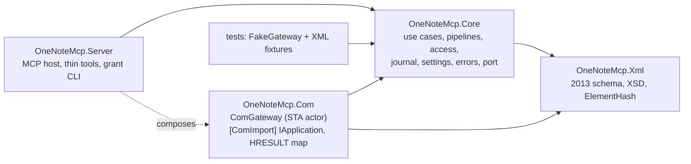
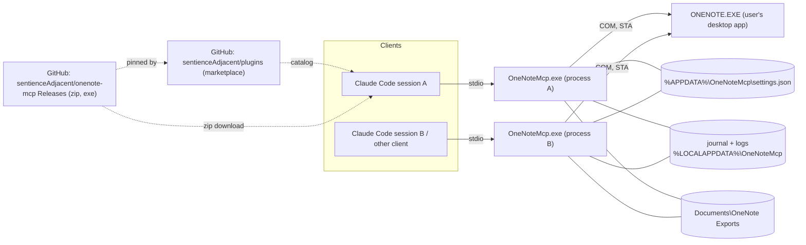

# Architecture Spine — onenote-mcp

## Design Paradigm

Hexagonal:
- **MCP tools** are the driving adapter.
- **Use cases** in Core own all policy.
- **`IOneNoteGateway`** is the one driven port.
- **`ComGateway`** is its only real adapter. It runs as an actor on one STA thread per process.
- **The XML model** is pure, with no COM or MCP dependency.

The same exe also serves a `grant` CLI subcommand over the same Core.



The arrows are the only dependencies allowed. Core never references Com or Server.

## Invariants & Rules

### AD-1 — Runtime and COM binding [ADOPTED]

- **Binds:** all
- **Prevents:** a host that mixes languages; IDispatch late binding, which fails for 64-bit hosts on this build; shipping a PIA that can't be embedded.
- **Rule:**
  - Use C# on .NET 10 with the ModelContextProtocol SDK.
  - OneNote is bound early, through a hand-declared `[ComImport]` `IApplication` matching the vtable of the OneNote 15 type library.
  - The first build story proves the vtable with a smoke test. If that fails, the fallback is the GAC PIA, decided at that point.

### AD-2 — Only ComGateway touches COM [ADOPTED]

- **Binds:** all
- **Prevents:** stories creating their own COM objects or threads; COM calls made off the STA thread.
- **Rule:**
  - Each process has one live `ComGateway` STA thread at a time, with a message pump, owning one COM reference. It serialises every call through its queue.
  - No other type references the COM interop types.

### AD-3 — Gateway lifecycle [ADOPTED]

- **Binds:** Com, Core
- **Prevents:** hangs; OneNote starting silently; the server disturbing the user's OneNote.
- **Rule:**
  - **Timeouts:**
    - Every COM call has a timeout: 30 s by default, 300 s for `Publish`.
    - Activation has its own timeout, 10 s.
  - **A call that times out:**
    - It returns `Timeout`.
    - The STA thread is marked poisoned and abandoned, and a fresh thread and COM reference replace it.
    - Calls already queued fail fast with `ComBusy`.
    - A write that timed out reports `outcomeUnknown: true`.
    - While an abandoned write is still outstanding, new non-read pipelines return `ComBusy`.
    - An abandoned thread releases its COM reference if its call ever returns.
    - After 2 abandoned threads, the gateway returns `ComUnavailable` until OneNote is reachable again.
  - **Disconnects (`RPC_S_SERVER_UNAVAILABLE` or `RPC_E_DISCONNECTED`):**
    - Drop the reference. Reactivation follows the same rules as a first activation.
    - A read is retried once. A write is never retried automatically, and returns `ComUnavailable` with `outcomeUnknown: true`.
  - **Busy (`RPC_E_CALL_REJECTED` or `RETRYLATER`):** retry with backoff, up to the call's timeout, then return `ComBusy`. `0x8004201D` hrNotYetSynchronized is not a busy code for this rule: it returns `ComBusy` at once, with no backoff, because a notebook sync can take longer than one call (AD-9).
  - **Activation:**
    - If `ONENOTE.EXE` is not running, return `OneNoteNotRunning`, unless `allowSilentActivation` is set.
    - Check the integrity level at startup and at every activation. A mismatch returns `IntegrityMismatch` and never calls COM.
  - **Idle:** release the COM reference after 5 minutes idle.
  - Never kill or close OneNote.

### AD-4 — Raw XML is the content contract [ADOPTED]

- **Binds:** every tool that returns or accepts hierarchy or page XML
- **Prevents:** a different format per tool; lossy round trips; the server quietly changing content.
- **Rule:**
  - Tools take and return OneNote 2013-schema XML. Every COM call passes `xs2013`.
  - The server never adds, changes or removes elements or attributes in the XML it returns. The exceptions:
    - Search may remove whole `one:Page` elements, and each one removed is listed in `meta.filtered`, except pages withheld under AD-21, which are never listed.
    - A read without a read grant removes the whole `one:Page` elements of a protected section, and lists the section in `meta.withheld` (AD-21).
    - An oversized result is delivered as an index plus parts (AD-20). The stored result is the body the tool would have returned inline, after every removal above. Each part is an exact substring of that body, never re-serialised, so its prefixes rely on the root's namespace declarations, which come in `meta.result` with every `read_result` response.
  - Degraded results go only in `meta` and `warnings`. Examples: an image that has no local binary, which is detected by comparing image counts against a basic read, and a locked section.
  - Page reads exclude binary content unless the caller asks for it.
  - OneNote IDs are opaque strings: never parsed, never built from parts.
  - Dates sent to COM are UTC.

### AD-5 — Thin tools, layered tasks [ADOPTED]

- **Binds:** Server, Core
- **Prevents:** task tools drifting away from the COM surface, or getting around policy.
- **Rule:**
  - There is roughly one MCP tool per COM method. Each tool is backed by one use case, holds no policy, and declares one `OperationClass` (AD-7).
  - Task-shaped behaviour starts as a recipe in the skill.
  - A task promoted into the server becomes a Core use case built from the thin use cases. It runs each of their pipelines and claims no atomicity: on failure it returns `meta.completedSteps`.

### AD-6 — Server-enforced write grants [ADOPTED]

- **Binds:** Core (access), every write use case, every read use case through AD-21, the `grant` CLI
- **Prevents:** a gate that lives only in the skill or that the model can grant itself; writes from clients that don't have the skill.
- **Rule:**
  - **Who can do what:**
    - Reads are allowed on every notebook, except content in password-protected sections, which needs a read grant (AD-21).
    - Writes need a write grant for each notebook they touch.
    - A permanent delete also needs a permanent-delete grant, which counts only alongside a write grant.
  - **How a grant is created:**
    - Through an MCP elicitation dialog in which the user types the notebook's name. The typed text is matched against each open notebook's displayed name (`nickname`, else `name`). If it matches more than one notebook, or none, no grant is made and the write returns `WriteNotGranted`. AD-7 step 1 raises the dialog itself when the client declares elicitation. If the user declines or cancels, or the client lacks the capability, the write returns `WriteNotGranted`, with `userAction` naming the CLI. Time spent waiting on the dialog doesn't count against the pipeline deadline.
    - Or through the interactive `OneNoteMcp grant` CLI, which refuses to run when there is no interactive terminal. It uses the same name matcher as elicitation, and lists the candidates when a name is ambiguous. `grant --revoke` removes a grant. It also runs on a `settings.json` that is invalid only because of case-only duplicate keys, so the user can remove one.
    - Or automatically, when a notebook is created at a path the server checked was empty (AD-7 `Create`), recorded as `grantedVia: created`.
    - No tool can create a grant. The read-only `list_grants` tool shows grants, read grants included, and how each was created.
    - The plugin blocks the model from changing `settings.json` or anything else in its folder or in the default `%APPDATA%\OneNoteMcp` (blocked even when the settings path is overridden), from running the grant CLI, and from running `OneNoteMcp uninstall`, whose `--purge` deletes `settings.json` and every grant in it (AD-19).
  - **Notebook resolution:**
    - The owning notebook is resolved through the gateway, never from the ID string: a `GetHierarchyParent` chain, where the empty string OneNote returns at the notebook marks the end of the chain, or a hierarchy lookup. An exception from `GetHierarchyParent` is an ordinary error (AD-9) and never ends the chain. (Observed 2026-11-04 on the local MCP Test notebook, `tests/OneNoteMcp.Tests/Fixtures/mcp-test/parent/notebook.txt`. Microsoft's documentation says it throws.) Resolution ends by reading that notebook's `one:Notebook@path` live from `GetHierarchy`.
    - A payload with several IDs, such as a move or a merge, needs a grant for every notebook it touches.
  - **Grant key:**
    - A grant is keyed by the notebook's path, never by its ID, because closing and reopening a notebook regenerates every ID.
    - One Core function, `NotebookKey`, computes the key, and every unit uses it: the access check, elicitation, the CLI, the `Create` auto-grant, the journal and restore.
      - Its only input is the `one:Notebook@path` attribute read live from `GetHierarchy`. That means never a section's `path`, and never a path argument passed to COM. On create, the path is read back after the call.
      - The transform is to trim trailing `\` and `/`, and nothing else: no decoding, no `GetFullPath`.
      - Keys compare `OrdinalIgnoreCase`. Two keys in `settings.json` that differ only in case make the file `SettingsInvalid`.
    - The notebook's `name` and its ID at grant time (`idAtGrant`, never refreshed) are stored for information only, and are never compared for access.
    - If the notebook's folder or URL is moved or renamed, its path changes, so the grant no longer applies and the user is asked again. Renaming the notebook's display name doesn't change the path.
    - That the path stays the same across close and reopen is expected but unverified (see Deferred).
  - **Limits** (they apply to AD-21's read grants too): the README says plainly that this guards against accidents and casual misuse, not against a hostile local process. Elicitation hooks can answer the dialog automatically, and headless runs cancel elicitation. A grant follows its path: a different notebook that later appears at a granted path inherits the grant without a prompt. This is an accepted risk, stated in the README. The plugin guard (the `PreToolUse` hook) is best effort and Claude Code only: a disguised shell command gets past it, and nothing stops another program from editing OneNoteMcp's files; the README says so.

### AD-7 — One write pipeline per operation class [ADOPTED]

- **Binds:** every use case that changes OneNote or the file system
- **Prevents:** writes that skip checks or run them in a different order; each story inventing what to snapshot.
- **Rule:**
  - Every non-read use case runs these steps in order. Any failed step aborts with its error (AD-9), and no write path exists outside the pipeline.
    1. Access check (AD-6).
    2. Take the write lock (AD-18).
    3. Read the current state.
    4. Validate.
    5. Optimistic check (AD-17). The server compares the basis date and hashes against step 3's read itself, for every class AD-17 binds. It also passes the date to the COM methods that take one: `UpdatePageContent`, `DeletePageContent` and `DeleteHierarchy`. `UpdateHierarchy` takes no date, so its check is the server's comparison alone.
    6. Snapshot (AD-8).
    7. COM call. A failure here with `Timeout`, `ComUnavailable` or `Cancelled` sets `outcomeUnknown` (AD-9).
    8. Release the lock.
  - Creating a notebook adds a step between 7 and 8: write the automatic grant (AD-6) under `Local\OneNoteMcp.Settings`. The lock order is always `Local\OneNoteMcp.Write` outside and `Local\OneNoteMcp.Settings` inside. If the path can't be read back, the result is `ok: true` with the warning `createdNotGranted`, and its `userAction` names the grant CLI.
  - Each pipeline has a deadline: 120 s by default, 600 s for classes that publish.
  - A write drops the written page's entry from the search page-text cache (AD-12) before it returns, whatever the COM call's outcome.
  - Every call has exactly one class. Where a method appears in more than one row, the class comes from explicit arguments: `DeleteHierarchy` from `permanent`; `OpenHierarchy` from whether the target exists, checked under the write lock.
  - "XSD" in the table means the AD-16 gate.

| Class | COM methods | Grant | Validate | Snapshot |
| --- | --- | --- | --- | --- |
| `Read` | `GetHierarchy`, `GetHierarchyParent`, `GetPageContent`, `GetBinaryPageContent`, `FindPages`, `FindMeta`, `GetHyperlinkToObject`, `GetWebHyperlinkToObject`, `GetSpecialLocation`; the server-only `list_grants` and `read_result` (AD-20) | none, except a read grant for content in a protected section (AD-21) | none | none |
| `PageWrite` | `UpdatePageContent`, `DeletePageContent` | write | XSD; referenced `objectID`s exist; section not locked; refuse to replace an Outline holding an image with no local binary | full page, with binary |
| `Create` | `CreateNewPage`; `OpenHierarchy` creating a section or section group by parent object ID (`bstrRelativeToObjectID`) plus a relative name, or a notebook at an absolute path verified empty; `restore_from_journal`. A section or section group is never created from an absolute path | write on the parent's notebook. A new notebook needs none and gets a write grant automatically (`grantedVia: created`), keyed by the `NotebookKey` of the path read back from `GetHierarchy` after creation | XSD; parent exists and isn't locked | none |
| `HierarchyWrite` | `UpdateHierarchy` (add, rename, reorder or move); `MergeSections`; `restore_from_recycle_bin` | write on every notebook touched | XSD; IDs exist | hierarchy XML of the affected nodes |
| `SoftDelete` | `DeleteHierarchy`, `permanent=false` | write | ID exists | a page gets a full page snapshot; a section or section group gets a hierarchy snapshot |
| `PermanentDelete` | `DeleteHierarchy`, `permanent=true` | write + permanent delete | ID exists | a page gets a full page snapshot; a section, section group or notebook gets a OneNote-format `Publish` backup, and the delete is refused if the backup fails |
| `ExternalWrite` | `Publish`, `OpenPackage`, `MergeFiles` | none, but the target path must be under `exportRoots` | path made canonical first (`GetFullPath`, junctions resolved), then allowed; file does not already exist | none |
| `AppState` | `OpenHierarchy` on an existing path (no grant is given), `CloseNotebook`, `SyncHierarchy`, `SetFilingLocation`, `NavigateTo`, `NavigateToUrl`, `QuickFiling`, `Windows` | none | AD-11 | none |

### AD-8 — Recovery journal [ADOPTED]

- **Binds:** Core (journal), the restore and permanent-delete use cases
- **Prevents:** overwrites and deletes that can't be recovered; journal formats that differ by tool; restores that silently lose images.
- **Rule:**
  - Snapshots follow AD-7. Each is a single gzip JSON entry in the format set by AD-10. It is written to a temporary name and then renamed. It records `binaryComplete` and `missingBinary[]`.
  - The default location is `%LOCALAPPDATA%\OneNoteMcp\journal`, and the user can change it.
  - Retention is 30 days, with a size cap of 2 GB (oldest pruned first).
  - Each process prunes at startup and then daily, and tolerates entries that vanish while it does.
  - **`restore_from_journal`** never overwrites. It finds the notebook only by the entry's `notebookPath`, which is a `NotebookKey` (AD-6). It never uses `notebookId`, because IDs regenerate when a notebook reopens.
    - It restores page entries only. For `hierarchy` and `onenoteBackup` entries it returns `NotSupported` in v1, with a `userAction` pointing to the entry or backup file.
    - It creates the new page under the entry's `parentId` if that parent still exists in that notebook. Otherwise it uses the one section whose name path inside the notebook equals the entry's `parentNamePath`, such as `Group/Section`. Failing both, it uses a `Recovered` section of that notebook. It reports the new ID.
    - If no open notebook matches, it returns `ObjectNotFound`, with a `userAction` asking the user to open the notebook at that path.
    - The write grant it checks is the one for the notebook it writes to. When `binaryComplete` is false it reports the missing binaries.
  - **`restore_from_recycle_bin`** restores a soft-deleted item. When the name is ambiguous it asks the user to choose, because soft-deleted pages get new IDs.

### AD-9 — One result envelope and error set [ADOPTED]

- **Binds:** all tools, Core, Com, FakeGateway
- **Prevents:** each tool inventing its own result or error shape; fakes and the real adapter disagreeing.
- **Rule:**
  - **Envelope:** every tool returns `structuredContent`, with `isError` matching:
    - `{ok: true, xml?, index?, meta: {correlationId, result?, ...}, warnings[]}`. `index` is an AD-20 index. A `read_result` part travels in `xml` (or, for a non-XML result, as the body below), and its `meta.result` marks it a part: it may be an XML fragment, not a document.
    - `{ok: false, error: {code, hresult?, retryable, outcomeUnknown?, userAction, message}, meta: {correlationId}}`
    - **The text content block** (Phill, 2026-11-06). Claude Code shows the model the text block only (story 1.3), and only the text block counts toward its size limits (spike 1.15).
      - A success with a body: line 1 is the compact JSON of the envelope without its body, then `\n`, then the body unchanged. The body is `xml` (a `read_result` part included), or `meta.binary` for `get_binary_page_content`. The header line leaves out only the body: `xml` or `meta.binary`. Everything else, `meta.basis`, `meta.result` and `warnings` included, stays in it.
      - Anything else, every error included, carries the whole envelope JSON.
      - `structuredContent` always carries the full envelope.
      - This replaced a text block that repeated the whole envelope JSON, which escaped the XML to 1.25–1.66 times its size.
    - Errors the MCP SDK raises before a tool runs are outside the envelope. An unknown tool is a JSON-RPC error. A missing required argument, a misnamed one standing in for a required one, or a value outside its enum fails as the SDK's own `isError` result: a generic text block and no `structuredContent`. A misnamed optional argument is ignored, and the tool runs with its default (SDK 2.3.1, `McpSdkBindingTests`, story 1.14).
  - **Who throws what:**
    - Tools never throw.
    - `ErrorCode` and `OneNoteException` live in Core. `ComGateway` and `FakeGateway` throw only `OneNoteException`.
  - **Codes:**
    - The codes form a closed list, and a code is added only by amending this AD.
    - Messages never contain page content.
    - The HRESULT map lives only in Com, and names come from learn.microsoft.com "Error codes (OneNote)" (copied in `OneNoteProbe.psm1`), never from memory.
    - `BinaryUnavailable` is a warning, never an error.
    - `retryable` comes from the per-code table below, unless the `OneNoteException` carries its own flag, which overrides it for that error only (a `read_result` refusal because an `hours` grant expired is `retryable: false`).
    - `outcomeUnknown: true` always comes with `retryable: false` and `userAction`: "re-read, then retry if the change is absent".
    - `hrTimeOut` (`0x80042023`) is an error OneNote returns, not our deadline: AD-3's timed-out-call rules (abandon the thread, count it toward the abandoned-thread limit) apply only to the gateway's own deadline.
    - The write pipeline (AD-7) sets `outcomeUnknown` on a write that fails with `Timeout`, `ComUnavailable` or `Cancelled`, whatever the source, since the HRESULT map alone can't know the call wrote.
    - Deliberately `Internal`, by reason:
      - Paths, not objects: `0x80042006` hrFileDoesNotExist, `0x80042018` hrFolderDoesNotExist.
      - Degraded instead: `0x8004200F` hrBinaryObjectDoesNotExist (reads turn it into the `BinaryUnavailable` warning).
      - Ambiguous: `0x800706BE` (can mean bad XML).
      - Write-side, no fitting code until epic 2's write tools: `0x8004200B` hrSectionReadOnly, `0x8004200C` hrPageReadOnly, `0x80042022` hrFutureContentLoss (content loss on update), `0x80042024` hrRecordingInProgress, `0x8004202E` hrRecycleBinEditFailed.
      - Policy, no fitting code: `0x8004201C` hrDisabledByPolicy.
    - The remaining OneNote codes are untriaged and fall to `Internal` by the default rule (see Deferred). Epic 1 accepts `Internal` for the ones its read tools can hit, such as `0x80042003` hrOpeningSection, `0x8004201E` hrLegacySection and `0x8004202B` hrUnreadDisabledForNotebook; epic 2 triages them all.

| Code | Source | Retryable |
| --- | --- | --- |
| `OneNoteNotRunning` | process check | yes |
| `IntegrityMismatch` | integrity check | no |
| `ComUnavailable` | `0x800706BA`, `RPC_E_DISCONNECTED`, too many abandoned threads; `0x80080005` CO_E_SERVER_EXEC_FAILURE after the integrity check passed (`userAction`: restart OneNote) | read yes; write no (`outcomeUnknown`) |
| `ComBusy` | `0x80010001` / RETRYLATER after backoff; `0x8004201D` hrNotYetSynchronized; write-lock timeout; abandoned write outstanding | yes |
| `Timeout` | call or pipeline deadline; `0x80042023` hrTimeOut | read yes; write no (`outcomeUnknown`) |
| `Cancelled` | the call's own cancellation token was cancelled (a client cancel, or the session ending). Any other `OperationCanceledException` is `Internal` (story 1.14) | read yes; write no (`outcomeUnknown`, epic 2) |
| `ModalDialogOpen` | `0x80042030` | yes, after the user closes the dialog |
| `SectionLocked` | `0x8004201B`, or `locked="true"` | after the user unlocks it |
| `StaleWrite` | `0x80042010`, basis mismatch | no; re-read |
| `ObjectNotFound` | the object does-not-exist HRESULTs: `0x80042004`, `0x80042005`, `0x8004200E`, `0x80042011`, `0x80042012`, `0x80042014`, `0x80042015`, as reported by OneNote; AD-8 restore when no open notebook matches `notebookPath` | no; re-read the hierarchy or page and use a current ID. For `0x80042015` and the AD-8 restore case, after the user opens the notebook |
| `UnknownObjectId` | the server's own validation: `objectID` absent (the same stale ID reported by OneNote is `ObjectNotFound`) | no |
| `InvalidXml` | XSD or namespace validation; `0x80042000`, `0x80042001`, `0x80042020` | no |
| `InvalidQuery` | `0x80042019`; AD-20 `read_result` with an `offset` at or past the span's length | no |
| `FileExists` | `0x8004201A` | no |
| `WriteNotGranted` / `PermanentDeleteNotGranted` | AD-6 | after the user grants |
| `ReadNotGranted` | AD-21: a target-scoped read inside a protected section with no read grant; `read_result` on a part whose grant has lapsed (AD-20) | after the user grants (for `read_result`, then repeat the original call); a `read_result` part whose `hours` grant expired is `retryable: false`, since that stored result stays refused |
| `ResultExpired` | AD-20: `read_result` with an unknown or expired `resultId` | no; repeat the original call |
| `ExportPathNotAllowed` | AD-11 | no |
| `SettingsInvalid` | AD-10 | after the user fixes it |
| `JournalFailed` / `BackupFailed` | AD-8 | no |
| `NotSupported` | method not in this release | no |
| `Internal` | anything unmapped (HRESULT kept); the deliberate list is in the Codes bullets above | no |

### AD-10 — Shared state across processes [ADOPTED]

- **Binds:** Core (settings, access, journal), the `grant` CLI, the result-store settings (AD-20), the search-cache setting (AD-12)
- **Prevents:** grants or entries stored in shapes that clash; lost updates; a stored grant that applies in one session but not another (AD-21's in-memory `once` grant is the one exception: it holds only in the process that asked).
- **Rule:**
  - **Ownership:**
    - Several server processes, one per client, may run at once.
    - One Core type owns each shared file, and the CLI uses the same types.
  - **`%APPDATA%\OneNoteMcp\settings.json`:**
    - Shape: `{schemaVersion, allowSilentActivation, timeouts{}, journal{path, retentionDays, maxSizeMB}, results{inlineMaxChars, ttlMinutes, maxStoreMB}, search{cacheMaxMB}, readGrants{onceMinutes}, exportRoots[], notebooks{<normalizedPath>: {name, idAtGrant, write, permanentDelete, grantedAt, grantedVia}}, protectedSections{<SectionKey>: {name, notebookKey, idAtGrant, grantedAt, grantedVia, expiresAt?}}}`. `notebooks{}` keys follow AD-6's grant key, and `protectedSections{}` keys follow AD-21's.
    - Every change is one read-modify-write inside the named mutex `Local\OneNoteMcp.Settings`: re-read, change, write a temporary file, then `File.Replace`. The mutex is never held across a prompt or a dialog.
    - Only grant writers (elicitation, CLI, the `Create` auto-grant, `grant --revoke`) write `notebooks{}` and `protectedSections{}`. The access check only reads them.
    - Re-read at every access check.
    - A grant applies to the open notebook whose `NotebookKey` equals its key. `list_grants` shows each grant as `active` (an open notebook matches) or `notebookNotOpen`, and each read grant as `active`, `sectionNotOpen` or `expired`. Entries are never pruned automatically; only `grant --revoke` removes one. The one exception: a grant writer drops `protectedSections{}` entries whose `expiresAt` has passed, inside its read-modify-write.
    - `schemaVersion` 1 is this path-keyed shape, `results{}`, `search{}`, `readGrants{}` and `protectedSections{}` included. No earlier shape was released, and no released server writes `settings.json`, so there is no migration. The released 0.4.x reader already ignores members it doesn't know (`SettingsStore.Validate` reads only known keys); story 1.20 confirms it with a test.
    - `results{}` ranges, as whole numbers: `inlineMaxChars` 20,000–380,000 (default 100,000), `ttlMinutes` 1–1,440 (default 30), `maxStoreMB` 16–4,096 (default 256). A value out of range makes the file `SettingsInvalid`, like every other field; reads then use the defaults.
    - `search{}` range, as a whole number: `cacheMaxMB` 0–1,024 (default 64), the page-text cache's cap (AD-12); 0 turns the cache off. Out of range makes the file `SettingsInvalid`, as for `results{}`.
    - `readGrants{}` range, as a whole number: `onceMinutes` 1–60 (default 5), the window of AD-21's `once` read grant (Phill, 2026-11-07). Out of range makes the file `SettingsInvalid`, as for `results{}`.
    - If the file is invalid, reads continue and writes fail with `SettingsInvalid`.
    - If `schemaVersion` is newer than the server knows, the server runs read-only.
  - **Journal entry file:**
    - Named `{takenAtUtc:yyyyMMddTHHmmssfff}-{pid}-{guid}.json.gz`, written once.
    - Contents: `{schemaVersion, entryId, correlationId, operation, operationClass, snapshotKind: page|hierarchy|onenoteBackup, objectId, notebookId, notebookPath, notebookName, parentId, parentNamePath, title, takenAtUtc, binaryComplete, missingBinary[], xml | backupFile}`.

### AD-11 — Calls the user sees, and exports [ADOPTED]

- **Binds:** `AppState` and `ExternalWrite` tools, the skill
- **Prevents:** the model taking focus or moving the user's view uninvited; files written to arbitrary paths.
- **Rule:**
  - **Visible calls:**
    - `NavigateTo`, `NavigateToUrl`, `QuickFiling` and `Windows` tools carry "user-visible" in their descriptions.
    - The skill calls them only when the user explicitly asks, and no use case calls them internally.
    - `FindPages` always passes `fDisplay=false`.
  - **Exports:**
    - `ExternalWrite` targets must sit under an `exportRoots` entry.
    - The default root is `Documents\OneNote Exports`, created on first use.
    - Every export result carries `meta.outputPath`, and the skill tells the user where the file went.

### AD-12 — Search semantics [ADOPTED]

- **Binds:** the `FindPages` and `FindMeta` use cases, the search page-text cache and its setting `search{}` (AD-10)
- **Prevents:** trusting indexed-only results; recycle-bin pages leaking into results.
- **Rule:**
  - Search with unindexed pages included.
  - Remove pages with `isInRecycleBin`, listed in `meta.filtered`.
  - Pages in protected sections without a read grant are never read, matched or listed by the server (AD-21). `FindPages` itself does return them; the server drops them before any post-filter, and they never go in `meta.filtered`.
  - Filter on metadata before text.
  - Search tools require a `startNodeId`. Searching from the root needs the explicit flag `fromRoot: true`.
  - Always set `meta.possiblyIncomplete: true`.
  - **Text rule (`FindPages`):** a page matches when every whitespace-separated term of the query appears, ignoring case, in its `name` or in its text. A page's text is the text of every `one:T` in its piBasic XML, HTML tags stripped and entities decoded, one `one:T` per line so a term never matches across two. `PageText.Of` is its one implementation. A page whose `name` already holds every term is kept without a read. Any other candidate is read, or found in the page-text cache below; it is removed as `noMatch` when it fails the rule, or as `notFound` when its read gives `ObjectNotFound`.
  - **Page-text cache (story 1.19):**
    - **What:** `FindPages` may keep each candidate's text by the text rule above (never the XML) in memory, one cache per server process.
    - **Key and hit:** page ID plus the page's `lastModifiedTime` from the search XML. A candidate whose ID and `lastModifiedTime` both match is matched against the cached text instead of being read. A different time, or a missing or unparsable one, means a read, and a page without a usable time is never cached. A page whose read gives `ObjectNotFound` loses its entry.
    - **Protected sections:** candidates in protected sections that no grant covers are dropped before any lookup (AD-21). Pages in protected sections are never cached, even when a grant covers them (Phill, 2026-11-07).
    - **Cap:** `search.cacheMaxMB` (AD-10), counted as each entry's estimated size: its text and page ID as UTF-16, plus a fixed per-entry overhead. Past it, the least recently read entries go first. A text larger than the cap alone isn't cached. 0 turns the cache off and empties it. `search{}` is read once per call, so a change applies at the next call, and a lowered cap trims the cache before any lookup.
    - **Disk and log:** never written to disk. Only counts (hits, misses, evictions, entries) and sizes are logged (AD-13).
    - **Writes:** a write drops the written page's entry before it returns (AD-7).
    - **Guarantee:** for a page whose `lastModifiedTime` changed with its content, the result is the same as a read. It differs only through the known gap below and `notFound`, which only a read can detect: a cached page deleted since the search is kept or removed as `noMatch`, not `notFound`.
  - **Known gap:** any COM edit of a page that isn't open in OneNote can leave the cache stale. That includes this server's own write tools (AD-7), journal restore (AD-8) and another server process (AD-10). On a page that isn't displayed, `lastModifiedTime` didn't advance within 8 s across COM edits (spike 1, row 18); whether it catches up later is open. COM edits on the page shown in OneNote do advance it (row 17). The time also has whole-second precision, so two edits within one second with a search between them can leave the first edit's text cached. Search can then match such a page against its old text until its `lastModifiedTime` changes, its entry is evicted, or the server restarts. This process's own writes drop their entries (above), so the gap that remains is another program's edit: another add-in, or a second OneNoteMcp process. The README and find_pages' description say so, and `search.cacheMaxMB: 0` avoids it.

### AD-13 — Logging [ADOPTED]

- **Binds:** all
- **Prevents:** corrupting the stdio protocol; leaking note content.
- **Rule:**
  - stdout carries the MCP protocol only.
  - Logs go to stderr and to a rolling file under `%LOCALAPPDATA%\OneNoteMcp\logs`: 10 MB per file, 5 files kept.
  - Log the `correlationId`, IDs, HRESULTs and timings. Never log page content, XML bodies, or XSD messages that quote content.
  - Note content reaches disk only through the journal (AD-8) and exports (AD-11). The result store (AD-20) is held in memory only. It is never written to disk, and only its `resultId` and sizes are logged. The same holds for the search page-text cache (AD-12): memory only, and only counts and sizes are logged.
  - A client may save a large tool result to disk itself: Claude Code does so under `~/.claude/projects/<project>/<session>/tool-results/` when a text block exceeds a tool's limit. That is outside the server, and the README says so.

### AD-14 — Tool contract versioning [ADOPTED]

- **Binds:** Server, plugin, skill, release
- **Prevents:** silent breaking changes for clients and skill recipes.
- **Rule:**
  - Tool names are the `snake_case` of the COM method (`get_page_content`). Tools with no COM method use `verb_noun` (`restore_from_journal`, `list_grants`).
  - Names, parameter schemas and the AD-9 envelope are a public contract.
  - An addition bumps the minor version. A rename or removal bumps the major version. Before 1.0.0, any contract change bumps the minor version.
  - There is one version number: `<Version>` in `Directory.Build.props`. It is the release tag (AD-19) and `serverInfo.version`, and these rules apply to its major.minor. The release job refuses a tag that differs from it.
  - A checked-in snapshot of tool names and schemas, with that major.minor, fails the unit tests when the contract changes. The test detects the change; the PR reviewer checks the size of the bump.

### AD-15 — Distribution [ADOPTED]

- **Binds:** repo layout, release, the plugin, server, skill and marketplace names
- **Prevents:**
  - installs that differ between the plugin route and manual setup;
  - a token in one repo that can write to another;
  - a catalog pin whose zip holds a differently named plugin;
  - renamed tools that break users' permission allowlists.
- **Rule:**
  - The repo holds one Claude Code plugin, `onenote`, in `plugin/`.
    - It bundles the server config and the `guide` skill (`/onenote:guide`).
    - Its single MCP server is `desktop`.
    - It has no top-level `bin/` folder.
  - The plugin name and the server key make up the tool names (`mcp__plugin_onenote_desktop__*`). They are frozen: renaming either is a breaking change under AD-14.
  - The marketplace is a separate public repo, `sentienceAdjacent/plugins`, whose marketplace name is `sentienceadjacent`. This repo holds no marketplace, and no token that writes to another repo.
  - The catalog pins each plugin itself, through its own sync workflow:
    - it pulls this repo's releases;
    - it checks the zip against the release's `.sha256`;
    - it commits with its own `GITHUB_TOKEN`, straight to its `main`, so that branch accepts bot pushes.
  - The pin moves forward only, by semver. It includes prereleases until 1.0 (see Deferred), and it never goes below a `since` floor of `0.4.0-rc.4`. Earlier zips hold a plugin named `onenote-mcp`. The plugin name inside a pinned zip must equal its catalog entry's name, and `claude plugin validate` doesn't open the zip, so the floor is what enforces it.
  - **The contract between the two repos:**
    - releases come from the public `sentienceAdjacent/onenote-mcp`, because an `archive` install can't authenticate;
    - tags are `v<semver>`;
    - the asset is `onenote-<ver>-win-x64.zip` at `https://github.com/sentienceAdjacent/onenote-mcp/releases/download/v<ver>/<asset>`;
    - the sidecar `<asset>.sha256` holds `<hex>  <asset>`.
    - Changing any of these burns a version (AD-19).
  - A published release is never deleted. Retract one by releasing a newer version.
  - The pin moves when the maintainer runs `gh workflow run sync -R sentienceAdjacent/plugins` after a release. A daily scheduled run is the backstop. Users pick up a new pin with `/plugin marketplace update sentienceadjacent`.
  - The server ships as a self-contained win-x64 exe on GitHub Releases.
  - The README gives install steps that a user or an agent can follow, plus manual config for other MCP clients and a route to build from source.

### AD-16 — Test seam [ADOPTED]

- **Binds:** Xml, Core, tests
- **Prevents:** logic that only a live OneNote can test; a schema gate that rejects valid writes.
- **Rule:**
  - XML handling and use cases are unit-tested in CI against `FakeGateway`, using captured 2013-schema fixtures.
  - Anything touching COM goes in an opt-in integration suite, run locally against a real OneNote, with writes guarded to a test notebook.
  - The 2013 XSD is vendored in `OneNoteMcp.Xml`, with its provenance and SHA-256 recorded. Microsoft's link now returns 403; the copies are from the Wayback Machine and from stevencohn/OneMore.
  - XSD validation becomes a hard gate in AD-7 only once a story proves it accepts partial-update XML. Until then the gate is well-formedness, namespace and `objectID` checks.

### AD-17 — Caller basis and ElementHash

- **Binds:** every `PageWrite`, `HierarchyWrite`, `SoftDelete` and `PermanentDelete` tool; the read tools; Xml
- **Prevents:** a content check that has nothing to compare against; each story inventing its own hash; stale deletes on pages that aren't displayed.
- **Rule:**
  - **Reads return the basis:** `lastModifiedTime`; `pageHash` for the whole page; and `elementHashes{objectID: hash}` for every Outline and OE.
    - **Source of `lastModifiedTime`, by target:**
      - For a page, it is the root `lastModifiedTime` of the page XML from a `GetPageContent` read. The hierarchy's value for a page can differ and is never used for a page's basis.
      - For a section, section group or notebook, it is that node's `lastModifiedTime` from `GetHierarchy`.
    - Reads return the basis as one object, `meta.basis: {lastModifiedTime, pageHash?, elementHashes?}`. The caller passes it back unchanged. For an oversized page (AD-20), each part carries a basis with the hashes of the elements in that part, and an `expand` response carries the hash of the element it expands. A caller may merge the `elementHashes` from one `resultId`'s responses into one basis.
    - The date stays the exact string OneNote returned until the gateway converts it. Only `OneNoteMcp.Xml` parses it.
  - **What each write compares:**
    - A page delete compares `pageHash`.
    - Element edits compare `elementHashes`.
    - A section, section group or notebook delete or hierarchy write compares only the `lastModifiedTime` from `GetHierarchy`, best effort.
  - **The hash:**
    - `ElementHash` is lowercase hex SHA-256 over the inclusive C14N (no comments) of the element's subtree. Two things are removed throughout the subtree first:
      - Attributes that record time, authorship, selection or view state, not content: `lastModifiedTime`, `creationTime`, `lastModifiedBy`, `lastModifiedByInitials`, `lastModifiedByResolutionID`, `selected`, `isCurrentlyViewed` and `isUnread`.
      - The binary elements `one:Data` and `one:CallbackID`, so that a piBasic read and a piBinaryData read of a local page hash the same.
    - Layout stays in the hash: `one:Size` and `one:Position` are content. Resizing or moving an Outline, with no text change, changes that Outline's hash and `pageHash`, but no OE's. So a page delete, or an edit that names that Outline, made with an older basis returns `StaleWrite`. An edit that names only its OEs goes through.
    - Only `OneNoteMcp.Xml` computes it. Callers never do.
  - **Writes check the basis:**
    - Write tools take an optional `basis: {lastModifiedTime?, pageHash?, elementHashes?}`.
    - A partial basis is filled from step 3's read. A missing date takes step 3's date, using the source-by-target rule. A page delete with no `pageHash`, or an element edit with no hash for a target element, proceeds without that check. Each fill adds the warning `partialBasis`.
    - If any target element's current hash differs from its basis, the write returns `StaleWrite`.
    - `dateExpectedLastModified` comes from the basis. Without a basis, it comes from step 3's read, using the same source-by-target rule, so a page's date always comes from a `GetPageContent` read. The result then carries the warning `noBasis`.
    - Never pass `DateTime.MinValue`.
    - The server never replaces a caller's basis date with the live one, even when every hash matches. A date mismatch returns `StaleWrite`, and the caller re-reads.

### AD-18 — Machine-wide write lock [ADOPTED]

- **Binds:** every non-read pipeline in every process
- **Prevents:** two writers, in one process or in two, both passing the check and overwriting each other.
- **Rule:**
  - Hold the named mutex `Local\OneNoteMcp.Write` from step 2 to step 7 of AD-7.
  - Waiting for it times out with `ComBusy`, retryable.
  - An `AbandonedMutexException` counts as acquiring the lock.
  - Reads never take it.
  - Every tool call gets a `correlationId`, carried in logs, journal entries and `meta`.

### AD-19 — Install lifecycle

- **Binds:** plugin, release, settings, journal
- **Prevents:** a plugin and exe that don't match; an upgrade blocked by a running exe; leftover note content after uninstall.
- **Rule:**
  - **Versions:** the plugin version and the exe version are the same release tag. A version string is never reused: a rebuild, release candidate or hotfix gets a new version string, at least a patch bump (AD-14 sets the size), because users already on a version never re-download it.
  - **Install and upgrade:**
    - The plugin installs the exe for its own version into a location specific to that version. Which location is the packaging story's choice: `${CLAUDE_PLUGIN_ROOT}` (an `archive` plugin source, where Claude Code keeps one directory per installed version and removes an old one 14 days after an update), `${CLAUDE_PLUGIN_DATA}`, or the `.mcpb` cache. Story 1.10 is set to use `${CLAUDE_PLUGIN_ROOT}` (`research-plugin-exe-delivery.md`).
    - An upgrade adds a new copy and never overwrites an exe that is running.
  - **Schema migration:** only forward, done by the newer server when it writes. Older servers fall back to read-only (AD-10).
  - **Uninstall:** `OneNoteMcp uninstall --purge` removes settings (read grants included), the journal and the logs. The README documents it, and says the journal holds copies of note content. The result store (AD-20) is in memory, so there are no result files to purge. The README also says that Claude Code's own `tool-results` files (AD-13) are Claude Code's to clean up, and purge doesn't touch them. It asks the user to type `purge`; `--yes` skips the question, and is required where it can't ask. Only the user runs it: the plugin guard denies it (AD-6).

### AD-20 — Large-result delivery

- **Binds:** every read tool, `read_result`, Server (the text block, `tools/list`), Core (the result store), settings
- **Prevents:** a result the model sees only as a 2 KB preview or a notice (spike 1.15); each tool inventing its own paging; parts that differ from what OneNote returned; note content left on disk by the server.
- **Rule:**
  - **No loss** (Phill, 2026-11-06): every part of every read result stays readable by the model through the tools, whatever its size.
  - **Declared limit:** every read tool, `read_result` included, declares `_meta["anthropic/maxResultSizeChars"]: 500000` in its `tools/list` entry. That is Claude Code's documented ceiling. With it, text blocks of up to 383,893 characters of XML-like text arrived whole, past both the 50,000-character persist limit and the token cap, and about 600,000 still spilled (spike 1.15 findings, addendum).
  - **Inline threshold:** `results.inlineMaxChars` (AD-10), default 100,000, in the range 20,000–380,000. It is measured on the whole text block (AD-9), header line included. A result at or under it is returned whole, as before. The threshold sits well under the ceiling because a result arriving whole still costs context: 380,000 characters of XML is about 238,000 tokens.
  - **Body budget:** for a response with a body, `bodyMax` = `inlineMaxChars` minus the length of that response's header line. Offset reads are sized to it when served. Runs are sized when the index is built, before their response's header is known, so they are sized to `inlineMaxChars` minus a header allowance that covers `meta.result`, `meta.basis` with the run's own `elementHashes`, and `warnings`. No text block ever exceeds `inlineMaxChars`.
  - **Index responses** have no body, so their text block is the whole envelope JSON. Index pages are sized so that the serialized envelope, with entries measured as serialized JSON (escaping included), stays at or under `inlineMaxChars`.
  - **Over the threshold:**
    - The tool stores the result in the result store and returns, instead of the body, `meta.result` and an `index`: the first page of `read_result(resultId, expand: "/")`. With no body, its text block is the whole envelope JSON (AD-9).
    - What is stored is the body the tool would have returned inline, after every AD-4 removal (search filtering, AD-21 withholding). Content withheld from the original call is never in the store.
    - `meta.result` is `{resultId, totalChars, expiresAt, namespaces, pages?}`, and every `read_result` response carries it too. `namespaces` holds the root's namespace declarations; `pages` is the page count of a paged index.
    - `meta.basis` (AD-17) keeps `lastModifiedTime` and `pageHash` but leaves out `elementHashes`.
    - For a page read, the piBasic XML is stored alongside, even when the body is the piBinaryData XML (`includeBinary`), so that hashes always come from piBasic (AD-17).
    - The original read's warnings and other `meta` come with the index.
  - **The index:** one entry per child element of the expanded element, in document order:
    - `ref`: the element's `objectID` (page XML) or `ID` (hierarchy XML), unchanged. An element with neither gets a positional ref, `<parent's ref>/<n>`, where `n` counts the parent's child elements from 0. The root's ref is `/`, so its first child without an ID is `/0`.
    - `element` (the qualified name, such as `one:Outline`), `chars` (the length of its span in the stored result) and `children` (its child-element count).
    - `contains`: counts of `one:Table`, `one:Image` and `one:InsertedFile` anywhere below it.
    - `label`: a hierarchy node's `name`; for page XML, the first 80 characters of the element's text, worked out by AD-12's text rule (`PageText.Of`: one:T text, tags stripped, entities decoded).
    - Consecutive siblings that together fit the run budget (above) are grouped into one run entry, `{run: [firstRef, lastRef], count, chars, firstLabel, lastLabel}`. A sibling bigger than the run budget always has its own entry.
    - An index that doesn't fit one response is paged: `expand` takes `page`, from 0, and `meta.result.pages` gives the count.
    - An `expand` response for a page element carries that element's own `elementHash` (AD-17) from the stored piBasic read, so the hash of an Outline or OE too big to sit wholly in one part is still delivered.
  - **`read_result(resultId, ...)`:** a server-only `Read` tool (AD-7) that never calls COM. It takes exactly one of:
    - `ref`, or `run: [firstRef, lastRef]` of siblings: returns that span unchanged as the body. A single `ref` bigger than `bodyMax` returns its `expand` index instead, so a part is never cut. A run whose response would still exceed `inlineMaxChars` returns the index of the run's members instead, in the same way.
    - `expand: ref`, with `page`: returns that element's index.
    - `ref` with `offset` and an optional `length`: returns that substring of the element's span. A missing `length` means as much as fits `bodyMax`, and a larger one is capped to it. An `offset` at or past the span's length returns `InvalidQuery`. This is how a single element with no children but a huge body is read, such as a long `one:T`, a `one:Data`, or `get_binary_page_content`'s base64, which isn't XML: its index is empty and its whole body is the ref `/`. It also reads the tags and whitespace between listed spans.
    - Every part is an exact substring of the stored result. Entries within one index never overlap; parts fetched by different calls may, such as a parent's ref and its child's, or offset reads. The namespace declarations of the root come in `meta.result.namespaces`.
    - An unknown or expired `resultId` returns `ResultExpired` (AD-9), whose `userAction` says to repeat the original call. A `ref` not in the result returns `UnknownObjectId`.
    - Each page part's `meta.basis` is `{lastModifiedTime, pageHash, elementHashes}`, with hashes for the Outlines and OEs whose spans lie wholly within the part, computed from the stored piBasic read.
    - It checks AD-21 again. The store entry records the grants that allowed the original call: `{sectionKeys[], lifetime, expiresAt?}`. A part inside a protected section is served only while that grant holds: an `hours` grant until its `expiresAt`, an `untilRevoked` grant until revoked, and a `once` grant for as long as the entry lives. A part whose grant has lapsed returns `ReadNotGranted`, and `read_result` never raises the dialog. Fail closed: a part counts as inside the section when the result has no index (only `/`) or the section isn't in the result.
  - **The result store:**
    - Held in memory, in each server process. It is never written to disk, and only its `resultId` and sizes are logged (AD-13). It holds the body string the tool already built, kept alive.
    - An entry expires `results.ttlMinutes` (default 30) after its last read. An entry read under a `once` grant expires `ttlMinutes` after the original call instead, never extended by reads. When the store's total passes `results.maxStoreMB` (default 256, counted as UTF-16 bytes), the least recently read entries go first. A single result larger than the cap is stored alone.
    - Everything goes when the process exits. There are no result files, so nothing joins `--purge` (AD-19).
  - **Contract:** the new text block (AD-9), `read_result`, `meta.result` and `index` are a contract change. Story 1.18 bumps the minor version (AD-14).
  - **Other clients** may not know the `_meta` key. The README tells their users to lower `results.inlineMaxChars`.

### AD-21 — Protected-section read grant

- **Binds:** Core (access), every read use case and `read_result`, elicitation, the `grant` CLI, `list_grants`, settings, Xml
- **Prevents:** the model reading a password-protected section just because the user unlocked it in OneNote; the model granting itself; read tools guarding protected sections in different ways.
- **Rule:**
  - **What's protected** (Phill, 2026-11-06): a section whose `one:Section` has `encrypted="true"` (or `"1"`), locked or not. It is read live from `GetHierarchy` on every call and never cached across calls. One Xml function, `EncryptedSections`, finds them, as `LockedSections` does for `locked`.
  - **Grant scope** (Phill, 2026-11-06): one protected section. A notebook or section group can't be granted as a whole, and a write grant (AD-6) doesn't grant reads of protected sections.
  - **Grant key:** one Core function, `SectionKey`, is the only key. Its only input is the `one:Section@path` attribute read live from `GetHierarchy`, and it uses `NotebookKey`'s transform and comparison (AD-6). The section's `name`, its notebook's `NotebookKey` and its ID at grant time are stored for information only. Renaming or moving the section changes its path, so the user is asked again.
  - **Lifetime, chosen by the user when granting** (Phill, 2026-11-06):
    - `once` (Phill, 2026-11-07): covers every read of that section, target-scoped and broad alike, for `readGrants.onceMinutes` (AD-10, default 5) from when the user's answer arrives. The window is checked when a call starts, so a call that starts inside it completes. `read_result` parts of results made under it follow AD-20. It's kept in memory by the server process that asked and never written; other server processes don't see it and keep asking (AD-10). It can't be revoked: it ends with its window or its process.
    - `hours`: 1 to 168. Stored with `expiresAt` in UTC.
    - `untilRevoked`: stored until `grant --revoke`.
  - **How a read grant is created** (Phill, 2026-11-06):
    - **Elicitation**, raised only by a target-scoped read (below) when the client declares elicitation. Time on the dialog counts against no timeout. Neither the STA thread nor the settings mutex is held across it (AD-10).
      - **The dialog** names the section and its notebook, and asks the user to type the section's name; the field's hint shows the name, so it can be copied. It offers the lifetimes as one list, because elicitation can't show a field conditionally (Phill, 2026-11-07): `once`; `hours` of 1, 8 or 24 hours, or 7 days (168 hours); and `untilRevoked`. The list's default is `once`, and the `once` option names its window (for example "This section, for 5 minutes"). The README and the skill use the list's words. Any other number of hours is granted through the CLI.
      - **The answer check:** the typed-name field gets a new name on every request (Phill, 2026-11-07), and the server reads the typed name only from the field it named in that request; any other key counts as a mismatch. The trimmed typed text must equal that section's `name`, compared `OrdinalIgnoreCase`; anything else makes no grant. The typed name proves that a person answered this request, not that they knew the name: the dialog's message names the section anyway (AD-6 Limits). A lifetime that isn't one of the offered options grants `once`, never more.
      - **Outcomes:** a decline, a cancel, a mismatch, or a client without elicitation returns `ReadNotGranted`, with `userAction` naming the CLI.
    - **The CLI**, `OneNoteMcp grant --read-section`, interactive only, like AD-6's. The user types a section name, which is matched against the protected sections of the open notebooks. If several match, the CLI lists them with their notebook and section-group path and the user picks one. It offers `hours` (any whole number 1 to 168, default 8) and `untilRevoked` only. `grant --revoke --read-section <name>` removes a read grant, with the same matching and list of candidates.
    - `list_grants` shows stored read grants, plus this process's live `once` grants with their expiry (`grantedVia: elicitation`, lifetime `once`). `once` grants are never stored.
    - No tool can create a read grant, and AD-6's Limits apply: an elicitation hook can answer the dialog.
  - **Where the check runs:** in Core's access check, before any content is returned, and before the `SectionLocked` check.
    - Target-scoped reads resolve the owning section through the gateway as in AD-6: a `GetHierarchyParent` chain from the target to its `one:Section`, then that section's `encrypted` and `path` from `GetHierarchy`. These extra COM calls run under AD-3's per-call timeouts.
    - Broad `get_hierarchy` reads find protected sections in their own result XML, with `EncryptedSections`, because that XML comes from `GetHierarchy`, and make no extra COM call.
    - `find_pages` and `find_meta` don't rely on the search XML carrying `encrypted`. They find protected sections from one `GetHierarchy` of the searched scope at `sections` level, one extra COM call under AD-3's timeouts.
  - **Per tool:**
    - **Target-scoped, which may raise the dialog; without a grant they return `ReadNotGranted`:**
      - `get_page_content` and `get_binary_page_content`;
      - `get_hierarchy_parent` on a page;
      - `get_hyperlink_to_object` and `get_web_hyperlink_to_object` on a page, or on an object in a page;
      - `get_hierarchy` whose `startNodeId` is a page in a protected section, or is the section itself at scope `children` or `pages`.
    - **Broad, which never raise the dialog:**
      - `get_hierarchy` from above the section keeps its `one:Section` element and, unless a grant holds (stored, or a `once` grant still in its window), removes its `one:Page` elements (AD-4).
      - `find_pages` and `find_meta` drop every candidate in a protected section that no grant covers before any text post-filter or page read, so no match inside one is learned. Withheld candidates are not listed in `meta.filtered`. They list every protected section in the raw result, whether or not it had a hit.
      - Both put the section IDs, without counts, in `meta.withheld`, with one `readNotGranted` warning per section whose `userAction` says how to grant.
    - **Allowed:** `get_hierarchy` with the section itself as `startNodeId` at scope `self`, `notebooks` or `sections`, which returns no pages; `get_hierarchy_parent` and both hyperlink tools on the section itself, because the section is visible in the hierarchy anyway. `get_special_location` is unaffected.
    - **`read_result`:** checks again, as AD-20 says.
  - **Messages** carry the section's ID only, never its name or anything inside it (AD-9).
  - **Storage:** `settings.json` `protectedSections{}` (AD-10), written only by grant writers. If `settings.json` is invalid, or its `schemaVersion` is newer than the server knows, stored read grants count as absent. The dialog still works: `once` as usual, while `hours` or `untilRevoked` then works like `once` (for `readGrants.onceMinutes`, memory only), with the warning `grantNotSaved`.

## Consistency Conventions

| Concern | Convention |
| --- | --- |
| Tool names | AD-14 |
| IDs | OneNote IDs are opaque strings, passed through unchanged. `correlationId` and `entryId` are GUIDs |
| Dates | UTC ISO-8601 at the tool boundary; UTC `DateTime` into COM |
| XML | namespace `http://schemas.microsoft.com/office/onenote/2013/onenote`, always declared |
| Hashes | `ElementHash` only (AD-17) |
| Results and errors | the AD-9 envelope only; no raw `COMException` past the gateway |
| Config | `settings.json` only (AD-10). Environment variables only for test overrides of the paths |
| Async | tools are `async`; the gateway returns `Task`s that run on the STA queue |
| Named mutexes | `Local\OneNoteMcp.Settings`, `Local\OneNoteMcp.Write` |
| Large results | AD-20 only: an index plus `read_result`; no tool pages its own output |
| Protected sections | AD-21 only: one Core check, one `ReadNotGranted` code, one `readNotGranted` warning |

## Stack

| Name | Version |
| --- | --- |
| .NET | 10 (LTS, 10.0.14) |
| C# | 14 (ships with .NET 10) |
| ModelContextProtocol (NuGet) | 2.3.1 |
| OneNote COM | OneNote 15 type library, M365 desktop 16.0 |
| OneNote XML schema | 2013 (vendored XSD) |

## Structural Seed



```text
/
  plugin/                       # manifest `onenote`, server `desktop`, skill `guide`
  src/OneNoteMcp.Server/        # MCP host, tool definitions (thin), grant/uninstall CLI
  src/OneNoteMcp.Core/          # use cases, pipelines, access, journal, settings, errors, IOneNoteGateway
  src/OneNoteMcp.Xml/           # 2013-schema model, vendored XSD, ElementHash
  src/OneNoteMcp.Com/           # ComGateway, [ComImport] IApplication, HRESULT map
  tests/OneNoteMcp.Tests/       # FakeGateway + fixtures (CI)
  tests/OneNoteMcp.Integration/ # opt-in, real OneNote
  .github/workflows/            # build, test, `claude plugin validate`, release
  README.md
```

## Deferred

| Item | Why it can wait / revisit when |
| --- | --- |
| Whether the per-request field name stops Claude Code pre-filling the typed section name (AD-21) | Resolved, AD-21 unchanged (Phill, 2026-11-07, Claude Code with the 0.7.0-rc.1 server): after the `once` window the dialog asked again with an empty name field |
| v1 tool list and later rounds | Work slicing, for `bmad-ticket`. The whole COM surface is the target, and AD-5/AD-7 make each round additive |
| Release pipeline, code signing, SmartScreen | Release story (1.11). The release job refuses a tag that differs from `<Version>` (AD-14) |
| How the plugin fetches the exe | Decided, see AD-15: an `archive` plugin source, a SHA-256-pinned release zip whose root is the plugin (`research-plugin-exe-delivery.md`, story 1.10) |
| Stable-only catalog channel | Open. The catalog pins prereleases until 1.0. At 1.0, decide whether it moves to stable releases only, so a `1.0.1-rc.1` doesn't move every user onto an rc |
| HRESULT triage | Epic 2. The untriaged OneNote codes, the write-side deliberate-`Internal` codes and `hrDisabledByPolicy` (AD-9); epic 1 reports them as `Internal` |
| Events (`OnHierarchyChange`, `OnNavigate`) | A later round. Microsoft says events can't be added in managed code, so this may need a native sink or be dropped |
| Move semantics via `UpdateHierarchy`; `MergeSections` and `MergeFiles` behaviour | Not probed. Verify in the stories that add them. `restore_from_recycle_bin` depends on move |
| `DeleteHierarchy` on a whole notebook; permanent delete of a section group | Not probed. Verify in the permanent-delete story |
| `DeleteHierarchy(deletePermanently=false)` on a page in a protected section | Not probed. Verify in epic 2's soft-delete story: if COM moves it to the recycle bin, amend AD-21; if COM deletes it permanently, the `SoftDelete` pipeline refuses it rather than do a permanent delete without AD-6's grant |
| `Publish` to OneNote format as the backup route | Not probed. Verify in the permanent-delete story; if it fails, AD-8/AD-7 are amended |
| Refusing to replace an Outline with an unavailable image (AD-7) | Rests on `UpdatePageContent` behaviour that wasn't probed. Epic 2's page-write story verifies it with a cloud-page fixture |
| XML schema `xs2026` (undocumented; `Cell@colSpan`/`rowSpan`, `AuthorDef`) | AD-4 stays on `xs2013`. Spike before epic 2's write stories: does a 2013 round trip unmerge cells, and does `UpdatePageContent` accept 2026? Amend AD-4 if needed |
| Which `lastModifiedTime` `UpdatePageContent`, `DeletePageContent` and `DeleteHierarchy` accept when a page's page-XML and hierarchy values differ | Epic 2: the page-write and soft-delete stories test a test-notebook page whose two values differ. AD-17 pins the page-XML value; spike 1's update probes used it successfully, but the delete methods were never probed with a date. If the page-XML value is disproved, only the date passed to COM changes; `meta.basis` stays. A wrong value shows up as a spurious `StaleWrite` |
| Whether a notebook's `path` is stable, and its exact forms | Epic 2's access story, in the test notebook. Capture local and cloud `path` values. Close and reopen, and compare. Rename in OneNote, then rename the folder or OneDrive item. Amend `NotebookKey` from the captures |
| Whether a section's `path` is stable | Epic 2's access story, with the notebook row above. `SectionKey` (AD-21) assumes it is, as `NotebookKey` does; story 1.20 didn't capture it. Capture local and cloud values, close and reopen, and rename, as for notebooks. Amend `SectionKey` from the captures |
| OneNote elevated while the server isn't | Untested. AD-3's integrity check refuses either way |
| A windowless OneNote left running after silent activation and idle release | Only possible when `allowSilentActivation` is on. The README notes it. With no OneNote running the integrity check passes trivially, so a failed silent launch that returns `0x80080005` gets the restart advice |
| Attachment (`InsertedFile`) reads on cloud notebooks | Not probed. The AD-4 degrade rule applies |
| Text blocks between 383,893 and 500,000 characters | Unmeasured with `maxResultSizeChars`. AD-20 caps `inlineMaxChars` at 380,000, the largest measured whole delivery. Raise the cap only after a probe, which epic 2 runs before any story raises it |
| A header line over the inline threshold | Not seen in the stress-harness runs of stories 1.18 (617 comparisons, largest text block 100,000 characters) and 1.20 (617 and 620 comparisons, none over 100,000); AD-20 unchanged. `ToolRunner` warns (`text block over the inline threshold`, IDs and sizes only) if it happens; then amend AD-20 to store lists such as `meta.filtered` with the result |
| Clients other than Claude Code | They don't know the `_meta` key. The user lowers `results.inlineMaxChars` for them, and the README says how |
| Pages deleted from a protected section | Resolved for the UI, AD-21 unchanged (Phill, 2026-11-07, M365 OneNote desktop 16.0 on Windows). A UI delete of a page in a protected section is refused with "Pages from password protected sections cannot be moved to Deleted Notes", and only a permanent delete is offered. The notebook's "Deleted Pages" section isn't `encrypted`, so a page landing there would have leaked; the test page wasn't in it afterwards. Still unverified, for epic 2's soft-delete story: a protected section deleted whole (does `encrypted` survive in the recycle bin?), and other clients syncing into the notebook. Pages deleted before a section was protected stay readable in the recycle bin (README) |
| Whether `FindPages` and `FindMeta` XML carries `encrypted` on `one:Section` | Partly answered, AD-21 unchanged (story 1.20, 2026-11-07, on story 17's fixture): the `FindPages` XML marks the protected section `encrypted="true"`. `FindMeta`'s XML wasn't checked, and one observation doesn't show the attribute is reliably present, so search keeps the extra `GetHierarchy`. Dropping it is an optimization; revisit with epic 2's search probe |
