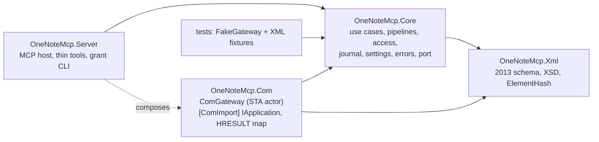
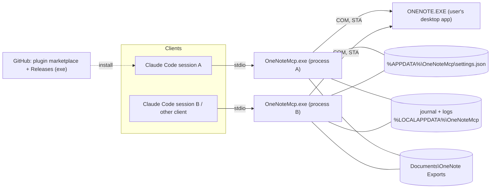

# Architecture Spine — onenote-mcp

## Design Paradigm

Hexagonal:
- **MCP tools** are the driving adapter.
- **Use cases** in Core own all policy.
- **`IOneNoteGateway`** is the one driven port.
- **`ComGateway`** is its only real adapter. It runs as an actor on one STA thread per process.
- **The XML model** is pure, with no COM or MCP dependency.

The same exe also serves a `grant` CLI subcommand over the same Core.



The arrows are the only dependencies allowed. Core never references Com or Server.

## Invariants & Rules

### AD-1 — Runtime and COM binding [ADOPTED]

- **Binds:** all
- **Prevents:** a host that mixes languages; IDispatch late binding, which fails for 64-bit hosts on this build; shipping a PIA that can't be embedded.
- **Rule:**
  - Use C# on .NET 10 with the ModelContextProtocol SDK.
  - OneNote is bound early, through a hand-declared `[ComImport]` `IApplication` matching the vtable of the OneNote 15 type library.
  - The first build story proves the vtable with a smoke test. If that fails, the fallback is the GAC PIA, decided at that point.

### AD-2 — Only ComGateway touches COM [ADOPTED]

- **Binds:** all
- **Prevents:** stories creating their own COM objects or threads; COM calls made off the STA thread.
- **Rule:**
  - Each process has one live `ComGateway` STA thread at a time, with a message pump, owning one COM reference. It serialises every call through its queue.
  - No other type references the COM interop types.

### AD-3 — Gateway lifecycle [ADOPTED]

- **Binds:** Com, Core
- **Prevents:** hangs; OneNote starting silently; the server disturbing the user's OneNote.
- **Rule:**
  - **Timeouts:**
    - Every COM call has a timeout: 30 s by default, 300 s for `Publish`.
    - Activation has its own timeout, 10 s.
  - **A call that times out:**
    - It returns `Timeout`.
    - The STA thread is marked poisoned and abandoned, and a fresh thread and COM reference replace it.
    - Calls already queued fail fast with `ComBusy`.
    - A write that timed out reports `outcomeUnknown: true`.
    - While an abandoned write is still outstanding, new non-read pipelines return `ComBusy`.
    - An abandoned thread releases its COM reference if its call ever returns.
    - After 2 abandoned threads, the gateway returns `ComUnavailable` until OneNote is reachable again.
  - **Disconnects (`RPC_S_SERVER_UNAVAILABLE` or `RPC_E_DISCONNECTED`):**
    - Drop the reference. Reactivation follows the same rules as a first activation.
    - A read is retried once. A write is never retried automatically, and returns `ComUnavailable` with `outcomeUnknown: true`.
  - **Busy (`RPC_E_CALL_REJECTED` or `RETRYLATER`):** retry with backoff, up to the call's timeout, then return `ComBusy`.
  - **Activation:**
    - If `ONENOTE.EXE` is not running, return `OneNoteNotRunning`, unless `allowSilentActivation` is set.
    - Check the integrity level at startup and at every activation. A mismatch returns `IntegrityMismatch` and never calls COM.
  - **Idle:** release the COM reference after 5 minutes idle.
  - Never kill or close OneNote.

### AD-4 — Raw XML is the content contract [ADOPTED]

- **Binds:** every tool that returns or accepts hierarchy or page XML
- **Prevents:** a different format per tool; lossy round trips; the server quietly changing content.
- **Rule:**
  - Tools take and return OneNote 2013-schema XML. Every COM call passes `xs2013`.
  - The server never adds, changes or removes elements or attributes in the XML it returns. The one exception: search may remove whole `one:Page` elements, and each one removed is listed in `meta.filtered`.
  - Degraded results go only in `meta` and `warnings`. Examples: an image that has no local binary, which is detected by comparing image counts against a basic read, and a locked section.
  - Page reads exclude binary content unless the caller asks for it.
  - OneNote IDs are opaque strings: never parsed, never built from parts.
  - Dates sent to COM are UTC.

### AD-5 — Thin tools, layered tasks [ADOPTED]

- **Binds:** Server, Core
- **Prevents:** task tools drifting away from the COM surface, or getting around policy.
- **Rule:**
  - There is roughly one MCP tool per COM method. Each tool is backed by one use case, holds no policy, and declares one `OperationClass` (AD-7).
  - Task-shaped behaviour starts as a recipe in the skill.
  - A task promoted into the server becomes a Core use case built from the thin use cases. It runs each of their pipelines and claims no atomicity: on failure it returns `meta.completedSteps`.

### AD-6 — Server-enforced write grants [ADOPTED]

- **Binds:** Core (access), every write use case, the `grant` CLI
- **Prevents:** a gate that lives only in the skill or that the model can grant itself; writes from clients that don't have the skill.
- **Rule:**
  - **Who can do what:**
    - Reads are allowed on every notebook.
    - Writes need a write grant for each notebook they touch.
    - A permanent delete also needs a permanent-delete grant, which counts only alongside a write grant.
  - **How a grant is created:**
    - Through an MCP elicitation dialog in which the user types the notebook's name. The typed text is matched against each open notebook's displayed name (`nickname`, else `name`). If it matches more than one notebook, or none, no grant is made and the write returns `WriteNotGranted`. AD-7 step 1 raises the dialog itself when the client declares elicitation. If the user declines or cancels, or the client lacks the capability, the write returns `WriteNotGranted`, with `userAction` naming the CLI. Time spent waiting on the dialog doesn't count against the pipeline deadline.
    - Or through the interactive `OneNoteMcp grant` CLI, which refuses to run when there is no interactive terminal. It uses the same name matcher as elicitation, and lists the candidates when a name is ambiguous. `grant --revoke` removes a grant. It also runs on a `settings.json` that is invalid only because of case-only duplicate keys, so the user can remove one.
    - Or automatically, when a notebook is created at a path the server checked was empty (AD-7 `Create`), recorded as `grantedVia: created`.
    - No tool can create a grant. The read-only `list_grants` tool shows grants and how each was created.
    - The plugin blocks the model from editing `settings.json`.
  - **Notebook resolution:**
    - The owning notebook is resolved through the gateway, never from the ID string: a `GetHierarchyParent` chain, where the throw at the notebook marks the end of the chain, or a hierarchy lookup. Resolution ends by reading that notebook's `one:Notebook@path` live from `GetHierarchy`.
    - A payload with several IDs, such as a move or a merge, needs a grant for every notebook it touches.
  - **Grant key:**
    - A grant is keyed by the notebook's path, never by its ID, because closing and reopening a notebook regenerates every ID.
    - One Core function, `NotebookKey`, computes the key, and every unit uses it: the access check, elicitation, the CLI, the `Create` auto-grant, the journal and restore.
      - Its only input is the `one:Notebook@path` attribute read live from `GetHierarchy`. That means never a section's `path`, and never a path argument passed to COM. On create, the path is read back after the call.
      - The transform is to trim trailing `\` and `/`, and nothing else: no decoding, no `GetFullPath`.
      - Keys compare `OrdinalIgnoreCase`. Two keys in `settings.json` that differ only in case make the file `SettingsInvalid`.
    - The notebook's `name` and its ID at grant time (`idAtGrant`, never refreshed) are stored for information only, and are never compared for access.
    - If the notebook's folder or URL is moved or renamed, its path changes, so the grant no longer applies and the user is asked again. Renaming the notebook's display name doesn't change the path.
    - That the path stays the same across close and reopen is expected but unverified (see Deferred).
  - **Limits:** the README says plainly that this guards against accidents and casual misuse, not against a hostile local process. Elicitation hooks can answer the dialog automatically, and headless runs cancel elicitation. A grant follows its path: a different notebook that later appears at a granted path inherits the grant without a prompt. This is an accepted risk, stated in the README.

### AD-7 — One write pipeline per operation class [ADOPTED]

- **Binds:** every use case that changes OneNote or the file system
- **Prevents:** writes that skip checks or run them in a different order; each story inventing what to snapshot.
- **Rule:**
  - Every non-read use case runs these steps in order. Any failed step aborts with its error (AD-9), and no write path exists outside the pipeline.
    1. Access check (AD-6).
    2. Take the write lock (AD-18).
    3. Read the current state.
    4. Validate.
    5. Optimistic check (AD-17). The server compares the basis date and hashes against step 3's read itself, for every class AD-17 binds. It also passes the date to the COM methods that take one: `UpdatePageContent`, `DeletePageContent` and `DeleteHierarchy`. `UpdateHierarchy` takes no date, so its check is the server's comparison alone.
    6. Snapshot (AD-8).
    7. COM call.
    8. Release the lock.
  - Creating a notebook adds a step between 7 and 8: write the automatic grant (AD-6) under `Local\OneNoteMcp.Settings`. The lock order is always `Local\OneNoteMcp.Write` outside and `Local\OneNoteMcp.Settings` inside. If the path can't be read back, the result is `ok: true` with the warning `createdNotGranted`, and its `userAction` names the grant CLI.
  - Each pipeline has a deadline: 120 s by default, 600 s for classes that publish.
  - Every call has exactly one class. Where a method appears in more than one row, the class comes from explicit arguments: `DeleteHierarchy` from `permanent`; `OpenHierarchy` from whether the target exists, checked under the write lock.
  - "XSD" in the table means the AD-16 gate.

| Class | COM methods | Grant | Validate | Snapshot |
| --- | --- | --- | --- | --- |
| `Read` | `GetHierarchy`, `GetHierarchyParent`, `GetPageContent`, `GetBinaryPageContent`, `FindPages`, `FindMeta`, `GetHyperlinkToObject`, `GetWebHyperlinkToObject`, `GetSpecialLocation`, `FormatDate`; the server-only `list_grants` | none | none | none |
| `PageWrite` | `UpdatePageContent`, `DeletePageContent` | write | XSD; referenced `objectID`s exist; section not locked; refuse to replace an Outline holding an image with no local binary | full page, with binary |
| `Create` | `CreateNewPage`; `OpenHierarchy` creating a section or section group by parent object ID (`bstrRelativeToObjectID`) plus a relative name, or a notebook at an absolute path verified empty; `restore_from_journal`. A section or section group is never created from an absolute path | write on the parent's notebook. A new notebook needs none and gets a write grant automatically (`grantedVia: created`), keyed by the `NotebookKey` of the path read back from `GetHierarchy` after creation | XSD; parent exists and isn't locked | none |
| `HierarchyWrite` | `UpdateHierarchy` (add, rename, reorder or move); `MergeSections`; `restore_from_recycle_bin` | write on every notebook touched | XSD; IDs exist | hierarchy XML of the affected nodes |
| `SoftDelete` | `DeleteHierarchy`, `permanent=false` | write | ID exists | a page gets a full page snapshot; a section or section group gets a hierarchy snapshot |
| `PermanentDelete` | `DeleteHierarchy`, `permanent=true` | write + permanent delete | ID exists | a page gets a full page snapshot; a section, section group or notebook gets a OneNote-format `Publish` backup, and the delete is refused if the backup fails |
| `ExternalWrite` | `Publish`, `OpenPackage`, `MergeFiles` | none, but the target path must be under `exportRoots` | path made canonical first (`GetFullPath`, junctions resolved), then allowed; file does not already exist | none |
| `AppState` | `OpenHierarchy` on an existing path (no grant is given), `CloseNotebook`, `SyncHierarchy`, `SetFilingLocation`, `NavigateTo`, `NavigateToUrl`, `QuickFiling`, `Windows` | none | AD-11 | none |

### AD-8 — Recovery journal [ADOPTED]

- **Binds:** Core (journal), the restore and permanent-delete use cases
- **Prevents:** overwrites and deletes that can't be recovered; journal formats that differ by tool; restores that silently lose images.
- **Rule:**
  - Snapshots follow AD-7. Each is a single gzip JSON entry in the format set by AD-10. It is written to a temporary name and then renamed. It records `binaryComplete` and `missingBinary[]`.
  - The default location is `%LOCALAPPDATA%\OneNoteMcp\journal`, and the user can change it.
  - Retention is 30 days, with a size cap of 2 GB (oldest pruned first).
  - Each process prunes at startup and then daily, and tolerates entries that vanish while it does.
  - **`restore_from_journal`** never overwrites. It finds the notebook only by the entry's `notebookPath`, which is a `NotebookKey` (AD-6). It never uses `notebookId`, because IDs regenerate when a notebook reopens.
    - It restores page entries only. For `hierarchy` and `onenoteBackup` entries it returns `NotSupported` in v1, with a `userAction` pointing to the entry or backup file.
    - It creates the new page under the entry's `parentId` if that parent still exists in that notebook. Otherwise it uses the one section whose name path inside the notebook equals the entry's `parentNamePath`, such as `Group/Section`. Failing both, it uses a `Recovered` section of that notebook. It reports the new ID.
    - If no open notebook matches, it returns `ObjectNotFound`, with a `userAction` asking the user to open the notebook at that path.
    - The write grant it checks is the one for the notebook it writes to. When `binaryComplete` is false it reports the missing binaries.
  - **`restore_from_recycle_bin`** restores a soft-deleted item. When the name is ambiguous it asks the user to choose, because soft-deleted pages get new IDs.

### AD-9 — One result envelope and error set [ADOPTED]

- **Binds:** all tools, Core, Com, FakeGateway
- **Prevents:** each tool inventing its own result or error shape; fakes and the real adapter disagreeing.
- **Rule:**
  - **Envelope:** every tool returns `structuredContent`, with `isError` matching:
    - `{ok: true, xml?, meta: {correlationId, ...}, warnings[]}`
    - `{ok: false, error: {code, hresult?, retryable, outcomeUnknown?, userAction, message}, meta: {correlationId}}`
    - The text content block carries the same JSON. Story 1.3's manual check found that Claude Code shows the model one copy, so the text block keeps `xml`; if a client is found that shows both, the text block drops `xml`.
    - Errors the MCP SDK raises before a tool runs (unknown tool, input-schema rejection) are JSON-RPC errors outside the envelope.
  - **Who throws what:**
    - Tools never throw.
    - `ErrorCode` and `OneNoteException` live in Core. `ComGateway` and `FakeGateway` throw only `OneNoteException`.
  - **Codes:**
    - The codes form a closed list, and a code is added only by amending this AD.
    - Messages never contain page content.
    - The HRESULT map lives only in Com, and names come from learn.microsoft.com "Error codes (OneNote)" (copied in `OneNoteProbe.psm1`), never from memory.
    - `BinaryUnavailable` is a warning, never an error.
    - `outcomeUnknown: true` always comes with `retryable: false` and `userAction`: "re-read, then retry if the change is absent".

| Code | Source | Retryable |
| --- | --- | --- |
| `OneNoteNotRunning` | process check | yes |
| `IntegrityMismatch` | integrity check; `0x80080005` | no |
| `ComUnavailable` | `0x800706BA`, `RPC_E_DISCONNECTED`, too many abandoned threads | read yes; write no (`outcomeUnknown`) |
| `ComBusy` | `0x80010001` / RETRYLATER after backoff; write-lock timeout; abandoned write outstanding | yes |
| `Timeout` | call or pipeline deadline | read yes; write no (`outcomeUnknown`) |
| `ModalDialogOpen` | `0x80042030` | yes, after the user closes the dialog |
| `SectionLocked` | `0x8004201B`, or `locked="true"` | after the user unlocks it |
| `StaleWrite` | `0x80042010`, basis mismatch | no; re-read |
| `ObjectNotFound` | the object does-not-exist HRESULTs: `0x80042004`, `0x80042005`, `0x8004200E`, `0x80042011`, `0x80042012`, `0x80042014`, `0x80042015`, as reported by OneNote; AD-8 restore when no open notebook matches `notebookPath` | no; re-read the hierarchy or page and use a current ID. For `0x80042015` and the AD-8 restore case, after the user opens the notebook |
| `UnknownObjectId` | the server's own validation: `objectID` absent (the same stale ID reported by OneNote is `ObjectNotFound`) | no |
| `InvalidXml` | XSD or namespace validation; `0x80042000`, `0x80042001`, `0x80042020` | no |
| `InvalidQuery` | `0x80042019` | no |
| `FileExists` | `0x8004201A` | no |
| `WriteNotGranted` / `PermanentDeleteNotGranted` | AD-6 | after the user grants |
| `ExportPathNotAllowed` | AD-11 | no |
| `SettingsInvalid` | AD-10 | after the user fixes it |
| `JournalFailed` / `BackupFailed` | AD-8 | no |
| `NotSupported` | method not in this release | no |
| `Internal` | anything unmapped (HRESULT kept). Deliberately unmapped: `0x80042006` hrFileDoesNotExist and `0x80042018` hrFolderDoesNotExist (paths, not objects); `0x8004200F` hrBinaryObjectDoesNotExist (reads turn it into the `BinaryUnavailable` warning); `0x800706BE` (can mean bad XML) | no |

### AD-10 — Shared state across processes [ADOPTED]

- **Binds:** Core (settings, access, journal), the `grant` CLI
- **Prevents:** grants or entries stored in shapes that clash; lost updates; a grant that applies in one session but not another.
- **Rule:**
  - **Ownership:**
    - Several server processes, one per client, may run at once.
    - One Core type owns each shared file, and the CLI uses the same types.
  - **`%APPDATA%\OneNoteMcp\settings.json`:**
    - Shape: `{schemaVersion, allowSilentActivation, timeouts{}, journal{path, retentionDays, maxSizeMB}, exportRoots[], notebooks{<normalizedPath>: {name, idAtGrant, write, permanentDelete, grantedAt, grantedVia}}}`. Keys follow AD-6's grant key.
    - Every change is one read-modify-write inside the named mutex `Local\OneNoteMcp.Settings`: re-read, change, write a temporary file, then `File.Replace`. The mutex is never held across a prompt or a dialog.
    - Only grant writers (elicitation, CLI, the `Create` auto-grant, `grant --revoke`) write `notebooks{}`. The access check only reads it.
    - Re-read at every access check.
    - A grant applies to the open notebook whose `NotebookKey` equals its key. `list_grants` shows each grant as `active` (an open notebook matches) or `notebookNotOpen`. Entries are never pruned automatically; only `grant --revoke` removes one.
    - `schemaVersion` 1 is this path-keyed shape. No earlier shape was released, so there is no migration.
    - If the file is invalid, reads continue and writes fail with `SettingsInvalid`.
    - If `schemaVersion` is newer than the server knows, the server runs read-only.
  - **Journal entry file:**
    - Named `{takenAtUtc:yyyyMMddTHHmmssfff}-{pid}-{guid}.json.gz`, written once.
    - Contents: `{schemaVersion, entryId, correlationId, operation, operationClass, snapshotKind: page|hierarchy|onenoteBackup, objectId, notebookId, notebookPath, notebookName, parentId, parentNamePath, title, takenAtUtc, binaryComplete, missingBinary[], xml | backupFile}`.

### AD-11 — Calls the user sees, and exports [ADOPTED]

- **Binds:** `AppState` and `ExternalWrite` tools, the skill
- **Prevents:** the model taking focus or moving the user's view uninvited; files written to arbitrary paths.
- **Rule:**
  - **Visible calls:**
    - `NavigateTo`, `NavigateToUrl`, `QuickFiling` and `Windows` tools carry "user-visible" in their descriptions.
    - The skill calls them only when the user explicitly asks, and no use case calls them internally.
    - `FindPages` always passes `fDisplay=false`.
  - **Exports:**
    - `ExternalWrite` targets must sit under an `exportRoots` entry.
    - The default root is `Documents\OneNote Exports`, created on first use.
    - Every export result carries `meta.outputPath`, and the skill tells the user where the file went.

### AD-12 — Search semantics [ADOPTED]

- **Binds:** the `FindPages` and `FindMeta` use cases
- **Prevents:** trusting indexed-only results; recycle-bin pages leaking into results.
- **Rule:**
  - Search with unindexed pages included.
  - Remove pages with `isInRecycleBin`, listed in `meta.filtered`.
  - Filter on metadata before text.
  - Search tools require a `startNodeId`. Searching from the root needs the explicit flag `fromRoot: true`.
  - Always set `meta.possiblyIncomplete: true`.

### AD-13 — Logging [ADOPTED]

- **Binds:** all
- **Prevents:** corrupting the stdio protocol; leaking note content.
- **Rule:**
  - stdout carries the MCP protocol only.
  - Logs go to stderr and to a rolling file under `%LOCALAPPDATA%\OneNoteMcp\logs`: 10 MB per file, 5 files kept.
  - Log the `correlationId`, IDs, HRESULTs and timings. Never log page content, XML bodies, or XSD messages that quote content.

### AD-14 — Tool contract versioning [ADOPTED]

- **Binds:** Server, plugin, skill, release
- **Prevents:** silent breaking changes for clients and skill recipes.
- **Rule:**
  - Tool names are the `snake_case` of the COM method (`get_page_content`). Tools with no COM method use `verb_noun` (`restore_from_journal`, `list_grants`).
  - Names, parameter schemas and the AD-9 envelope are a public contract.
  - An addition bumps the minor version. A rename or removal bumps the major version. Before 1.0.0, any contract change bumps the minor version.
  - There is one version number: `<Version>` in `Directory.Build.props`. It is the release tag (AD-19) and `serverInfo.version`, and these rules apply to its major.minor. The release job refuses a tag that differs from it.
  - A checked-in snapshot of tool names and schemas, with that major.minor, fails the unit tests when the contract changes. The test detects the change; the PR reviewer checks the size of the bump.

### AD-15 — Distribution [ADOPTED]

- **Binds:** repo layout, release
- **Prevents:** installs that differ between the plugin route and manual setup.
- **Rule:**
  - The repo is a Claude Code plugin marketplace. One plugin bundles the server config and the `onenote` skill, and has no top-level `bin/` folder.
  - The server ships as a self-contained win-x64 exe on GitHub Releases.
  - The README gives install steps that a user or an agent can follow, plus manual config for other MCP clients and a route to build from source.

### AD-16 — Test seam [ADOPTED]

- **Binds:** Xml, Core, tests
- **Prevents:** logic that only a live OneNote can test; a schema gate that rejects valid writes.
- **Rule:**
  - XML handling and use cases are unit-tested in CI against `FakeGateway`, using captured 2013-schema fixtures.
  - Anything touching COM goes in an opt-in integration suite, run locally against a real OneNote, with writes guarded to a test notebook.
  - The 2013 XSD is vendored in `OneNoteMcp.Xml`, with its provenance and SHA-256 recorded. Microsoft's link now returns 403; the copies are from the Wayback Machine and from stevencohn/OneMore.
  - XSD validation becomes a hard gate in AD-7 only once a story proves it accepts partial-update XML. Until then the gate is well-formedness, namespace and `objectID` checks.

### AD-17 — Caller basis and ElementHash

- **Binds:** every `PageWrite`, `HierarchyWrite`, `SoftDelete` and `PermanentDelete` tool; the read tools; Xml
- **Prevents:** a content check that has nothing to compare against; each story inventing its own hash; stale deletes on pages that aren't displayed.
- **Rule:**
  - **Reads return the basis:** `lastModifiedTime`; `pageHash` for the whole page; and `elementHashes{objectID: hash}` for every Outline and OE.
    - **Source of `lastModifiedTime`, by target:**
      - For a page, it is the root `lastModifiedTime` of the page XML from a `GetPageContent` read. The hierarchy's value for a page can differ and is never used for a page's basis.
      - For a section, section group or notebook, it is that node's `lastModifiedTime` from `GetHierarchy`.
    - Reads return the basis as one object, `meta.basis: {lastModifiedTime, pageHash?, elementHashes?}`. The caller passes it back unchanged.
    - The date stays the exact string OneNote returned until the gateway converts it. Only `OneNoteMcp.Xml` parses it.
  - **What each write compares:**
    - A page delete compares `pageHash`.
    - Element edits compare `elementHashes`.
    - A section, section group or notebook delete or hierarchy write compares only the `lastModifiedTime` from `GetHierarchy`, best effort.
  - **The hash:**
    - `ElementHash` is lowercase hex SHA-256 over the C14N of the element, with `lastModifiedTime`, `creationTime` and `lastModifiedBy` attributes and binary data removed.
    - Only `OneNoteMcp.Xml` computes it. Callers never do.
  - **Writes check the basis:**
    - Write tools take an optional `basis: {lastModifiedTime?, pageHash?, elementHashes?}`.
    - A partial basis is filled from step 3's read. A missing date takes step 3's date, using the source-by-target rule. A page delete with no `pageHash`, or an element edit with no hash for a target element, proceeds without that check. Each fill adds the warning `partialBasis`.
    - If any target element's current hash differs from its basis, the write returns `StaleWrite`.
    - `dateExpectedLastModified` comes from the basis. Without a basis, it comes from step 3's read, using the same source-by-target rule, so a page's date always comes from a `GetPageContent` read. The result then carries the warning `noBasis`.
    - Never pass `DateTime.MinValue`.
    - The server never replaces a caller's basis date with the live one, even when every hash matches. A date mismatch returns `StaleWrite`, and the caller re-reads.

### AD-18 — Machine-wide write lock [ADOPTED]

- **Binds:** every non-read pipeline in every process
- **Prevents:** two writers, in one process or in two, both passing the check and overwriting each other.
- **Rule:**
  - Hold the named mutex `Local\OneNoteMcp.Write` from step 2 to step 7 of AD-7.
  - Waiting for it times out with `ComBusy`, retryable.
  - An `AbandonedMutexException` counts as acquiring the lock.
  - Reads never take it.
  - Every tool call gets a `correlationId`, carried in logs, journal entries and `meta`.

### AD-19 — Install lifecycle

- **Binds:** plugin, release, settings, journal
- **Prevents:** a plugin and exe that don't match; an upgrade blocked by a running exe; leftover note content after uninstall.
- **Rule:**
  - **Versions:** the plugin version and the exe version are the same release tag.
  - **Install and upgrade:**
    - The plugin installs the exe for its own version into a location specific to that version. Which location is the packaging story's choice: `${CLAUDE_PLUGIN_DATA}` or the `.mcpb` cache.
    - An upgrade adds a new copy and never overwrites an exe that is running.
  - **Schema migration:** only forward, done by the newer server when it writes. Older servers fall back to read-only (AD-10).
  - **Uninstall:** `OneNoteMcp uninstall --purge` removes settings, the journal and the logs. The README documents it, and says the journal holds copies of note content.

## Consistency Conventions

| Concern | Convention |
| --- | --- |
| Tool names | AD-14 |
| IDs | OneNote IDs are opaque strings, passed through unchanged. `correlationId` and `entryId` are GUIDs |
| Dates | UTC ISO-8601 at the tool boundary; UTC `DateTime` into COM |
| XML | namespace `http://schemas.microsoft.com/office/onenote/2013/onenote`, always declared |
| Hashes | `ElementHash` only (AD-17) |
| Results and errors | the AD-9 envelope only; no raw `COMException` past the gateway |
| Config | `settings.json` only (AD-10). Environment variables only for test overrides of the paths |
| Async | tools are `async`; the gateway returns `Task`s that run on the STA queue |
| Named mutexes | `Local\OneNoteMcp.Settings`, `Local\OneNoteMcp.Write` |

## Stack

| Name | Version |
| --- | --- |
| .NET | 10 (LTS, 10.0.14) |
| C# | 14 (ships with .NET 10) |
| ModelContextProtocol (NuGet) | 2.3.1 |
| OneNote COM | OneNote 15 type library, M365 desktop 16.0 |
| OneNote XML schema | 2013 (vendored XSD) |

## Structural Seed



```text
/
  .claude-plugin/marketplace.json
  plugin/                       # plugin manifest, server config, skills/onenote/SKILL.md
  src/OneNoteMcp.Server/        # MCP host, tool definitions (thin), grant/uninstall CLI
  src/OneNoteMcp.Core/          # use cases, pipelines, access, journal, settings, errors, IOneNoteGateway
  src/OneNoteMcp.Xml/           # 2013-schema model, vendored XSD, ElementHash
  src/OneNoteMcp.Com/           # ComGateway, [ComImport] IApplication, HRESULT map
  tests/OneNoteMcp.Tests/       # FakeGateway + fixtures (CI)
  tests/OneNoteMcp.Integration/ # opt-in, real OneNote
  .github/workflows/            # build, test, `claude plugin validate`, release
  README.md
```

## Deferred

| Item | Why it can wait / revisit when |
| --- | --- |
| v1 tool list and later rounds | Work slicing, for `bmad-ticket`. The whole COM surface is the target, and AD-5/AD-7 make each round additive |
| Release pipeline, code signing, SmartScreen | Packaging story. The release job refuses a tag that differs from `<Version>` (AD-14) |
| How the plugin fetches the exe (`.mcpb` bundle vs launcher) | Packaging story. Both are documented in plugins-reference; whether a `.mcpb` can carry a self-contained .NET exe is unchecked |
| Events (`OnHierarchyChange`, `OnNavigate`) | A later round. Microsoft says events can't be added in managed code, so this may need a native sink or be dropped |
| Move semantics via `UpdateHierarchy`; `MergeSections` and `MergeFiles` behaviour | Not probed. Verify in the stories that add them. `restore_from_recycle_bin` depends on move |
| `DeleteHierarchy` on a whole notebook; permanent delete of a section group | Not probed. Verify in the permanent-delete story |
| `Publish` to OneNote format as the backup route | Not probed. Verify in the permanent-delete story; if it fails, AD-8/AD-7 are amended |
| Refusing to replace an Outline with an unavailable image (AD-7) | Rests on `UpdatePageContent` behaviour that wasn't probed. Verify with a cloud-page fixture |
| XML schema `xs2026` (undocumented; `Cell@colSpan`/`rowSpan`, `AuthorDef`) | AD-4 stays on `xs2013`. Spike before epic 2's write stories: does a 2013 round trip unmerge cells, and does `UpdatePageContent` accept 2026? Amend AD-4 if needed |
| Which `lastModifiedTime` `UpdatePageContent`, `DeletePageContent` and `DeleteHierarchy` accept when a page's page-XML and hierarchy values differ | Epic 2: the page-write and soft-delete stories test a test-notebook page whose two values differ. AD-17 pins the page-XML value; spike 1's update probes used it successfully, but the delete methods were never probed with a date. If the page-XML value is disproved, only the date passed to COM changes; `meta.basis` stays. A wrong value shows up as a spurious `StaleWrite` |
| Whether a notebook's `path` is stable, and its exact forms | Access story, in the test notebook. Capture local and cloud `path` values. Close and reopen, and compare. Rename in OneNote, then rename the folder or OneDrive item. Amend `NotebookKey` from the captures |
| OneNote elevated while the server isn't | Untested. AD-3's integrity check refuses either way |
| A windowless OneNote left running after silent activation and idle release | Only possible when `allowSilentActivation` is on. The README notes it |
| Attachment (`InsertedFile`) reads on cloud notebooks | Not probed. The AD-4 degrade rule applies |
