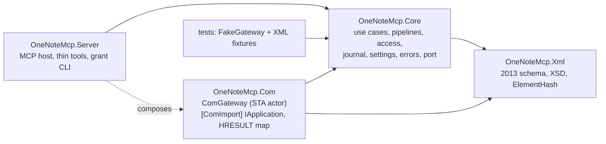
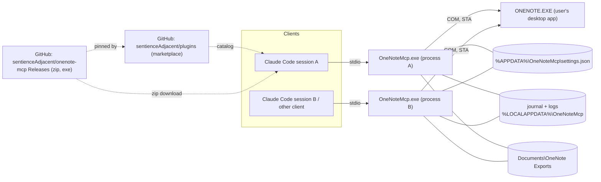

# Architecture Spine — onenote-mcp

## Design Paradigm

Hexagonal:
- **MCP tools** are the driving adapter.
- **Use cases** in Core own all policy.
- **`IOneNoteGateway`** is the one driven port.
- **`ComGateway`** is its only real adapter. It runs as an actor on one STA thread per process.
- **The XML model** is pure, with no COM or MCP dependency.

The same exe also serves a `grant` CLI subcommand over the same Core.



The arrows are the only dependencies allowed. Core never references Com or Server.

## Invariants & Rules

### AD-1 — Runtime and COM binding [ADOPTED]

- **Binds:** all
- **Prevents:** a host that mixes languages; IDispatch late binding, which fails for 64-bit hosts on this build; shipping a PIA that can't be embedded.
- **Rule:**
  - Use C# on .NET 10 with the ModelContextProtocol SDK.
  - OneNote is bound early, through a hand-declared `[ComImport]` `IApplication` matching the vtable of the OneNote 15 type library.
  - The first build story proves the vtable with a smoke test. If that fails, the fallback is the GAC PIA, decided at that point.

### AD-2 — Only ComGateway touches COM [ADOPTED]

- **Binds:** all
- **Prevents:** stories creating their own COM objects or threads; COM calls made off the STA thread.
- **Rule:**
  - Each process has one live `ComGateway` STA thread at a time, with a message pump, owning one COM reference. It serialises every call through its queue.
  - The COM interop types are `internal` to `OneNoteMcp.Com`. Inside it, only `ComGateway` and its `StaThread` worker reference them: `ComGateway` creates the `IApplication` and makes every call; the worker holds and releases it, on its own STA thread. The test projects also see them through `InternalsVisibleTo`, for the vtable smoke test and `FakeApplication` (AD-16).

### AD-3 — Gateway lifecycle [ADOPTED]

- **Binds:** Com, Core
- **Prevents:** hangs; OneNote starting silently; the server disturbing the user's OneNote.
- **Rule:**
  - **Timeouts:**
    - Every COM call has a timeout: 30 s by default, 300 s for `Publish`.
    - Activation has its own timeout, 10 s.
    - The 30 s default stays for every write, cloud creates included (Phill, 2026-11-12, 2.7 plan Q1). On MCP Test Cloud an `OpenHierarchy` create took 3.6–6.4 s, once 12.8 s in a burst, and a create that timed out at a 2 s test limit still landed about 3 s later (spike 5.1 constraint 12). So a timed-out create is `outcomeUnknown` like any write, and the caller re-reads before retrying. Whether 30 s covers every cloud create wasn't probed (see Deferred). Hierarchy calls other than create took under 0.4 s.
  - **A call that times out:**
    - It returns `Timeout`.
    - The STA thread is marked poisoned and abandoned, and a fresh thread and COM reference replace it.
    - Calls already queued fail fast with `ComBusy`.
    - A write that timed out reports `outcomeUnknown: true`.
    - While an abandoned write is still outstanding, new non-read pipelines return `ComBusy`.
    - An abandoned thread releases its COM reference if its call ever returns.
    - After 2 abandoned threads, the gateway returns `ComUnavailable` until OneNote is reachable again.
  - **Disconnects (`RPC_S_SERVER_UNAVAILABLE` or `RPC_E_DISCONNECTED`):**
    - Drop the reference. Reactivation follows the same rules as a first activation.
    - A read is retried once. A write is never retried automatically, and returns `ComUnavailable` with `outcomeUnknown: true`.
  - **Busy (`RPC_E_CALL_REJECTED` or `RETRYLATER`):** retry with backoff, up to the call's timeout, then return `ComBusy`. `0x8004201D` hrNotYetSynchronized is not a busy code for this rule: it returns `ComBusy` at once, with no backoff, because a notebook sync can take longer than one call (AD-9).
  - **Activation:**
    - If `ONENOTE.EXE` is not running, return `OneNoteNotRunning`, unless `allowSilentActivation` is set.
    - An `ONENOTE.EXE` that has crashed doesn't count as running, though it stays listed while Windows Error Reporting writes its dump. Without that rule, a reconnect's activation started a hidden `ONENOTE.EXE -Embedding` that the user had to end before OneNote would start (spike 2.2, Failure modes). Story 2.7 built the detection: an `ONENOTE.EXE` that a `WerFault.exe` or `WerFaultSecure.exe` in this session targets (`-p <pid>`) isn't running, and a live reference to it is dropped. A WER process whose command line can't be read counts every OneNote as crashing only when connecting (a first activation or a reconnect); a live reference's per-call check ignores it, so a working connection keeps going (Phill, 2026-11-12, 2.7 plan Q3). The exception: with `allowSilentActivation` on, a reconnect after a crash may start a windowless instance, as that setting allows for any activation.
    - Check the integrity level at startup and at every activation. A mismatch returns `IntegrityMismatch` and never calls COM.
  - **Modal dialogs:** with File > Options open, of the page methods only `UpdatePageContent` failed, with `0x80042030` (`ModalDialogOpen`, AD-9). `DeletePageContent`, `CreateNewPage`, `GetPageContent`, `FindPages` and `GetHierarchy` went through (spike 2.2 constraint 8). No pipeline checks for a dialog up front; the error comes from the call.
    - Hierarchy methods (spike 5.1 constraint 11), with File > Options or a section's password dialog open, alike: `UpdateHierarchy` failed `0x80042030` and applied nothing; `GetHierarchy`, `OpenHierarchy` create and `DeleteHierarchy` soft and permanent went through and applied (only page deletes were tried); `Publish` returned `0x80042006`, cause unclear. So only the two update methods are blocked by these dialogs.
    - Two dialogs block the call instead of returning an error: "OneNote is syncing changes" and "We couldn't find that file." (`Publish` into a missing folder; AD-7 creates the folder first). Each surfaces as `Timeout`, so a write is `outcomeUnknown` (AD-9).
    - Other dialogs weren't tried (see Deferred).
  - **Idle:** release the COM reference after 5 minutes idle.
  - Never kill or close OneNote.

### AD-4 — Raw XML is the content contract [ADOPTED]

- **Binds:** every tool that returns or accepts hierarchy or page XML
- **Prevents:** a different format per tool; lossy round trips; the server quietly changing content.
- **Rule:**
  - Tools take and return OneNote 2013-schema XML. Every COM call passes `xs2013`, and no tool offers a schema choice: a `GetPageContent` in `xs2007` of a page just rewritten in `xs2010` crashed OneNote (spike 2.2, Failure modes).
    - `xs2013` stays safe for tables with merged cells when an Outline is sent back as read: a 2013 round trip of an unchanged merged table kept the merge, and `0x80042022` hrFutureContentLoss never appeared (spike 2.2 constraint 12). The undocumented `xs2026` isn't used. Editing inside a merged table in `xs2013` wasn't probed (see Deferred).
    - A page write's XML is merged by OneNote, not applied as a diff: a sent Outline's OE list replaces the one on the page (AD-7 `PageWrite`).
  - The server never adds, changes or removes elements or attributes in the XML it returns. The exceptions:
    - Search may remove whole `one:Page` elements, and each one removed is listed in `meta.filtered`, except pages withheld under AD-21, which are never listed.
    - A read without a read grant removes the whole `one:Page` elements of a protected section, and lists the section in `meta.withheld` (AD-21).
    - An oversized result is delivered as an index plus parts (AD-20). The stored result is the body the tool would have returned inline, after every removal above. Each part is an exact substring of that body, never re-serialised, so its prefixes rely on the root's namespace declarations, which come in `meta.result` with every `read_result` response.
  - Degraded results go only in `meta` and `warnings`. Examples: an image that has no local binary, which is detected by comparing image counts against a basic read, and a locked section.
  - Page reads exclude binary content unless the caller asks for it.
  - OneNote IDs are opaque strings: never parsed, never built from parts.
  - Dates sent to COM are UTC.

### AD-5 — Thin tools, layered tasks [ADOPTED]

- **Binds:** Server, Core
- **Prevents:** task tools drifting away from the COM surface, or getting around policy.
- **Rule:**
  - There is roughly one MCP tool per COM method. Each tool is backed by one use case, holds no policy, and declares one `OperationClass` (AD-7).
  - Task-shaped behaviour starts as a recipe in the skill.
  - A task promoted into the server becomes a Core use case built from the thin use cases. It runs each of their pipelines and claims no atomicity: on failure it returns `meta.completedSteps`.

### AD-6 — Server-enforced write grants [ADOPTED]

- **Binds:** Core (access), every write use case, every read use case through AD-21, the `grant` CLI
- **Prevents:** a gate that lives only in the skill or that the model can grant itself; writes from clients that don't have the skill.
- **Rule:**
  - **Who can do what:**
    - Reads are allowed on every notebook, except content in password-protected sections, which needs a read grant (AD-21).
    - Writes need a write grant for each notebook they touch.
    - A write inside a password-protected section, by one of the tools AD-21 lists under Writes, needs only that notebook's write grant, never the section's read grant (Phill, 2026-11-10, 2.3 plan Q3 option c, superseding inception decision 3's "both grants"). The write's own reads (AD-7 step 3, the read-back, the snapshot) run under the write grant and never return content to the model. A write grant never opens a protected section to the read tools (AD-21): without the section's read grant, the model can't read the page and writes with `noBasis` (AD-17).
    - Deletes in or of a password-protected section follow the same rule: the notebook's write grant alone, never the section's read grant (Phill, 2026-11-12, 5.2 plan Q6). AD-21 lists them under Writes, with the deletes it still refuses there.
    - A permanent delete also needs a permanent-delete grant, which counts only alongside a write grant.
  - **How a grant is created:**
    - Through an MCP elicitation dialog in which the user types the notebook's name. The typed text is matched against each open notebook's displayed name (`nickname`, else `name`). If it matches more than one notebook, or none, no grant is made and the write returns `WriteNotGranted`. So does a name that matches exactly one open notebook other than the one the write targets ("the name typed in the grant dialog didn't match this notebook"; Phill, 2026-11-12, 2.6 plan Q2). AD-7 step 1 raises the dialog itself when the client declares elicitation. If the user declines or cancels, or the client lacks the capability, the write returns `WriteNotGranted`, with `userAction` naming the CLI. Time spent waiting on the dialog doesn't count against the pipeline deadline.
    - Or through the interactive `OneNoteMcp grant` CLI, which refuses to run when there is no interactive terminal. It uses the same name matcher as elicitation, and lists the candidates when a name is ambiguous. `grant --revoke` removes a grant. It also runs on a `settings.json` that is invalid only because of duplicate grant keys (below), and then removes every entry matching the key, so the user can fix the file.
    - Or automatically, when a notebook is created at a path the server checked was empty (AD-7 `Create`), recorded as `grantedVia: created`.
    - No tool can create a grant. The read-only `list_grants` tool shows grants, read grants included, and how each was created.
    - The plugin blocks the model from changing `settings.json` or anything else in its folder or in the default `%APPDATA%\OneNoteMcp` (blocked even when the settings path is overridden), from running the grant CLI, and from running `OneNoteMcp uninstall`, whose `--purge` deletes `settings.json` and every grant in it (AD-19).
  - **Notebook resolution:**
    - The owning notebook is resolved through the gateway, never from the ID string: a `GetHierarchyParent` chain, where the empty string OneNote returns at the notebook marks the end of the chain, or a hierarchy lookup. An exception from `GetHierarchyParent` is an ordinary error (AD-9) and never ends the chain. (Observed 2026-11-04 on the local MCP Test notebook, `tests/OneNoteMcp.Tests/Fixtures/mcp-test/parent/notebook.txt`. Microsoft's documentation says it throws.) Resolution ends by reading that notebook's `one:Notebook@path` live from `GetHierarchy`.
    - A payload with several IDs, such as a move or a merge, needs a grant for every notebook it touches.
  - **Grant key:**
    - A grant is keyed by the notebook's path, never by its ID, because closing and reopening a notebook regenerates every ID.
    - One Core function, `NotebookKey`, computes the key, and every unit uses it: the access check, elicitation, the CLI, the `Create` auto-grant, the journal and restore.
      - Its only input is the `one:Notebook@path` attribute read live from `GetHierarchy`. That means never a section's `path`, and never a path argument passed to COM. On create, the path is read back after the call.
      - The transform is to trim trailing `\` and `/`, and nothing else: no decoding, no `GetFullPath`.
      - Keys compare `OrdinalIgnoreCase`. Two keys in `notebooks{}`, or two in `protectedSections{}`, that are equal, exactly or ignoring case, make the file `SettingsInvalid` (Phill, 2026-11-10, 2.3 plan Q7). `grant --revoke` still runs on such a file, as above.
    - The notebook's `name` and its ID at grant time (`idAtGrant`, never refreshed) are stored for information only, and are never compared for access.
    - **Path stability**, measured on a local and a OneDrive notebook (spike 2.2 constraint 9):
      - Close and reopen gives every notebook, section and section group a new ID and keeps every `path`.
      - Renaming a notebook in OneNote changes only its `nickname`; its `name`, `path` and ID stay.
      - Moving or renaming a local notebook's folder (with a reopen) changes its `name`, every `path` and every ID. Renaming the OneDrive item while the notebook is open changes its `name` and every `path`, live and with no sync error, and keeps the IDs.
      - Password-protecting a section in OneNote gives the section and every page in it new IDs, local and OneDrive; names, paths, page `dateTime` and the pages' hierarchy `lastModifiedTime` stay (spike 5.1 constraint 15). OneNote writes a new `.one` in place of the old one. Grants survive it, because they are keyed by path; `idAtGrant` goes stale, which doesn't matter, since it is informational.
      - So a grant survives close, reopen, protecting a section and display renames, where an ID wouldn't. A folder move or a OneDrive rename changes the key: `list_grants` shows the grant as `notebookNotOpen`, and the user grants again. That fails closed.
    - **Path forms:** a local notebook `C:\…\<notebook>`, with no trailing separator; a OneDrive notebook `https://d.docs.live.net/<cid>/Documents/<notebook>/`, with a trailing slash, which the transform trims. Sections end in `.one` in both forms; section groups end like their notebook form (spike 2.2 constraint 9).
  - **Limits** (they apply to AD-21's read grants too): the README says plainly that this guards against accidents and casual misuse, not against a hostile local process. Elicitation hooks can answer the dialog automatically, and headless runs cancel elicitation. A grant follows its path: a different notebook that later appears at a granted path inherits the grant without a prompt. This is an accepted risk, stated in the README. The plugin guard (the `PreToolUse` hook) is best effort and Claude Code only: a disguised shell command gets past it, and nothing stops another program from editing OneNoteMcp's files; the README says so.

### AD-7 — One write pipeline per operation class [ADOPTED]

- **Binds:** every use case that changes OneNote or the file system
- **Prevents:** writes that skip checks or run them in a different order; each story inventing what to snapshot.
- **Rule:**
  - Every non-read use case runs these steps in order. Any failed step aborts with its error (AD-9), and no write path exists outside the pipeline.
    1. Access check (AD-6). In a password-protected section, for the tools AD-21 lists under Writes, the notebook's write grant alone lets the write run, this pipeline's own reads included (step 3, the `PageWrite` read-back, the snapshot). Those reads never return content to the model (AD-21).
    2. Take the write lock (AD-18).
    3. Read the current state.
    4. Validate.
    5. Optimistic check (AD-17). The server compares the basis date and hashes against step 3's read itself, for every class AD-17 binds. It also passes the date to the COM methods that take one: `UpdatePageContent`, `DeletePageContent` and `DeleteHierarchy`. The date each method checks is AD-17's: a page delete's caller basis is still the page XML's, compared here, but `DeleteHierarchy` is sent the page's hierarchy `lastModifiedTime` from step 3's read (Phill, 2026-11-12, 5.2 plan Q4; spike 5.1 constraint 1). `UpdateHierarchy` takes no date, so its check is the server's comparison alone.
    6. Snapshot (AD-8).
    7. COM call. A failure here with `Timeout`, `ComUnavailable` or `Cancelled`, or with HRESULT `0x800706BE`, sets `outcomeUnknown` (AD-9).
    8. Release the lock.
  - Creating a notebook adds a step between 7 and 8: write the automatic grant (AD-6) under `Local\OneNoteMcp.Settings`. The lock order is always `Local\OneNoteMcp.Write` outside and `Local\OneNoteMcp.Settings` inside. If the path can't be read back, the result is `ok: true` with the warning `createdNotGranted`, and its `userAction` names the grant CLI.
  - Each pipeline has a deadline: 120 s by default, 600 s for classes that publish (`PermanentDelete` and `ExternalWrite`).
  - **Results are checked against the hierarchy, never the file system** (spike 5.1 constraint 10). Straight after a soft or permanent delete, a section's `.one` was still at its old path, and a recycled section's file appeared late or not at all.
  - **IDs a pipeline holds can vanish.** Protecting a section gives it and its pages new IDs (AD-6; spike 5.1 constraint 15), as a reopen does. A pipeline that stores an ID (a journal `parentId`, a snapshot, a created-ID set, a recycle-bin lookup) re-resolves it by path or name when it is gone; an ID the caller sends that is gone is `ObjectNotFound`, and the caller re-reads (AD-9).
  - A write drops the written page's entry from the search page-text cache (AD-12) before it returns, whatever the COM call's outcome.
  - Every call has exactly one class. Where a method appears in more than one row, the class comes from explicit arguments: `DeleteHierarchy` from `permanent`; `OpenHierarchy` from whether the target exists, checked under the write lock.
  - "XSD" in the table means the AD-16 gate.
  - **`PageWrite` validation** (spike 2.2 constraints 1 and 2):
    - **Whole Outlines:** `UpdatePageContent` replaces the OE list of every Outline it is sent: an OE left out is deleted, and an Outline left out is kept. So every Outline sent with an `objectID` must list every OE that step 3 read under it, nested OEs included, with their `objectID`s, except OEs the caller names for removal in `removeObjectIds` (story 2.9); removing an OE removes the OEs nested under it. Anything else is refused with `InvalidArgument` before COM. An OE without an `objectID` is added, and an Outline without one is added beside the others.
    - **No moves between Outlines** (Phill, 2026-11-12, 2.9 plan Q4): an OE sent under a different Outline from the one step 3 read it in is refused with `InvalidArgument` before COM. The `userAction` says to send it without its `objectID` in the new Outline and name it in `removeObjectIds` for the old one. OneNote deletes and re-creates a moved OE under a new `objectID` (read-back, below); spike 2.2 tried that only with both Outlines sent.
    - **Removal:** removing an OE means resending its Outline without it. `DeletePageContent` on an OE fails with `0x8004200E` and the OE stays.
    - **`delete_page_content`** deletes Outlines only in v1 (Phill, 2026-11-10, 2.3 plan Q8). Any other target, an OE included, is refused with `InvalidArgument` before COM. Image and ink deletes are deferred (see Deferred).
    - **Protected sections:** with no read grant for the section, a refusal names no `objectID` or anything else inside the page (AD-21 Messages).
  - **`PageWrite` read-back**, a step between 7 and 8, under the lock, after a successful COM call (spike 2.2 constraint 7). OneNote silently ignores some edits: a changed `quickStyleIndex` on an existing OE is dropped with the page hash unchanged, and an OE moved to another Outline is deleted and re-created under a new `objectID`.
    - The step re-reads the page and compares its attributes and `objectID`s with what was sent, not its text. It exempts two normalisations OneNote is known to make (spike 2.2, Results, Side effects rows): an OE `style` equal to its QuickStyleDef is dropped (`side-local-style-duplicate`), and every `&nbsp;` form reads back as the text `&nbsp;` (`side-nbsp-*`).
    - For `DeletePageContent`, it checks only that the deleted Outline is gone, and warns `readBackDiffers` if it isn't.
    - It reports as warnings: an attribute OneNote didn't apply (`readBackDiffers`); an OE re-created under a new `objectID` (`readBackDiffers`, with old and new IDs); an image in a sent Outline that is gone (`imageLost`; Phill, 2026-11-10, 2.3 plan Q1).
    - It skips what `ElementHash` excludes (AD-17), so an auto-sized column width or a `pathCache` isn't reported.
    - It never fails the write, which already happened. A read-back that fails gives the warning `readBackFailed`.
    - Its warnings carry `objectID`s and attribute names, never content (AD-9). In a protected section with no read grant, they carry only counts (AD-21). "No read grant" means no grant that would let a read of that section pass at the call's start, a `once` grant included.
  - **`Create` validation** (spike 5.1 constraints 3, 16, 18):
    - A relative name is checked before COM: `..`, `\`, `/` and characters a Windows file name can't hold are refused with `InvalidArgument`. OneNote made a phantom `..` section group from `..\` that jammed the notebook's sync, and returned `0x80042006` for `*` and `?`.
    - A section's relative name reaches COM ending in `.one`; without it OneNote returns `0x80042004` and creates nothing. Story 5.3 picks whether the tool adds the extension or refuses the name.
    - The parent must be a live notebook or section group. A section, a page, or anything in the recycle bin is refused with `ObjectNotFound` before COM, with a `userAction` asking for a notebook or section group, as `create_page` does for its own parent (story 2.4 Q8). A locked section can't be a parent anyway: only sections can be password-protected.
    - An existing name: OneNote returns the existing section's ID, with no error and no second section. Step 3 checks the parent's children by name first. The result is `ok: true` with that ID and the warning `alreadyExisted`; nothing is created or granted.
    - A notebook: the server checks that the folder is empty itself. OneNote creates a notebook in a non-empty folder, and its files can land after the call returns. At an open notebook's path OneNote returns that notebook's ID, which is `AppState` (the class rule above).
    - A create may take the foreground window (AD-11).
  - **`HierarchyWrite` validation** (`UpdateHierarchy` add, rename and reorder; spike 5.1 constraints 4, 5, 18):
    - **No moves.** `UpdateHierarchy` moves a known ID listed under another parent, with no error. Until epic 3's move tool, every ID sent must already be a child, in step 3's read, of the node it is listed under; anything else is refused with `InvalidArgument`.
    - **Partial lists:** children left out are kept, and the listed ones are reordered to the order sent (unlike a page Outline's OEs), so no whole-list check applies.
    - **Order:** sections before section groups, as the 2013 schema's `Notebook` and `SectionGroup` types require. The other order returned `0x80042001` and applied nothing; the AD-16 gate refuses it as `InvalidXml`.
    - **Names** are checked before COM as for `Create`: a sibling's name (OneNote: `0x80042017`) and characters a file name can't hold (OneNote silently strips `*` and `?`) are refused with `InvalidArgument`.
    - **Read-back**, a step between 7 and 8 like `PageWrite`'s: re-read the written nodes and compare names and order with what was sent. A difference is the warning `readBackDiffers`, never a failure.
    - **A notebook's** displayed name is its `nickname`: a rename sets `nickname`, because OneNote silently ignores a changed `name`.
    - **A section group in a notebook whose path is a URL (OneDrive) isn't renamed:** `NotSupported` before COM, with a `userAction` to rename it in OneNote (Phill, 2026-11-12, 5.2 plan Q5). Its rename showed locally but never reached OneDrive in 4.5 hours, while a section rename beside it did, and a section moved into it afterwards read back under the old folder name. Local notebooks and section renames are unaffected.
    - **Protected sections:** a move or merge out of a password-protected section, a protected section moved whole included, is refused (Phill, 2026-11-12, epic 3 decisions Q9 and Q14; AD-21). Epic 3's spine amendments (3.2) may relax it on its spike's evidence.
  - **`SoftDelete`** (spike 5.1 constraint 8; spike 1 rows 19 and 22):
    - A page goes to its section's Deleted Pages under a new ID. After the delete, under the lock, the pipeline reads that ID back and stores it in the journal entry as `recycleBinId` (AD-8; Phill, 2026-11-12, epic 3 decision Q10). Telling it apart from same-named pages there is story 5.5's to settle.
    - A section moves to `OneNote_RecycleBin` with its ID, marked `isInRecycleBin`.
    - A section group dissolves: its sections go to the recycle bin one by one, and no group remains, so its hierarchy snapshot is the only record of it.
    - A target already in the recycle bin (`isInRecycleBin` or `isDeletedPages`) is refused with `ObjectNotFound` before COM.
    - In a protected section, AD-21 Writes applies; a notebook, the bullet below.
  - **`PermanentDelete`** (spike 5.1 constraints 6, 9, 16, 17):
    - A live page gets its page snapshot. A page already in the recycle bin is refused before COM with `NotSupported`, with a `userAction` to empty the recycle bin in OneNote: OneNote returns `0x8004200C` and deletes nothing (Phill, 2026-11-12, 5.2 plan Q9).
    - A section, live or recycled, gets a `Publish` `pfOneNote` backup first:
      - The pipeline checks `locked` before `Publish` and answers `SectionLocked`; a locked section's `Publish` returns a misleading `0x80042014`.
      - It creates the backup folder first (AD-8), because `Publish` into a missing folder raises a modal and blocks, and it publishes to a new file name, because `Publish` refuses an existing file.
      - The backup counts as done only once its file exists and isn't empty, waited for within the pipeline's deadline. Any failure of this step is `BackupFailed`, and the delete doesn't run.
    - A password-protected section is refused before COM with `NotSupported`, with a `userAction` to soft-delete it, then empty the recycle bin in OneNote (Phill, 2026-11-12, 5.2 plan Q1): its `Publish` backup would be plaintext (AD-21).
    - A section group is refused before COM with `NotSupported` unless step 3 reads it empty, with no section or section group beneath; then its hierarchy snapshot is its whole record (Phill, 2026-11-12, 5.2 plan Q2). `Publish` can't back up a group in any form.
    - Restoring from a backup isn't proven (AD-8).
  - **Notebooks can't be deleted through COM** (spike 5.1 constraint 18): every notebook `DeleteHierarchy`, soft or permanent, local or OneDrive, failed `0x80042014` and left the notebook open. So `SoftDelete` and `PermanentDelete` of a notebook are refused before COM with `NotSupported` and the `userAction` "COM can't delete a notebook. Ask the user to close it in OneNote, then delete its folder in File Explorer or OneDrive." No backup is taken (Phill, 2026-11-12, 5.2 plan Q3).

| Class | COM methods | Grant | Validate | Snapshot |
| --- | --- | --- | --- | --- |
| `Read` | `GetHierarchy`, `GetHierarchyParent`, `GetPageContent`, `GetBinaryPageContent`, `FindPages`, `FindMeta`, `GetHyperlinkToObject`, `GetWebHyperlinkToObject`, `GetSpecialLocation`; the server-only `list_grants` and `read_result` (AD-20) | none, except a read grant for content in a protected section (AD-21) | none | none |
| `PageWrite` | `UpdatePageContent`, `DeletePageContent` | write; in a protected section too, with no read grant (step 1) | XSD; referenced `objectID`s exist; section not locked; whole Outlines; `DeletePageContent` targets an Outline (all above). No image refusal: a resent Outline kept its image with no local binary (spike 2.2 constraint 6), and the read-back reports a lost one | full page, with binary |
| `Create` | `CreateNewPage`; `OpenHierarchy` creating a section or section group by parent object ID (`bstrRelativeToObjectID`) plus a relative name, or a notebook at an absolute path verified empty; `restore_from_journal`. A section or section group is never created from an absolute path | write on the parent's notebook. A new notebook needs none and gets a write grant automatically (`grantedVia: created`), keyed by the `NotebookKey` of the path read back from `GetHierarchy` after creation | XSD; relative name; parent a live notebook or section group; a new notebook's folder empty (all above) | none |
| `HierarchyWrite` | `UpdateHierarchy` (add, rename, reorder; a move only through epic 3's move tool); `MergeSections`; `restore_from_recycle_bin` | write on every notebook touched | XSD; IDs exist; no move; names; no section-group rename on OneDrive; nothing moved or merged out of a protected section (all above) | hierarchy XML of the affected nodes |
| `SoftDelete` | `DeleteHierarchy`, `permanent=false` | write | ID exists; not in the recycle bin; not a notebook (above) | a page gets a full page snapshot; a section or section group gets a hierarchy snapshot |
| `PermanentDelete` | `DeleteHierarchy`, `permanent=true` | write + permanent delete | ID exists; section not locked; not a notebook, a protected section, a non-empty section group or a recycled page (above) | a page gets a full page snapshot; a section gets a OneNote-format `Publish` backup, and the delete is refused if the backup fails; an empty section group gets a hierarchy snapshot |
| `ExternalWrite` | `Publish`, `OpenPackage`, `MergeFiles` | none, but the target path must be under `exportRoots` | path made canonical first (`GetFullPath`, junctions resolved), then allowed; file does not already exist | none |
| `AppState` | `OpenHierarchy` on an existing path (no grant is given), `CloseNotebook`, `SyncHierarchy`, `SetFilingLocation`, `NavigateTo`, `NavigateToUrl`, `QuickFiling`, `Windows` | none | AD-11 | none |

### AD-8 — Recovery journal [ADOPTED]

- **Binds:** Core (journal), the restore and permanent-delete use cases
- **Prevents:** overwrites and deletes that can't be recovered; journal formats that differ by tool; restores that silently lose images.
- **Rule:**
  - Snapshots follow AD-7. Each is a single gzip JSON entry in the format set by AD-10. It is written to a temporary name and then renamed. It records `binaryComplete` and `missingBinary[]`.
  - The default location is `%LOCALAPPDATA%\OneNoteMcp\journal`, and the user can change it (`journal.path`, AD-10). Tests override the default with `ONENOTE_MCP_JOURNAL_DIR`, else a `journal` folder beside the file `ONENOTE_MCP_SETTINGS_PATH` names; one resolver serves the server, the pruner and `uninstall` (story 2.8 Q1).
  - Retention is 30 days, with a size cap of 2 GB (oldest pruned first, by the timestamp in the file name, never the newest entry).
  - Each process prunes at startup and then daily, and tolerates entries that vanish while it does.
  - **Backups** (Phill, 2026-11-12, 5.2 plan Q8): a `PermanentDelete` backup (AD-7) goes in a `backups` folder inside the journal folder, created before `Publish`, under the journal entry's own name with the `Publish` extension (`.one`). Its `onenoteBackup` entry names it in `backupFile`. A backup counts toward the size cap and is pruned with its entry. The README says a backup is kept for 30 days, and that it lives outside OneDrive unless the user moves the journal there.
  - **Soft-deleted pages** (Phill, 2026-11-12, epic 3 decision Q10): the entry of a page soft delete carries `recycleBinId`, the page's new ID in Deleted Pages, read back after the delete (AD-7 `SoftDelete`), for epic 3's `restore_from_recycle_bin`. Like any ID it goes stale when the notebook reopens or the section is protected (spike 5.1 constraint 15); the reader then falls back to the page's name.
  - **Entries from password-protected sections** (inception decision 3b, Phill 2026-11-09). A page is protected when its section is `encrypted` (AD-21), read live at the snapshot.
    - The entry's `title` and `xml` are encrypted with Windows DPAPI for the current user (`DataProtectionScope.CurrentUser`), and the entry carries the section's `SectionKey` as its protection marker (AD-10).
    - A hierarchy snapshot of a protected section (a soft delete of it) is a protected entry the same way, marked with that section's `SectionKey`, because its XML holds the section's page titles. A hierarchy snapshot of a larger node keeps a protected section's `one:Section` element but never its `one:Page` elements, as a read without a grant would (AD-4).
    - Retention, the size cap and pruning are the same as for any entry.
    - DPAPI keeps the content from other Windows accounts, a copy of the disk and a backup. Any process running as the user can still read it for the entry's 30 days, whereas OneNote re-locks the section on its timer. The README says so.
  - **`restore_from_journal`** never overwrites. It finds the notebook only by the entry's `notebookPath`, which is a `NotebookKey` (AD-6). It never uses `notebookId`, because IDs regenerate when a notebook reopens.
    - It restores page entries only. For `hierarchy` and `onenoteBackup` entries it returns `NotSupported` in v1, with a `userAction` pointing to the entry or backup file.
    - Restoring from a backup isn't proven (spike 5.1 constraint 7): `OpenHierarchy` opened a published `.one` and returned an ID, but a pages-scope read straight after listed no pages, though the file holds them. So an `onenoteBackup` entry's `userAction` names the file and says the user can open it in OneNote, without promising it brings the section back. An opened backup is no longer the file that was published: OneNote rewrote opened backups later. Nothing in the server opens a backup.
    - A page entry's `parentId` goes stale when its section is protected, as on a reopen (spike 5.1 constraint 15); the `parentNamePath` and `SectionKey` fallbacks below don't depend on it.
    - It creates the new page under the entry's `parentId` if that parent still exists in that notebook. Otherwise it uses the one section whose name path inside the notebook equals the entry's `parentNamePath`, such as `Group/Section`. Failing both, it uses a `Recovered` section of that notebook. It reports the new ID.
    - If no open notebook matches, it returns `ObjectNotFound`, with a `userAction` asking the user to open the notebook at that path.
    - The write grant it checks is the one for the notebook it writes to. When `binaryComplete` is false it reports the missing binaries.
    - **A protected entry** goes back only into the section whose `SectionKey` equals the entry's marker, and only while that section is still protected. It never uses `parentNamePath` or `Recovered` (inception decision 3b). Like any write in a protected section, it needs only the write grant (AD-6). Phill, 2026-11-10, 2.3 plan Q6:
      - That section is locked: `SectionLocked`, retryable after the user unlocks it.
      - It is gone, or no longer protected: `ObjectNotFound`, with a `userAction` naming the entry file, which stays for its 30 days.
  - **`restore_from_recycle_bin`** restores a soft-deleted item. When the name is ambiguous it asks the user to choose, because soft-deleted pages get new IDs.

### AD-9 — One result envelope and error set [ADOPTED]

- **Binds:** all tools, Core, Com, FakeGateway
- **Prevents:** each tool inventing its own result or error shape; fakes and the real adapter disagreeing.
- **Rule:**
  - **Envelope:** every tool returns `structuredContent`, with `isError` matching:
    - `{ok: true, xml?, index?, meta: {correlationId, result?, ...}, warnings[]}`. `index` is an AD-20 index. A `read_result` part travels in `xml` (or, for a non-XML result, as the body below), and its `meta.result` marks it a part: it may be an XML fragment, not a document.
    - `{ok: false, error: {code, hresult?, retryable, outcomeUnknown?, userAction, message}, meta: {correlationId}}`
    - **The text content block** (Phill, 2026-11-06). Claude Code shows the model the text block only (story 1.3), and only the text block counts toward its size limits (spike 1.15).
      - A success with a body: line 1 is the compact JSON of the envelope without its body, then `\n`, then the body unchanged. The body is `xml` (a `read_result` part included), or `meta.binary` for `get_binary_page_content`. The header line leaves out only the body: `xml` or `meta.binary`. Everything else, `meta.basis`, `meta.result` and `warnings` included, stays in it.
      - Anything else, every error included, carries the whole envelope JSON.
      - `structuredContent` always carries the full envelope.
      - This replaced a text block that repeated the whole envelope JSON, which escaped the XML to 1.25–1.66 times its size.
    - Errors the MCP SDK raises before a tool runs are outside the envelope: an unknown tool is a JSON-RPC error. A malformed request (arguments that aren't a JSON object) never reaches the check either; what the SDK returns for it isn't pinned by a test. Every input-schema argument error is ours (story 2.14, Phill 2026-11-11): before the SDK binds a call, a call-tool request filter (ModelContextProtocol 2.3.1) checks its arguments against the tool's input schema, and an undeclared name, a missing required argument, or a value of the wrong type or outside its enum fails with `InvalidArgument` inside the envelope, naming each argument and what it expects, never its value. An undeclared name is the caller's own text and is quoted back, cut to 64 characters, 10 names at most. The check is strict: no type conversion (`"5"` and `1.0` aren't integers), integers must fit in 32 bits, enum values match case-sensitively, and null passes only where the schema's type lists it, so null for an optional text argument is refused (leave the argument out instead). A refused call gets a correlationId and one log line, and runs nothing else: no grant prompt, lock or COM call. Every input schema declares `additionalProperties: false`. Tools still raise their own argument errors beyond the schema (`find_pages` with neither or both of its start options is `InvalidQuery`). The SDK's generic `isError` result (a text block, no `structuredContent`) would mean a bug: the check missed a case, or something threw outside the tool runner. History: until story 2.5 the SDK ignored a misnamed optional argument (SDK 2.3.1, story 1.14); 2.5 refused it after binding; 2.14 moved the check before binding.
  - **Who throws what:**
    - Tools never throw.
    - `ErrorCode` and `OneNoteException` live in Core. `ComGateway` and `FakeGateway` throw only `OneNoteException`.
  - **Codes:**
    - The codes form a closed list, and a code is added only by amending this AD.
    - Messages never contain page content.
    - The HRESULT map lives only in Com, and names come from learn.microsoft.com "Error codes (OneNote)" (copied in `OneNoteProbe.psm1`), never from memory.
    - `BinaryUnavailable` is a warning, never an error.
    - `retryable` comes from the per-code table below, unless the `OneNoteException` carries its own flag, which overrides it for that error only (a `read_result` refusal because an `hours` grant expired is `retryable: false`).
    - `outcomeUnknown: true` always comes with `retryable: false` and `userAction`: "re-read, then retry if the change is absent".
    - `hrTimeOut` (`0x80042023`) is an error OneNote returns, not our deadline: AD-3's timed-out-call rules (abandon the thread, count it toward the abandoned-thread limit) apply only to the gateway's own deadline.
    - The write pipeline (AD-7) sets `outcomeUnknown` on a write that fails with `Timeout`, `ComUnavailable` or `Cancelled`, whatever the source, since the HRESULT map alone can't know the call wrote. It also sets it on a write that fails with `0x800706BE`, which stays `Internal` (below): OneNote may have crashed mid-call (spike 2.2, Failure modes).
    - Page-write HRESULTs are confirmed by spike 2.2 (constraint 13): `0x80042010` → `StaleWrite`; `0x8004200E` and `0x80042014` → `ObjectNotFound` (`0x80042014` came from a read after the crash, `hr-read-xs2010`, not from a page write); `0x80042030` → `ModalDialogOpen`; `0x80042000` and `0x80042001` → `InvalidXml`; `0x800706BE` → `Internal`. The table below already maps each one, and page writes need no new code.
    - Deliberately `Internal`, by reason:
      - Paths, not objects: `0x80042006` hrFileDoesNotExist, `0x80042018` hrFolderDoesNotExist.
      - Degraded instead: `0x8004200F` hrBinaryObjectDoesNotExist (reads turn it into the `BinaryUnavailable` warning).
      - Ambiguous: `0x800706BE` RPC_S_CALL_FAILED (can mean bad XML, or OneNote crashing during the call; on a write, `outcomeUnknown`, above).
      - Write-side, no fitting code: `0x8004200B` hrSectionReadOnly, `0x8004200C` hrPageReadOnly, `0x80042022` hrFutureContentLoss (content loss on update). `0x8004200C` came from a permanent delete of a page already in the recycle bin, which AD-7 now refuses before COM (Phill, 2026-11-12, 5.2 plan Q9); it stays `Internal` for its other causes.
      - Policy, no fitting code: `0x8004201C` hrDisabledByPolicy.
    - **Triage** (story 2.7): every named HRESULT, all 49 OneNote codes included, has its own row in Com's triage table, and none falls to the default arm. A row left `Internal` carries its own `userAction`; those whose action ends "then retry" (`0x80042003` hrOpeningSection, `0x8004200B`, `0x8004200C`, `0x8004201E` hrLegacySection) set `retryable: true` through the exception's own flag (above). Only an HRESULT with no name falls to `Internal` with the defaults.
    - **Remapped** (Phill, 2026-11-12, 2.7 plan Q2): `0x80042017` hrInvalidName → `InvalidArgument`; `0x80042024` hrRecordingInProgress → `ComBusy`; `0x8004202E` hrRecycleBinEditFailed → `ObjectNotFound`, as `create_page` treats recycle-bin targets (story 2.4 Q8). Story 5.4 changes the three triage rows.
    - Hierarchy-write HRESULTs are confirmed by spike 5.1 (constraint 13): `0x80042000` and `0x80042001` → `InvalidXml`; `0x80042010` → `StaleWrite`; `0x80042014` → `ObjectNotFound`; `0x8004201A` → `FileExists`; `0x8004201B` → `SectionLocked`; `0x80042030` → `ModalDialogOpen`. Where a code would mislead, AD-7 refuses before COM instead: `0x80042014` from a notebook delete, or from `Publish` of a section group or a locked section; `0x80042004` and `0x80042006` from a bad relative name. A failure in `PermanentDelete`'s backup step is `BackupFailed`, with the HRESULT kept, whatever this map says.

| Code | Source | Retryable |
| --- | --- | --- |
| `OneNoteNotRunning` | process check | yes |
| `IntegrityMismatch` | integrity check | no |
| `ComUnavailable` | `0x800706BA`, `RPC_E_DISCONNECTED`, too many abandoned threads; `0x80080005` CO_E_SERVER_EXEC_FAILURE after the integrity check passed (`userAction`: restart OneNote) | read yes; write no (`outcomeUnknown`) |
| `ComBusy` | `0x80010001` / RETRYLATER after backoff; `0x8004201D` hrNotYetSynchronized; `0x80042024` hrRecordingInProgress; write-lock timeout; abandoned write outstanding | yes |
| `Timeout` | call or pipeline deadline; `0x80042023` hrTimeOut | read yes; write no (`outcomeUnknown`) |
| `Cancelled` | the call's own cancellation token was cancelled (a client cancel, or the session ending). Any other `OperationCanceledException` is `Internal` (story 1.14) | read yes; write no (`outcomeUnknown`, epic 2) |
| `ModalDialogOpen` | `0x80042030` | yes, after the user closes the dialog |
| `SectionLocked` | `0x8004201B`, or `locked="true"` (AD-7 `PermanentDelete` checks it before `Publish`); AD-8 restore of a protected entry whose section is locked | after the user unlocks it |
| `StaleWrite` | `0x80042010`, basis mismatch | no; re-read |
| `ObjectNotFound` | the object does-not-exist HRESULTs: `0x80042004`, `0x80042005`, `0x8004200E`, `0x80042011`, `0x80042012`, `0x80042014`, `0x80042015`, as reported by OneNote; `0x8004202E` hrRecycleBinEditFailed; AD-7's refusal of a parent that isn't a live notebook or section group, or of a soft-delete target already in the recycle bin; AD-8 restore when no open notebook matches `notebookPath`, or when a protected entry's section is gone or no longer protected | no; re-read the hierarchy or page and use a current ID. For `0x80042015` and the AD-8 restore case where no open notebook matches `notebookPath`, after the user opens the notebook. A protected entry whose section is gone isn't retryable; its `userAction` names the entry file. One whose section is no longer protected is retryable after the user protects it again, at the same path |
| `UnknownObjectId` | the server's own validation: `objectID` absent (the same stale ID reported by OneNote is `ObjectNotFound`) | no |
| `InvalidXml` | XSD or namespace validation; `0x80042000`, `0x80042001`, `0x80042020` | no |
| `InvalidArgument` | an argument that doesn't fit the tool's input schema: an undeclared name, a missing required argument, or a value of the wrong type or outside its enum (stories 2.5, 2.14); an argument the server refuses: an Outline sent without an OE that step 3 read under it and that the caller didn't name for removal, an OE sent under a different Outline from its own, a `delete_page_content` target that isn't an Outline, a relative or node name AD-7 refuses, or an `UpdateHierarchy` ID not already under the node it is listed under (AD-7); `0x80042017` hrInvalidName | no |
| `InvalidQuery` | `0x80042019`; AD-20 `read_result` with an `offset` at or past the span's length | no |
| `FileExists` | `0x8004201A` | no |
| `WriteNotGranted` / `PermanentDeleteNotGranted` | AD-6 | after the user grants |
| `ReadNotGranted` | AD-21: a target-scoped read inside a protected section with no read grant (never a write, AD-6); `read_result` on a part whose grant has lapsed (AD-20) | after the user grants (for `read_result`, then repeat the original call); a `read_result` part whose `hours` grant expired is `retryable: false`, since that stored result stays refused |
| `ResultExpired` | AD-20: `read_result` with an unknown or expired `resultId` | no; repeat the original call |
| `ExportPathNotAllowed` | AD-11 | no |
| `SettingsInvalid` | AD-10 | after the user fixes it |
| `JournalFailed` / `BackupFailed` | AD-8; `BackupFailed` is any failure of AD-7 `PermanentDelete`'s backup step, a `Publish` HRESULT or a file that never lands included | no |
| `NotSupported` | method not in this release; an operation AD-7 refuses because COM can't do it or v1 won't: a notebook delete, a permanent delete of a protected section, of a non-empty section group or of a page in the recycle bin, a section-group rename in a OneDrive notebook; AD-8 restore of a `hierarchy` or `onenoteBackup` entry | no |
| `Internal` | anything unmapped (HRESULT kept); the deliberate list is in the Codes bullets above | no |

### AD-10 — Shared state across processes [ADOPTED]

- **Binds:** Core (settings, access, journal), the `grant` CLI, the result-store settings (AD-20), the search-cache setting (AD-12)
- **Prevents:** grants or entries stored in shapes that clash; lost updates; a stored grant that applies in one session but not another (AD-21's in-memory `once` grant is the one exception: it holds only in the process that asked).
- **Rule:**
  - **Ownership:**
    - Several server processes, one per client, may run at once.
    - One Core type owns each shared file, and the CLI uses the same types.
  - **`%APPDATA%\OneNoteMcp\settings.json`:**
    - Shape: `{schemaVersion, allowSilentActivation, timeouts{}, journal{path, retentionDays, maxSizeMB}, results{inlineMaxChars, ttlMinutes, maxStoreMB}, search{cacheMaxMB}, readGrants{onceMinutes}, exportRoots[], notebooks{<normalizedPath>: {name, idAtGrant, write, permanentDelete, grantedAt, grantedVia}}, protectedSections{<SectionKey>: {name, notebookKey, idAtGrant, grantedAt, grantedVia, expiresAt?}}}`. `notebooks{}` keys follow AD-6's grant key, and `protectedSections{}` keys follow AD-21's.
    - Every change is one read-modify-write inside the named mutex `Local\OneNoteMcp.Settings`: re-read, change, write a temporary file, then `File.Replace`. The mutex is never held across a prompt or a dialog.
    - Only grant writers (elicitation, CLI, the `Create` auto-grant, `grant --revoke`) write `notebooks{}` and `protectedSections{}`. The access check only reads them.
    - Re-read at every access check.
    - A grant applies to the open notebook whose `NotebookKey` equals its key. `list_grants` shows each grant as `active` (an open notebook matches) or `notebookNotOpen`, and each read grant as `active`, `sectionNotOpen` or `expired`. Entries are never pruned automatically; only `grant --revoke` removes one. The one exception: a grant writer drops `protectedSections{}` entries whose `expiresAt` has passed, inside its read-modify-write.
    - `schemaVersion` 1 is this path-keyed shape, `results{}`, `search{}`, `readGrants{}` and `protectedSections{}` included. No earlier shape was released, and no released server writes `settings.json`, so there is no migration. The released 0.4.x reader already ignores members it doesn't know (`SettingsStore.Validate` reads only known keys); story 1.20 confirms it with a test.
    - `results{}` ranges, as whole numbers: `inlineMaxChars` 20,000–380,000 (default 100,000), `ttlMinutes` 1–1,440 (default 30), `maxStoreMB` 16–4,096 (default 256). A value out of range makes the file `SettingsInvalid`, like every other field; reads then use the defaults.
    - `search{}` range, as a whole number: `cacheMaxMB` 0–1,024 (default 64), the page-text cache's cap (AD-12); 0 turns the cache off. Out of range makes the file `SettingsInvalid`, as for `results{}`.
    - `readGrants{}` range, as a whole number: `onceMinutes` 1–60 (default 5), the window of AD-21's `once` read grant (Phill, 2026-11-07). Out of range makes the file `SettingsInvalid`, as for `results{}`.
    - If the file is invalid, reads continue and writes fail with `SettingsInvalid`.
    - If `schemaVersion` is newer than the server knows, the server runs read-only.
  - **Journal entry file:**
    - Named `{takenAtUtc:yyyyMMddTHHmmssfff}-{pid}-{guid:N}.json.gz`, written once, to a dot-prefixed `.tmp` file of the same name in the same folder and then renamed (story 2.8).
    - Contents: `{schemaVersion, entryId, correlationId, operation, operationClass, snapshotKind: page|hierarchy|onenoteBackup, objectId, notebookId, notebookPath, notebookName, parentId, parentNamePath, sectionKey?, protected?, recycleBinId?, title, takenAtUtc, binaryComplete, missingBinary[], xml | backupFile}`.
    - Optional members are left out when they have no value, and a reader ignores members it doesn't know, so a field added within `schemaVersion` 1 breaks no older reader (story 2.8). `recycleBinId` is one: present only on a page soft delete's entry (AD-8; Phill, 2026-11-12, epic 3 decision Q10). `backupFile` names the backup in the journal's `backups` folder (AD-8).
    - `sectionKey` is the protection marker (AD-8): present only on an entry from a password-protected section, as that section's `SectionKey` (AD-21). On such an entry, `title` and `xml` are absent, and `protected` holds them: one DPAPI blob (current user) of the JSON `{title, xml}`, base64-encoded. Everything else stays readable, so pruning and restore can find the entry's place without decrypting it.

### AD-11 — Calls the user sees, and exports [ADOPTED]

- **Binds:** `AppState` and `ExternalWrite` tools, the skill
- **Prevents:** the model taking focus or moving the user's view uninvited; files written to arbitrary paths.
- **Rule:**
  - **Visible calls:**
    - `NavigateTo`, `NavigateToUrl`, `QuickFiling` and `Windows` tools carry "user-visible" in their descriptions.
    - The skill calls them only when the user explicitly asks, and no use case calls them internally.
    - `FindPages` always passes `fDisplay=false`.
    - An `OpenHierarchy` create isn't a visible call, but it can't be assumed to leave focus alone: most creates kept the foreground window, while three, each the first create of its run, took it (spike 5.1 constraint 14, cause not isolated). The skill doesn't promise a create stays in the background.
  - **Exports:**
    - `ExternalWrite` targets must sit under an `exportRoots` entry.
    - The default root is `Documents\OneNote Exports`, created on first use.
    - Every export result carries `meta.outputPath`, and the skill tells the user where the file went.

### AD-12 — Search semantics [ADOPTED]

- **Binds:** the `FindPages` and `FindMeta` use cases, the search page-text cache and its setting `search{}` (AD-10)
- **Prevents:** trusting indexed-only results; recycle-bin pages leaking into results.
- **Rule:**
  - Search with unindexed pages included.
  - Remove pages with `isInRecycleBin`, listed in `meta.filtered`.
  - Pages in protected sections without a read grant are never read, matched or listed by the server (AD-21). `FindPages` itself does return them; the server drops them before any post-filter, and they never go in `meta.filtered`.
  - Filter on metadata before text.
  - Search tools require a `startNodeId`. Searching from the root needs the explicit flag `fromRoot: true`.
  - Always set `meta.possiblyIncomplete: true`.
  - **Text rule (`FindPages`):** a page matches when every whitespace-separated term of the query appears, ignoring case, in its `name` or in its text. A page's text is the text of every `one:T` in its piBasic XML, HTML tags stripped and entities decoded, one `one:T` per line so a term never matches across two. `PageText.Of` is its one implementation. A page whose `name` already holds every term is kept without a read. Any other candidate is read, or found in the page-text cache below; it is removed as `noMatch` when it fails the rule, or as `notFound` when its read gives `ObjectNotFound`.
  - **Page-text cache (story 1.19):**
    - **What:** `FindPages` may keep each candidate's text by the text rule above (never the XML) in memory, one cache per server process.
    - **Key and hit:** page ID plus the page's `lastModifiedTime` from the search XML. A candidate whose ID and `lastModifiedTime` both match is matched against the cached text instead of being read. A different time, or a missing or unparsable one, means a read, and a page without a usable time is never cached. A page whose read gives `ObjectNotFound` loses its entry.
    - **Protected sections:** candidates in protected sections that no grant covers are dropped before any lookup (AD-21). Pages in protected sections are never cached, even when a grant covers them (Phill, 2026-11-07).
    - **Cap:** `search.cacheMaxMB` (AD-10), counted as each entry's estimated size: its text and page ID as UTF-16, plus a fixed per-entry overhead. Past it, the least recently read entries go first. A text larger than the cap alone isn't cached. 0 turns the cache off and empties it. `search{}` is read once per call, so a change applies at the next call, and a lowered cap trims the cache before any lookup.
    - **Disk and log:** never written to disk. Only counts (hits, misses, evictions, entries) and sizes are logged (AD-13).
    - **Writes:** a write drops the written page's entry before it returns (AD-7).
    - **Guarantee:** for a page whose `lastModifiedTime` changed with its content, the result is the same as a read. It differs only through the known gap below and `notFound`, which only a read can detect: a cached page deleted since the search is kept or removed as `noMatch`, not `notFound`.
  - **Known gap:** any COM edit of a page that isn't open in OneNote can leave the cache stale. That includes this server's own write tools (AD-7), journal restore (AD-8) and another server process (AD-10). On a page that isn't displayed, `lastModifiedTime` didn't advance within 8 s across COM edits (spike 1, row 18); whether it catches up later is open. Spike 2.2 saw the same after accepted `UpdatePageContent` calls: the page XML's date stayed put on every page that wasn't displayed, local and cloud (constraint 4). COM edits on the page shown in OneNote do advance it (spike 1 row 17; spike 2.2, one displayed cloud page). The time also has whole-second precision, so two edits within one second with a search between them can leave the first edit's text cached. Search can then match such a page against its old text until its `lastModifiedTime` changes, its entry is evicted, or the server restarts. This process's own writes drop their entries (above), so the gap that remains is another program's edit: another add-in, or a second OneNoteMcp process. The README and find_pages' description say so, and `search.cacheMaxMB: 0` avoids it.

### AD-13 — Logging [ADOPTED]

- **Binds:** all
- **Prevents:** corrupting the stdio protocol; leaking note content.
- **Rule:**
  - stdout carries the MCP protocol only.
  - Logs go to stderr and to a rolling file under `%LOCALAPPDATA%\OneNoteMcp\logs`: 10 MB per file, 5 files kept.
  - Log the `correlationId`, IDs, HRESULTs and timings. Never log page content, XML bodies, or XSD messages that quote content.
  - Note content reaches disk only through the journal (AD-8) and exports (AD-11). The result store (AD-20) is held in memory only. It is never written to disk, and only its `resultId` and sizes are logged. The same holds for the search page-text cache (AD-12): memory only, and only counts and sizes are logged.
  - A client may save a large tool result to disk itself: Claude Code does so under `~/.claude/projects/<project>/<session>/tool-results/` when a text block exceeds a tool's limit. That is outside the server, and the README says so.

### AD-14 — Tool contract versioning [ADOPTED]

- **Binds:** Server, plugin, skill, release
- **Prevents:** silent breaking changes for clients and skill recipes.
- **Rule:**
  - Tool names are the `snake_case` of the COM method (`get_page_content`). Tools with no COM method use `verb_noun` (`restore_from_journal`, `list_grants`). One exception: `create_page` names `CreateNewPage` (Phill, 2.4 plan Q1).
  - Names, parameter schemas and the AD-9 envelope are a public contract.
  - An addition bumps the minor version. A rename or removal bumps the major version. Before 1.0.0, any contract change bumps the minor version.
  - There is one version number: `<Version>` in `Directory.Build.props`. It is the release tag (AD-19) and `serverInfo.version`, and these rules apply to its major.minor. The release job refuses a tag that differs from it.
  - A checked-in snapshot of tool names and schemas, with that major.minor, fails the unit tests when the contract changes. The test detects the change; the PR reviewer checks the size of the bump.

### AD-15 — Distribution [ADOPTED]

- **Binds:** repo layout, release, the plugin, server, skill and marketplace names
- **Prevents:**
  - installs that differ between the plugin route and manual setup;
  - a token in one repo that can write to another;
  - a catalog pin whose zip holds a differently named plugin;
  - renamed tools that break users' permission allowlists.
- **Rule:**
  - The repo holds one Claude Code plugin, `onenote`, in `plugin/`.
    - It bundles the server config and the `guide` skill (`/onenote:guide`).
    - Its single MCP server is `desktop`.
    - It has no top-level `bin/` folder.
  - The plugin name and the server key make up the tool names (`mcp__plugin_onenote_desktop__*`). They are frozen: renaming either is a breaking change under AD-14.
  - The marketplace is a separate public repo, `sentienceAdjacent/plugins`, whose marketplace name is `sentienceadjacent`. This repo holds no marketplace, and no token that writes to another repo.
  - The catalog pins each plugin itself, through its own sync workflow:
    - it pulls this repo's releases;
    - it checks the zip against the release's `.sha256`;
    - it commits with its own `GITHUB_TOKEN`, straight to its `main`, so that branch accepts bot pushes.
  - The pin moves forward only, by semver. It includes prereleases until 1.0 (see Deferred), and it never goes below a `since` floor of `0.4.0-rc.4`. Earlier zips hold a plugin named `onenote-mcp`. The plugin name inside a pinned zip must equal its catalog entry's name, and `claude plugin validate` doesn't open the zip, so the floor is what enforces it.
  - **The contract between the two repos:**
    - releases come from the public `sentienceAdjacent/onenote-mcp`, because an `archive` install can't authenticate;
    - tags are `v<semver>`;
    - the asset is `onenote-<ver>-win-x64.zip` at `https://github.com/sentienceAdjacent/onenote-mcp/releases/download/v<ver>/<asset>`;
    - the sidecar `<asset>.sha256` holds `<hex>  <asset>`.
    - Changing any of these burns a version (AD-19).
  - A published release is never deleted. Retract one by releasing a newer version.
  - The pin moves when the maintainer runs `gh workflow run sync -R sentienceAdjacent/plugins` after a release. A daily scheduled run is the backstop. Users pick up a new pin with `/plugin marketplace update sentienceadjacent`.
  - The server ships as a self-contained win-x64 exe on GitHub Releases.
  - The README gives install steps that a user or an agent can follow, plus manual config for other MCP clients and a route to build from source.

### AD-16 — Test seam [ADOPTED]

- **Binds:** Xml, Core, tests
- **Prevents:** logic that only a live OneNote can test; a schema gate that rejects valid writes.
- **Rule:**
  - XML handling and use cases are unit-tested in CI against `FakeGateway`, using captured 2013-schema fixtures.
  - Anything touching COM goes in an opt-in integration suite, run locally against a real OneNote, with writes guarded to a test notebook.
  - The 2013 XSD is vendored in `OneNoteMcp.Xml`, with its provenance and SHA-256 recorded. Microsoft's link now returns 403; the copies are from the Wayback Machine and from stevencohn/OneMore.
  - XSD validation becomes a hard gate in AD-7 only once a story proves it accepts partial-update XML. Until then the gate is well-formedness, namespace and `objectID` checks.
    - For `UpdatePageContent` it is a hard gate against the vendored 2013 XSD (Phill, 2026-11-12, 2.9 plan Q3; story 2.9 settles it). Its `InvalidXml` names the line, position and element name only, never the validator's text, which can quote content (AD-9).
    - Story 5.4 settles it for `UpdateHierarchy`. Either gate refuses section groups listed before sections, which the 2013 schema's order forbids and OneNote refused with `0x80042001` (spike 5.1 constraint 4).
  - Schema validity can't catch a partial Outline deleting OEs: XML that OneNote accepts can still delete content (spike 2.2 constraints 1 and 14). AD-7's whole-Outline check catches that, whichever gate applies.

### AD-17 — Caller basis and ElementHash

- **Binds:** every `PageWrite`, `HierarchyWrite`, `SoftDelete` and `PermanentDelete` tool; the read tools; Xml
- **Prevents:** a content check that has nothing to compare against; each story inventing its own hash; stale deletes on pages that aren't displayed.
- **Rule:**
  - **Reads return the basis:** `lastModifiedTime`; `pageHash` for the whole page; and `elementHashes{objectID: hash}` for every Outline and OE.
    - **Source of `lastModifiedTime`, by target:**
      - For a page, it is the root `lastModifiedTime` of the page XML from a `GetPageContent` read. The hierarchy's value for a page can differ and is never used for a page's basis. Where the two differed (cloud pages only), `UpdatePageContent` and `DeletePageContent` rejected the hierarchy's value with `0x80042010`, and `UpdatePageContent` accepted the page XML's (spike 2.2 constraint 3; `DeletePageContent`'s acceptance is inferred, see Deferred).
      - On a page that isn't displayed, that date didn't advance after accepted updates, local or cloud (spike 2.2 constraint 4; spike 1 row 18). So the date check alone can't catch a second writer there; the hash check is what does.
      - For a section, section group or notebook, it is that node's `lastModifiedTime` from `GetHierarchy`.
    - **The date each COM method checks** depends on the method, not the target (spike 5.1 constraint 1). `UpdatePageContent` and `DeletePageContent` check the page XML's date. `DeleteHierarchy` checks the target's hierarchy `lastModifiedTime`, pages included: on a page whose two dates differed it accepted the hierarchy date and refused the page XML's `0x80042010`, displayed or not. So a page keeps one basis, the page XML's, for every write, and a page delete sends `DeleteHierarchy` the hierarchy date step 3 read (below).
    - An `update_page_content` result also carries a fresh `meta.basis`, read under the lock after the write, so the caller can write again without a re-read. It is left out when the read-back fails, and in a protected section without a read grant (AD-21) (Phill, 2026-11-12, 2.9 plan Q2).
    - Page reads return the basis as one object, `meta.basis: {lastModifiedTime?, pageHash?, elementHashes?}`. A field is left out only where OneNote's XML lacks it or AD-20 says so. The caller passes it back unchanged. For an oversized page (AD-20), each part carries a basis with the hashes of the elements in that part, and an `expand` response carries the hash of the element it expands. A caller may merge the `elementHashes` from one `resultId`'s responses into one basis.
    - Hierarchy reads add no `meta.basis`, because one result can hold many nodes. A notebook's, section group's or section's basis is the `lastModifiedTime` attribute on its element in the returned XML, and the caller passes it as `basis: {lastModifiedTime}`. A caller holding only an ID, such as one from `get_hierarchy_parent`, reads the node with `get_hierarchy` scope `self`. An oversized hierarchy result's index entries carry no `lastModifiedTime`, so the caller reads the node's part with `read_result` to get it.
    - The date stays the exact string OneNote returned until the gateway converts it. Only `OneNoteMcp.Xml` parses it.
  - **What each write compares:**
    - A page delete compares `pageHash`, and the caller's page XML date with step 3's `GetPageContent` read.
    - An edit (`UpdatePageContent`) compares the hash of every Outline it sends that has an `objectID` (Phill, 2026-11-10, Fable H2). It also compares the basis hash of every OE it sends with an `objectID` that sits outside every sent Outline, such as the page title's OE, so a title edit isn't left with only the date check (Phill, 2026-11-12, 2.9 plan Q5). Hashes the basis supplies for elements the write doesn't send are ignored, so a change elsewhere on the page doesn't block it. A sent Outline whose hash the basis lacks follows the partial-basis rule below: that check is skipped, with the warning `partialBasis`. A sent Outline replaces its OE list (AD-7), so an OE another writer added under it since the caller's read would be deleted; the Outline's own hash catches that, and AD-7's whole-Outline check can't, because step 3's read already includes the new OE.
    - An element delete (`DeletePageContent`) compares the hash of the Outline it deletes (epic 2 inception, Fable finding F12).
    - A section, section group or notebook delete or hierarchy write compares only the `lastModifiedTime` from `GetHierarchy`, best effort, and weak (spike 5.1 constraint 2; Phill, 2026-11-12, 5.2 plan Q11):
      - A rename or a move didn't move the renamed or moved node's own date, so a basis read before someone else's rename still matches.
      - A parent's date has 1 s resolution; it moved after about half of the `UpdateHierarchy` writes, and never after a section-group rename. Reordering or adding pages moved a section's date.
      - A node's date can move about a second after our own write has returned, so a hierarchy write or delete straight after one of ours can get a spurious `StaleWrite`. The caller re-reads and retries; the server never retries a write.
  - **The hash:**
    - `ElementHash` is lowercase hex SHA-256 over the inclusive C14N (no comments) of the element's subtree. These are removed throughout the subtree first:
      - Attributes that record time, authorship, selection or view state, not content: `lastModifiedTime`, `creationTime`, `lastModifiedBy`, `lastModifiedByInitials`, `lastModifiedByResolutionID`, `selected`, `isCurrentlyViewed` and `isUnread`.
      - The binary elements `one:Data` and `one:CallbackID`, so that a piBasic read and a piBinaryData read of a local page hash the same.
      - Two attributes that OneNote sets itself (Phill, 2026-11-10, 2.3 plan Q2): `one:InsertedFile@pathCache`, a local cache path (story 1.17 saw it change on every read), and `width` on a `one:Column` without `isLocked="true"`, which OneNote sizes itself (it replaced the 80 and 120 sent on create with 37.11, spike 2.2 constraint 7; spike 1.15 saw a width alternate between reads). Spike 2.2 reproduced neither change in 20 reads each. A concurrent change to an unlocked column width alone goes undetected; a locked width stays in the hash.
    - `lastModifiedTime` must stay excluded: resending a whole Outline bumps it on every OE in it, edited or not (spike 2.2 constraint 5).
    - Layout stays in the hash: `one:Size` and `one:Position` are content. Resizing or moving an Outline, with no text change, changes that Outline's hash and `pageHash`, but no OE's. So a page delete, or any edit to that Outline (every edit sends whole Outlines), made with an older basis returns `StaleWrite`.
    - Only `OneNoteMcp.Xml` computes it. Callers never do.
  - **Writes check the basis:**
    - Write tools take an optional `basis: {lastModifiedTime?, pageHash?, elementHashes?}`.
    - A partial basis is filled from step 3's read. A missing date takes step 3's date, using the source-by-target rule. A page delete with no `pageHash`, or an element edit with no hash for a target element, proceeds without that check. Each fill adds the warning `partialBasis`.
    - If any target element's current hash differs from its basis, the write returns `StaleWrite`. The target elements are the sent Outlines, and the sent OEs outside them, for an edit, and the deleted Outline for a delete.
    - `dateExpectedLastModified` comes from the basis. Without a basis, it comes from step 3's read, using the same source-by-target rule, so a page's date always comes from a `GetPageContent` read. The result then carries the warning `noBasis`. A page delete passes `DeleteHierarchy` the hierarchy date instead (the exception below).
    - Never pass `DateTime.MinValue`.
    - The server never replaces a caller's basis date with the live one, even when every hash matches. A date mismatch returns `StaleWrite`, and the caller re-reads.
    - The one exception is a page delete (Phill, 2026-11-12, 5.2 plan Q4): the server compares the caller's page XML date and `pageHash` with step 3's read itself, then sends `DeleteHierarchy` the page's hierarchy `lastModifiedTime` from the same step 3, under the lock, because that is the date `DeleteHierarchy` checks. A mismatch on the caller's date is still `StaleWrite`. Without a basis, the date compared comes from step 3 as above, with `noBasis`.

### AD-18 — Machine-wide write lock [ADOPTED]

- **Binds:** every non-read pipeline in every process
- **Prevents:** two writers, in one process or in two, both passing the check and overwriting each other.
- **Rule:**
  - Hold the named mutex `Local\OneNoteMcp.Write` from step 2 of AD-7 until step 8 releases it, through any step AD-7 adds between 7 and 8 (the `PageWrite` and `HierarchyWrite` read-backs, the soft-delete `recycleBinId` read-back, the notebook auto-grant).
  - After a step-7 failure with an abandoned write outstanding (AD-3), step 8 keeps the lock until the gateway reports none outstanding or the pipeline's deadline runs out, whichever comes first. The release happens in the background, so the tool's result isn't held back (story 2.7). Basis-checked pipelines also check for an abandoned write right after step 2 and return `ComBusy` there, so no basis or snapshot is taken of a page an abandoned call may still be changing.
  - Waiting for it times out with `ComBusy`, retryable.
  - An `AbandonedMutexException` counts as acquiring the lock.
  - Reads never take it.
  - Every tool call gets a `correlationId`, carried in logs, journal entries and `meta`.

### AD-19 — Install lifecycle

- **Binds:** plugin, release, settings, journal
- **Prevents:** a plugin and exe that don't match; an upgrade blocked by a running exe; leftover note content after uninstall.
- **Rule:**
  - **Versions:** the plugin version and the exe version are the same release tag. A version string is never reused: a rebuild, release candidate or hotfix gets a new version string, at least a patch bump (AD-14 sets the size), because users already on a version never re-download it.
  - **Install and upgrade:**
    - The plugin installs the exe for its own version into a location specific to that version. Which location is the packaging story's choice: `${CLAUDE_PLUGIN_ROOT}` (an `archive` plugin source, where Claude Code keeps one directory per installed version and removes an old one 14 days after an update), `${CLAUDE_PLUGIN_DATA}`, or the `.mcpb` cache. Story 1.10 is set to use `${CLAUDE_PLUGIN_ROOT}` (`research-plugin-exe-delivery.md`).
    - An upgrade adds a new copy and never overwrites an exe that is running.
  - **Schema migration:** only forward, done by the newer server when it writes. Older servers fall back to read-only (AD-10).
  - **Uninstall:** `OneNoteMcp uninstall --purge` removes settings (read grants included), the journal and the logs. The README documents it, and says the journal holds copies of note content. The result store (AD-20) is in memory, so there are no result files to purge. The README also says that Claude Code's own `tool-results` files (AD-13) are Claude Code's to clean up, and purge doesn't touch them. It asks the user to type `purge`; `--yes` skips the question, and is required where it can't ask. Only the user runs it: the plugin guard denies it (AD-6).

### AD-20 — Large-result delivery

- **Binds:** every read tool, `read_result`, Server (the text block, `tools/list`), Core (the result store), settings
- **Prevents:** a result the model sees only as a 2 KB preview or a notice (spike 1.15); each tool inventing its own paging; parts that differ from what OneNote returned; note content left on disk by the server.
- **Rule:**
  - **No loss** (Phill, 2026-11-06): every part of every read result stays readable by the model through the tools, whatever its size.
  - **Declared limit:** every read tool, `read_result` included, declares `_meta["anthropic/maxResultSizeChars"]: 500000` in its `tools/list` entry. That is Claude Code's documented ceiling. With it, text blocks of up to 383,893 characters of XML-like text arrived whole, past both the 50,000-character persist limit and the token cap, and about 600,000 still spilled (spike 1.15 findings, addendum).
  - **Inline threshold:** `results.inlineMaxChars` (AD-10), default 100,000, in the range 20,000–380,000. It is measured on the whole text block (AD-9), header line included. A result at or under it is returned whole, as before. The threshold sits well under the ceiling because a result arriving whole still costs context: 380,000 characters of XML is about 238,000 tokens.
  - **Body budget:** for a response with a body, `bodyMax` = `inlineMaxChars` minus the length of that response's header line. Offset reads are sized to it when served. Runs are sized when the index is built, before their response's header is known, so they are sized to `inlineMaxChars` minus a header allowance that covers `meta.result`, `meta.basis` with the run's own `elementHashes`, and `warnings`. No text block ever exceeds `inlineMaxChars`.
  - **Index responses** have no body, so their text block is the whole envelope JSON. Index pages are sized so that the serialized envelope, with entries measured as serialized JSON (escaping included), stays at or under `inlineMaxChars`.
  - **Over the threshold:**
    - The tool stores the result in the result store and returns, instead of the body, `meta.result` and an `index`: the first page of `read_result(resultId, expand: "/")`. With no body, its text block is the whole envelope JSON (AD-9).
    - What is stored is the body the tool would have returned inline, after every AD-4 removal (search filtering, AD-21 withholding). Content withheld from the original call is never in the store.
    - `meta.result` is `{resultId, totalChars, expiresAt, namespaces, pages?}`, and every `read_result` response carries it too. `namespaces` holds the root's namespace declarations; `pages` is the page count of a paged index.
    - `meta.basis` (AD-17) keeps `lastModifiedTime` and `pageHash` but leaves out `elementHashes`.
    - For a page read, the piBasic XML is stored alongside, even when the body is the piBinaryData XML (`includeBinary`), so that hashes always come from piBasic (AD-17).
    - The original read's warnings and other `meta` come with the index.
  - **The index:** one entry per child element of the expanded element, in document order:
    - `ref`: the element's `objectID` (page XML) or `ID` (hierarchy XML), unchanged. An element with neither gets a positional ref, `<parent's ref>/<n>`, where `n` counts the parent's child elements from 0. The root's ref is `/`, so its first child without an ID is `/0`.
    - `element` (the qualified name, such as `one:Outline`), `chars` (the length of its span in the stored result) and `children` (its child-element count).
    - `contains`: counts of `one:Table`, `one:Image` and `one:InsertedFile` anywhere below it.
    - `label`: a hierarchy node's `name`; for page XML, the first 80 characters of the element's text, worked out by AD-12's text rule (`PageText.Of`: one:T text, tags stripped, entities decoded).
    - Consecutive siblings that together fit the run budget (above) are grouped into one run entry, `{run: [firstRef, lastRef], count, chars, firstLabel, lastLabel}`. A sibling bigger than the run budget always has its own entry.
    - An index that doesn't fit one response is paged: `expand` takes `page`, from 0, and `meta.result.pages` gives the count.
    - An `expand` response for a page element carries that element's own `elementHash` (AD-17) from the stored piBasic read, so the hash of an Outline or OE too big to sit wholly in one part is still delivered.
  - **`read_result(resultId, ...)`:** a server-only `Read` tool (AD-7) that never calls COM. It takes exactly one of:
    - `ref`, or `run: [firstRef, lastRef]` of siblings: returns that span unchanged as the body. A single `ref` bigger than `bodyMax` returns its `expand` index instead, so a part is never cut. A run whose response would still exceed `inlineMaxChars` returns the index of the run's members instead, in the same way.
    - `expand: ref`, with `page`: returns that element's index.
    - `ref` with `offset` and an optional `length`: returns that substring of the element's span. A missing `length` means as much as fits `bodyMax`, and a larger one is capped to it. An `offset` at or past the span's length returns `InvalidQuery`. This is how a single element with no children but a huge body is read, such as a long `one:T`, a `one:Data`, or `get_binary_page_content`'s base64, which isn't XML: its index is empty and its whole body is the ref `/`. It also reads the tags and whitespace between listed spans.
    - Every part is an exact substring of the stored result. Entries within one index never overlap; parts fetched by different calls may, such as a parent's ref and its child's, or offset reads. The namespace declarations of the root come in `meta.result.namespaces`.
    - An unknown or expired `resultId` returns `ResultExpired` (AD-9), whose `userAction` says to repeat the original call. A `ref` not in the result returns `UnknownObjectId`.
    - Each page part's `meta.basis` is `{lastModifiedTime, pageHash, elementHashes}`, with hashes for the Outlines and OEs whose spans lie wholly within the part, computed from the stored piBasic read.
    - It checks AD-21 again. The store entry records the grants that allowed the original call: `{sectionKeys[], lifetime, expiresAt?}`. A part inside a protected section is served only while that grant holds: an `hours` grant until its `expiresAt`, an `untilRevoked` grant until revoked, and a `once` grant for as long as the entry lives. A part whose grant has lapsed returns `ReadNotGranted`, and `read_result` never raises the dialog. Fail closed: a part counts as inside the section when the result has no index (only `/`) or the section isn't in the result.
  - **The result store:**
    - Held in memory, in each server process. It is never written to disk, and only its `resultId` and sizes are logged (AD-13). It holds the body string the tool already built, kept alive.
    - An entry expires `results.ttlMinutes` (default 30) after its last read. An entry read under a `once` grant expires `ttlMinutes` after the original call instead, never extended by reads. When the store's total passes `results.maxStoreMB` (default 256, counted as UTF-16 bytes), the least recently read entries go first. A single result larger than the cap is stored alone.
    - Everything goes when the process exits. There are no result files, so nothing joins `--purge` (AD-19).
  - **Contract:** the new text block (AD-9), `read_result`, `meta.result` and `index` are a contract change. Story 1.18 bumps the minor version (AD-14).
  - **Other clients** may not know the `_meta` key. The README tells their users to lower `results.inlineMaxChars`.

### AD-21 — Protected-section read grant

- **Binds:** Core (access), every read use case and `read_result`, the write use cases listed under Writes below (which need no read grant), the journal (AD-8), elicitation, the `grant` CLI, `list_grants`, settings, Xml
- **Prevents:** the model reading a password-protected section just because the user unlocked it in OneNote; the model granting itself; read tools guarding protected sections in different ways.
- **Rule:**
  - **What's protected** (Phill, 2026-11-06): a section whose `one:Section` has `encrypted="true"` (or `"1"`), locked or not. It is read live from `GetHierarchy` on every call and never cached across calls. `encrypted` was on a protected section in the hierarchy, `FindPages` and `FindMeta` XML, locked and unlocked; `locked="true"` only while locked (spike 2.2 constraint 11). One Xml function, `EncryptedSections`, finds them, as `LockedSections` does for `locked`.
    - In the recycle bin a protected section keeps `encrypted`, locked and unlocked, so the marker holds there too. Soft-deleted while unlocked, it read back already locked (spike 5.1 constraint 16).
    - OneNote doesn't relock quickly: neither a live nor a recycled protected section relocked right away after the user left it. "Unlocked a moment ago" can still be "unlocked now", so no rule here counts on a relock.
  - **Grant scope** (Phill, 2026-11-06): one protected section. A notebook or section group can't be granted as a whole.
    - The read grant gates the read tools only (Phill, 2026-11-10, 2.3 plan Q3 option c). A write in a protected section needs only the notebook's write grant (AD-6), and its own reads return no content to the model (AD-7).
    - A write grant never opens a protected section to the read tools.
  - **Grant key:** one Core function, `SectionKey`, is the only key. Its only input is the `one:Section@path` attribute read live from `GetHierarchy`, and it uses `NotebookKey`'s transform, comparison and duplicate-key rule (AD-6). The section's `name`, its notebook's `NotebookKey` and its ID at grant time are stored for information only.
    - Close and reopen keeps a section's path while its ID changes, and so does password-protecting it, which also gives every page in it a new ID (spike 5.1 constraint 15). Renaming the section in OneNote renames its `.one` file, so its path changes and its ID stays. A move or rename of its notebook's folder or OneDrive item changes it too (spike 2.2 constraint 9). Any such change makes the grant `sectionNotOpen` in `list_grants`, and the user is asked again: it fails closed.
    - Forms: `C:\…\<notebook>\<section>.one` locally, `https://d.docs.live.net/<cid>/…/<section>.one` on OneDrive.
  - **Lifetime, chosen by the user when granting** (Phill, 2026-11-06):
    - `once` (Phill, 2026-11-07): covers every read of that section, target-scoped and broad alike, for `readGrants.onceMinutes` (AD-10, default 5) from when the user's answer arrives. The window is checked when a call starts, so a call that starts inside it completes. `read_result` parts of results made under it follow AD-20. It's kept in memory by the server process that asked and never written; other server processes don't see it and keep asking (AD-10). It can't be revoked: it ends with its window or its process.
    - `hours`: 1 to 168. Stored with `expiresAt` in UTC.
    - `untilRevoked`: stored until `grant --revoke`.
  - **How a read grant is created** (Phill, 2026-11-06):
    - **Elicitation**, raised only by a target-scoped read (below) when the client declares elicitation. Time on the dialog counts against no timeout. Neither the STA thread nor the settings mutex is held across it (AD-10).
      - **The dialog** names the section and its notebook, and asks the user to type the section's name; the field's hint shows the name, so it can be copied. It offers the lifetimes as one list, because elicitation can't show a field conditionally (Phill, 2026-11-07): `once`; `hours` of 1, 8 or 24 hours, or 7 days (168 hours); and `untilRevoked`. The list's default is `once`, and the `once` option names its window (for example "This section, for 5 minutes"). The README and the skill use the list's words. Any other number of hours is granted through the CLI.
      - **The answer check:** the typed-name field gets a new name on every request (Phill, 2026-11-07), and the server reads the typed name only from the field it named in that request; any other key counts as a mismatch. The trimmed typed text must equal that section's `name`, compared `OrdinalIgnoreCase`; anything else makes no grant. The typed name proves that a person answered this request, not that they knew the name: the dialog's message names the section anyway (AD-6 Limits). A lifetime that isn't one of the offered options grants `once`, never more.
      - **Outcomes:** a decline, a cancel, a mismatch, or a client without elicitation returns `ReadNotGranted`, with `userAction` naming the CLI.
    - **The CLI**, `OneNoteMcp grant --read-section`, interactive only, like AD-6's. The user types a section name, which is matched against the protected sections of the open notebooks. If several match, the CLI lists them with their notebook and section-group path and the user picks one. It offers `hours` (any whole number 1 to 168, default 8) and `untilRevoked` only. `grant --revoke --read-section <name>` removes a read grant, with the same matching and list of candidates.
    - `list_grants` shows stored read grants, plus this process's live `once` grants with their expiry (`grantedVia: elicitation`, lifetime `once`). `once` grants are never stored.
    - No tool can create a read grant, and AD-6's Limits apply: an elicitation hook can answer the dialog.
  - **Where the check runs:** in Core's access check, before any content is returned, and before the `SectionLocked` check.
    - Target-scoped reads resolve the owning section through the gateway as in AD-6: a `GetHierarchyParent` chain from the target to its `one:Section`, then that section's `encrypted` and `path` from `GetHierarchy`. These extra COM calls run under AD-3's per-call timeouts.
    - Broad `get_hierarchy` reads find protected sections in their own result XML, with `EncryptedSections`, because that XML comes from `GetHierarchy`, and make no extra COM call.
    - `find_pages` and `find_meta` don't rely on the search XML carrying `encrypted`. They find protected sections from one `GetHierarchy` of the searched scope at `sections` level, one extra COM call under AD-3's timeouts.
  - **Per tool:**
    - **Target-scoped, which may raise the dialog; without a grant they return `ReadNotGranted`:**
      - `get_page_content` and `get_binary_page_content`;
      - `get_hierarchy_parent` on a page;
      - `get_hyperlink_to_object` and `get_web_hyperlink_to_object` on a page, or on an object in a page;
      - `get_hierarchy` whose `startNodeId` is a page in a protected section, or is the section itself at scope `children` or `pages`.
    - **Broad, which never raise the dialog:**
      - `get_hierarchy` from above the section keeps its `one:Section` element and, unless a grant holds (stored, or a `once` grant still in its window), removes its `one:Page` elements (AD-4).
      - `find_pages` and `find_meta` drop every candidate in a protected section that no grant covers before any text post-filter or page read, so no match inside one is learned. Withheld candidates are not listed in `meta.filtered`. They list every protected section in the raw result, whether or not it had a hit.
      - Both put the section IDs, without counts, in `meta.withheld`, with one `readNotGranted` warning per section whose `userAction` says how to grant.
    - **Allowed:** `get_hierarchy` with the section itself as `startNodeId` at scope `self`, `notebooks` or `sections`, which returns no pages; `get_hierarchy_parent` and both hyperlink tools on the section itself, because the section is visible in the hierarchy anyway. `get_special_location` is unaffected.
    - **`read_result`:** checks again, as AD-20 says.
    - **Writes** (`create_page`, `update_page_content`, `delete_page_content`, `restore_from_journal`, and `delete_hierarchy` as below) need no read grant and never raise this dialog (AD-6; Phill, 2026-11-10, 2.3 plan Q3 option c, which also settles Q4 and Q5):
      - The pipeline's own reads (AD-7 step 3, the `PageWrite` read-back, the snapshot) run under the write grant. Their content reaches only the comparison, the validation and the DPAPI journal entry (AD-8), never the result.
      - Without a read grant, the model has no basis for the page and writes with `noBasis` (AD-17). Refusals and warnings then name nothing inside the page (AD-7).
      - In practice such a page write can only add: an Outline sent with an `objectID` it couldn't have read is refused by AD-7's whole-Outline check, and `delete_page_content` needs an Outline's `objectID`.
      - A `once` grant's window doesn't bear on writes; it applies to reads as above.
      - **Deletes** (`delete_hierarchy`, soft and permanent) follow the same rule (Phill, 2026-11-12, 5.2 plan Q6): the notebook's write grant, plus the permanent-delete grant for a permanent delete, never the section's read grant. Their snapshots are DPAPI-encrypted (AD-8) and return nothing to the model. Two are refused:
        - A page soft delete in a protected section, until story 5.5's probe, sent with the hierarchy date, shows where the page lands. If it lands somewhere `encrypted`, 5.5 allows it and amends this bullet; if it lands in the unencrypted Deleted Pages, or is deleted outright, it stays refused. OneNote's own UI refuses that delete (see Deferred).
        - A protected section's permanent delete (AD-7 `PermanentDelete`; Copies outside OneNote, below).
      - **Moves and merges out of a protected section** are refused, a protected section moved whole included (Phill, 2026-11-12, epic 3 decisions Q9 and Q14; AD-7 `HierarchyWrite`): such a write could carry a protected page into an unprotected section and make it readable without a read grant. Epic 3's spine amendments (3.2) may relax this on its spike's evidence.
      - Other hierarchy writes get no write-grant-alone exemption: AD-7 step 1's exemption covers only the tools listed here.
  - **Copies outside OneNote** (one rule for backups and exports; Phill, 2026-11-12, 5.2 plan Q10). A file OneNote writes from a protected section is plaintext: `Publish` of an unlocked protected section wrote its page titles and body text in the clear, with no encryption header, local and OneDrive, and the bytes didn't change afterwards; an opened backup is plaintext too (spike 5.1 constraint 17).
    - **Backups:** the server never writes a backup of a protected section, so its permanent delete is refused (AD-7; Phill, 2026-11-12, 5.2 plan Q1). A page's backup is its journal snapshot, DPAPI-encrypted (AD-8). A locked section can't be published at all.
    - **Opening a backup** writes plaintext to disk, and the opened copy carries no `encrypted` marker, so the read tools would serve it without a read grant. The server never opens a backup. A section whose `path` lies under the backup folder (AD-8), or in a notebook whose `path` does, counts as protected and needs a read grant, whoever opened it (epic 3 decision Q11, its backup-folder half).
    - **Exports and unpacked packages:** epic 3's spine amendments (3.2) add their rule here (epic 3 decisions Q1 and Q11).
  - **Messages** carry the section's ID only, never its name or anything inside it (AD-9).
  - **Storage:** `settings.json` `protectedSections{}` (AD-10), written only by grant writers. If `settings.json` is invalid, or its `schemaVersion` is newer than the server knows, stored read grants count as absent. The dialog still works: `once` as usual, while `hours` or `untilRevoked` then works like `once` (for `readGrants.onceMinutes`, memory only), with the warning `grantNotSaved`.

## Consistency Conventions

| Concern | Convention |
| --- | --- |
| Tool names | AD-14 |
| IDs | OneNote IDs are opaque strings, passed through unchanged. `correlationId` and `entryId` are GUIDs |
| Dates | UTC ISO-8601 at the tool boundary; UTC `DateTime` into COM |
| XML | namespace `http://schemas.microsoft.com/office/onenote/2013/onenote`, always declared |
| Hashes | `ElementHash` only (AD-17) |
| Results and errors | the AD-9 envelope only; no raw `COMException` past the gateway |
| Config | `settings.json` only (AD-10). Environment variables only for test overrides of the paths |
| Async | tools are `async`; the gateway returns `Task`s that run on the STA queue |
| Named mutexes | `Local\OneNoteMcp.Settings`, `Local\OneNoteMcp.Write` |
| Large results | AD-20 only: an index plus `read_result`; no tool pages its own output |
| Protected sections | AD-21 only: one Core check, one `ReadNotGranted` code, one `readNotGranted` warning |

## Stack

| Name | Version |
| --- | --- |
| .NET | 10 (LTS, 10.0.14) |
| C# | 14 (ships with .NET 10) |
| ModelContextProtocol (NuGet) | 2.3.1 |
| OneNote COM | OneNote 15 type library, M365 desktop 16.0 |
| OneNote XML schema | 2013 (vendored XSD) |

## Structural Seed



```text
/
  plugin/                       # manifest `onenote`, server `desktop`, skill `guide`
  src/OneNoteMcp.Server/        # MCP host, tool definitions (thin), grant/uninstall CLI
  src/OneNoteMcp.Core/          # use cases, pipelines, access, journal, settings, errors, IOneNoteGateway
  src/OneNoteMcp.Xml/           # 2013-schema model, vendored XSD, ElementHash
  src/OneNoteMcp.Com/           # ComGateway, [ComImport] IApplication, HRESULT map
  tests/OneNoteMcp.Tests/       # FakeGateway + fixtures (CI)
  tests/OneNoteMcp.Integration/ # opt-in, real OneNote
  .github/workflows/            # build, test, `claude plugin validate`, release
  README.md
```

## Deferred

| Item | Why it can wait / revisit when |
| --- | --- |
| Whether the per-request field name stops Claude Code pre-filling the typed section name (AD-21) | Resolved, AD-21 unchanged (Phill, 2026-11-07, Claude Code with the 0.7.0-rc.1 server): after the `once` window the dialog asked again with an empty name field |
| v1 tool list and later rounds | Work slicing, for `bmad-ticket`. The whole COM surface is the target, and AD-5/AD-7 make each round additive |
| Release pipeline, code signing, SmartScreen | Release story (1.11). The release job refuses a tag that differs from `<Version>` (AD-14) |
| How the plugin fetches the exe | Decided, see AD-15: an `archive` plugin source, a SHA-256-pinned release zip whose root is the plugin (`research-plugin-exe-delivery.md`, story 1.10) |
| Stable-only catalog channel | Open. The catalog pins prereleases until 1.0. At 1.0, decide whether it moves to stable releases only, so a `1.0.1-rc.1` doesn't move every user onto an rc |
| HRESULT triage | Resolved (story 2.7): every named HRESULT has its own row, and three were remapped (Phill, 2026-11-12, 2.7 plan Q2); see AD-9's Triage and Remapped bullets |
| Events (`OnHierarchyChange`, `OnNavigate`) | A later round. Microsoft says events can't be added in managed code, so this may need a native sink or be dropped |
| Move semantics via `UpdateHierarchy`; `MergeSections` and `MergeFiles` behaviour | Partly answered (spike 5.1 constraint 4): `UpdateHierarchy` moves a section listed under another group of the same notebook, with no error; the section keeps its ID and date. AD-7 refuses any move outside epic 3's move tool. Page moves, moves between notebooks, `MergeSections` and `MergeFiles` aren't probed: epic 3's spike. `restore_from_recycle_bin` depends on move |
| `DeleteHierarchy` on a whole notebook; permanent delete of a section group | Resolved (spike 5.1 constraints 6 and 18): COM can't delete a notebook, soft or permanent, local or OneDrive (`0x80042014`), so AD-7 refuses it with `NotSupported` (Phill, 2026-11-12, 5.2 plan Q3). A section group can't be backed up, so its permanent delete is refused unless it is empty (5.2 plan Q2); the delete itself wasn't run |
| Hierarchy writes that move or merge content out of a protected section (`UpdateHierarchy` move, `MergeSections`, `restore_from_recycle_bin`) | Resolved for v1 (Phill, 2026-11-12, epic 3 decisions Q9 and Q14): moves and merges out of a protected section, the section moved whole included, are refused (AD-7, AD-21). Epic 3's spine amendments (3.2) may relax it on its spike's evidence, and set restore's rule |
| `DeleteHierarchy(deletePermanently=false)` on a page in a protected section | Still open. Spike 5.1's only try sent the page XML date and was refused `0x80042010`; locked, `0x8004201B` (constraint 16). Story 5.5 probes it with the hierarchy date. Until then AD-21 refuses it; if the page lands somewhere `encrypted`, 5.5 allows it, and if it lands in the unencrypted Deleted Pages or is deleted outright, it stays refused |
| `Publish` to OneNote format as the backup route | Resolved (spike 5.1 constraints 6, 17 and 18): a page or section publishes to `.one` in about 0.1 s; a section group fails in every form; a notebook only as `.onepkg`. A protected section's backup is plaintext, so it is never written (AD-21). Restoring from a backup is the row below |
| Restoring from a `Publish` backup | Unproven (spike 5.1 constraint 7): an opened section backup listed no pages on one immediate read, though its file holds them. AD-8 keeps `NotSupported` for `onenoteBackup` entries and promises no restore. Epic 3's spike may try merging an opened unprotected backup with `MergeSections`, as OneMore imports, never a protected one |
| Whether a permanent delete leaves a OneDrive copy | Unknown (spike 5.1 constraint 6): three unprotected sections never reached OneDrive's recycle bin, and one protected section did. So the backup is the only way back that can be counted on |
| A stale date on a permanent delete | Not compared on one page (spike 5.1, Evidence gaps). Spike 1 row 21 saw a permanent delete go through with a "stale" date that probably still matched. Story 5.6 probes it before relying on the date for permanent deletes |
| Whether showing a page moves its page XML date | Seen in two runs, not in a third, and not isolated from typing (spike 5.1, Evidence gaps). If viewing alone moves it, page writes get spurious `StaleWrite`s (AD-17) |
| A create under a deleted parent | Not probed (spike 5.1): OneNote might create it somewhere else. AD-7 refuses a parent that isn't a live notebook or section group before COM |
| The cloud sync jam (`0xE0000644`) | Seen once on MCP Test Cloud during the first cloud run, not reproduced in six repro runs (spike 5.1, Failure modes); the cause is unproven. No COM call returned the code. Live sittings check Sync Now after every cloud step |
| Whether AD-3's 30 s covers every cloud create | The longest seen was 12.8 s, and about 17 s inferred in the jam (spike 5.1 constraint 12). A create that times out is `outcomeUnknown` |
| Reordering section groups among themselves | Not probed (spike 5.1): only sections were reordered. Story 5.4 tries it before relying on it |
| Refusing to replace an Outline with an unavailable image (AD-7) | Resolved, refusal dropped (Phill, 2026-11-10, 2.3 plan Q1). Resending the Outline that held a cloud image with no local binary kept the image, and so did a copy in a new Outline (spike 2.2 constraint 6). AD-7's read-back reports a lost image as `imageLost`. One image, one run: if one is ever lost, the journal can't bring back a binary it never had |
| XML schema `xs2026` (undocumented; `Cell@colSpan`/`rowSpan`, `AuthorDef`) | Resolved, AD-4 stays on `xs2013` (spike 2.2 constraint 12). `UpdatePageContent` accepted `xs2026` with `colSpan`, and 2013 and 2010 round trips of the unchanged Outline kept the merge. Editing inside a merged table is the row below |
| Editing inside a merged table in `xs2013` | Not probed: only unchanged round trips ran (spike 2.2, Evidence gaps). In 2013 XML a merged row reads as separate cells, one emptied. Story 2.9 probes an edit inside one on MCP Test before relying on it; if the merge is lost, amend AD-4 |
| Which `lastModifiedTime` `UpdatePageContent`, `DeletePageContent` and `DeleteHierarchy` accept when a page's page-XML and hierarchy values differ | Resolved for `UpdatePageContent` (spike 2.2 constraint 3): the page XML's value is accepted and a differing hierarchy value is rejected `0x80042010`, as AD-17 says. `DeletePageContent` is the row below. Resolved for `DeleteHierarchy` (spike 5.1 constraint 1): it checks the hierarchy's value, pages included, the reverse of `UpdatePageContent`; AD-17 names the date per method and makes the page-delete exception. A wrong value shows up as a spurious `StaleWrite` |
| `DeletePageContent` and dates | Spike 2.2's evidence gaps: it never succeeded with the page XML's date (every target was an OE, refused after the date check, so acceptance is inferred from the error order), and never ran on a displayed page whose two dates differed. Differing dates were seen only on cloud pages, so story 2.10 deletes an Outline with the page XML's date on MCP Test Cloud as well as MCP Test, on a displayed and an undisplayed page in each |
| Whether a notebook's `path` is stable, and its exact forms | Resolved, `NotebookKey` unchanged (spike 2.2 constraint 9): see AD-6's path stability and path forms. Not tried: renaming a notebook's folder from OneNote itself |
| Whether a section's `path` is stable | Resolved, `SectionKey` unchanged (spike 2.2 constraint 9): see AD-21's grant key. Not tried: moving a section between notebooks |
| Page-level image and ink deletes (`DeletePageContent`) | Deferred (Phill, 2026-11-10, 2.3 plan Q8). Only an Outline delete was probed; image and ink are the API docs' claim. v1 refuses other targets with `InvalidArgument` (AD-7). Adding them needs `elementHashes` for every page-level object with an `objectID`, not just Outlines and OEs (`PageBasis`), a read contract change (AD-14), and a probe |
| Modal dialogs other than File > Options and the section password dialog | Not probed (spikes 2.2, 5.1). The password dialog behaved like File > Options for every hierarchy method (spike 5.1 constraint 11), and neither blocked more than the two update methods. A section or section-group delete under a dialog wasn't tried. Another dialog may block more methods. AD-9 maps `0x80042030` to `ModalDialogOpen` whichever method returns it, so nothing waits on this |
| A basis date newer than the page's | Not probed: spike 2.2 sent only stale and equal dates. The server's own comparison (AD-7 step 5) refuses a basis date that differs from step 3's read, newer included, with `StaleWrite` before COM, so OneNote's handling only matters if that check is ever skipped |
| OneNote elevated while the server isn't | Untested. AD-3's integrity check refuses either way |
| A windowless OneNote left running after silent activation and idle release | Only possible when `allowSilentActivation` is on. The README notes it. With no OneNote running the integrity check passes trivially, so a failed silent launch that returns `0x80080005` gets the restart advice |
| Attachment (`InsertedFile`) reads on cloud notebooks | Not probed. The AD-4 degrade rule applies |
| Text blocks between 383,893 and 500,000 characters | Unmeasured with `maxResultSizeChars`. AD-20 caps `inlineMaxChars` at 380,000, the largest measured whole delivery. Raise the cap only after a probe, which epic 2 runs before any story raises it |
| A header line over the inline threshold | Not seen in the stress-harness runs of stories 1.18 (617 comparisons, largest text block 100,000 characters) and 1.20 (617 and 620 comparisons, none over 100,000); AD-20 unchanged. `ToolRunner` warns (`text block over the inline threshold`, IDs and sizes only) if it happens; then amend AD-20 to store lists such as `meta.filtered` with the result |
| Clients other than Claude Code | They don't know the `_meta` key. The user lowers `results.inlineMaxChars` for them, and the README says how |
| Pages deleted from a protected section | Resolved for the UI, AD-21 unchanged (Phill, 2026-11-07, M365 OneNote desktop 16.0 on Windows). A UI delete of a page in a protected section is refused with "Pages from password protected sections cannot be moved to Deleted Notes", and only a permanent delete is offered. The notebook's "Deleted Pages" section isn't `encrypted`, so a page landing there would have leaked; the test page wasn't in it afterwards. A protected section deleted whole keeps `encrypted` in the recycle bin, locked and unlocked (spike 5.1 constraint 16; AD-21). Still unverified: other clients syncing into the notebook. Pages deleted before a section was protected stay readable in the recycle bin (README) |
| Whether `FindPages` and `FindMeta` XML carries `encrypted` on `one:Section` | Resolved, AD-21 unchanged (spike 2.2 constraint 11): the hierarchy, `FindPages` and `FindMeta` XML all carried `encrypted="true"` on the protected section, locked and unlocked; locked, its pages were listed nowhere, and unlocked, both searches listed them. Search keeps the extra `GetHierarchy`, which costs one call per search; dropping it is an optimization no story owns |
