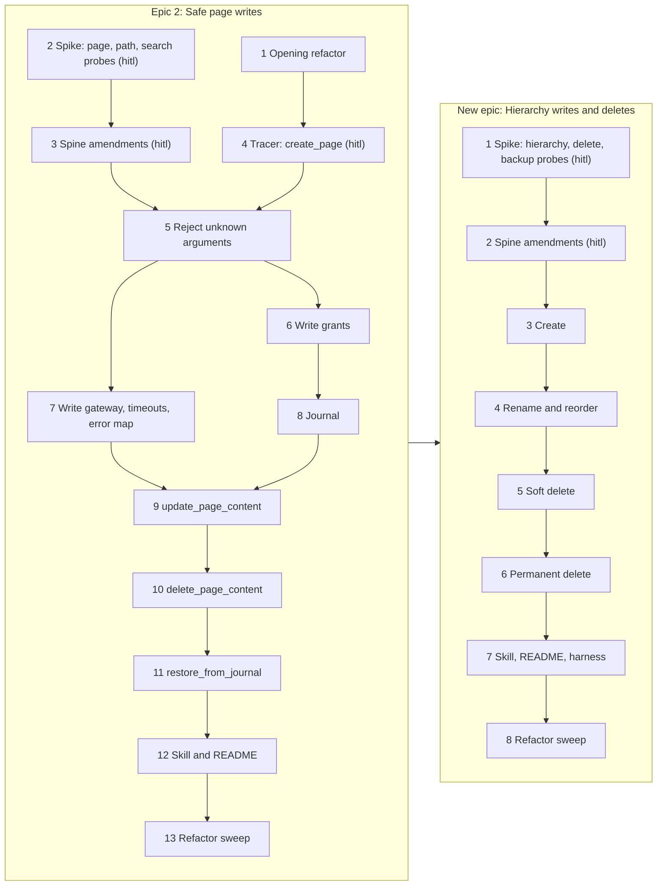

# Epic 2 inception: draft breakdown

**Status:** all 14 Fable findings applied (Phill, 2026-11-09). Question 3b is answered: (b), DPAPI.

## What I read, and what the check changed

**Sources:**
- the epic 2 envelope;
- initiative R4–R6, its tracer path and its Decisions;
- spine AD-3, AD-6–AD-10, AD-12, AD-16–AD-18, AD-21 and the Deferred table;
- the epic 1 retrospective;
- `deferred-work.md` (17 entries aimed at epic 2);
- OneMore rows 1–6 and 12–15;
- a survey of the code.

**What exists:**
- The read side is solid, but nothing for writes exists yet: no write method on the gateway port or either gateway, no pipeline, no write mutex, no journal, and no write-grant model.
- The grant CLI, `list_grants` and the elicitation types handle read grants only.
- Already in place: the write error codes, `outcomeUnknown`, cache eviction (`PageTextCache.Remove`), the integration guard that confines writes to MCP Test, and the journal file pattern in purge.

**The independent check** ran on my first draft, before you saw it. I verified each finding against the source.

It changed the draft:
- **Tracer:** shrank it. The AD-3 write-side timeout rules moved to the gateway entry, and the step table is built only for the `Create` class.
- **Page writes:** split into update and delete.
- **Grants:** the permanent-delete grant moved entirely to the delete epic, so epic 2 doesn't ship a grant nothing uses.
- **`ReadAccess` split:** moved into the opening refactor.
- **Order:** the `InvalidArgument` code is now amended in the spine story, so entry 5 follows it.
- **Grants are typed by you:** entry 4 is now hitl, and the verify checks have you do the granting, because no model can create a grant (AD-6).
- **Gaps closed:** four deferred items without an owner were placed. The AD-7 validation checks were added to every class. The page backup is described correctly (a page gets a snapshot, not a `Publish` backup). Two verify checks were tightened.

It confirmed:
- every prerequisite is real;
- the sweeps come last;
- the code facts above;
- every epic Notes unknown and every deferred item now has an owner (table at the end).

## Your decisions

### 1. One epic or two

Planned as one epic, this is 21 entries, against a typical 8–12. After the tracer it is almost entirely one lane, because every write story touches the tool runner, the error list, the gateway or the pipeline runner.

**Should epic 2 stay one epic, or split in two?**

Decided: (b) Split (Phill, 2026-11-09).

Why (b):
- **Earlier use.** Page writes reach real use sooner, as epic 1's read-only release did.
- **Deletes learn from page writes.** Permanent delete is the riskiest work in v1, and a retrospective in between feeds page-write lessons into it.
- **Each spike stays session-sized.**

**Placement.** The new epic must come before round 2, because round 2's move and `restore_from_recycle_bin` need its `UpdateHierarchy` and soft delete. It gets ID 5, since IDs are never reused, but it builds third.

**The cost:**
- a second envelope, retrospective and release;
- recorded statements to amend: the initiative says v1 is "epics 1–2", its 2026-11-03 Decisions fix four epics and put permanent delete in epic 2, and the envelope says "This epic completes v1";
- after epic 2, page overwrites can be recovered, but deletes can't until the new epic lands.

How the Done-when items split under (b):

| Done when | Epic 2 | New epic |
|---|---|---|
| 1. Writes on a granted notebook; `WriteNotGranted` plus the dialog | `create_page`, page update and delete | create, rename, reorder, soft and permanent delete |
| 2. A stale basis returns `StaleWrite`, including a delete on a page that isn't displayed | page update and delete | hierarchy writes and soft delete |
| 3. Journal entries; `restore_from_journal` | the journal, `PageWrite` entries, restore | `HierarchyWrite` and `SoftDelete` entries |
| 4. Permanent delete behind both grants, after a backup | none | all of it |
| 5. Two processes never interleave | all of it (the tracer) | none |
| 6. A release with the skill and README updated | its own | its own |

The new epic covers R4 (the hierarchy part of `Create`, `HierarchyWrite`, `SoftDelete`, `PermanentDelete` and the permanent-delete grant), R5 (the permanent-delete backup and `HierarchyWrite` and `SoftDelete` snapshots) and R6 (`OpenHierarchy` create, `UpdateHierarchy`, `DeleteHierarchy`).

### 2. The tracer bullet

The initiative already names epic 2's tracer path: "`update_page_content` on a granted notebook, with a journal snapshot and a restore". The draft's slice tracer is smaller, and it reaches that path at entries 9–11.

**What should entry 4, the first slice, be?**

Decided: (a) `create_page` through the pipeline (Phill, 2026-11-09).

### 3. Writes inside password-protected sections

Neither the spine nor the draft covers this.
- AD-21 says a write grant doesn't grant reads.
- A page write reads the page first (AD-7 step 3) and again afterwards, for the read-back check.
- The journal stores the page's content on disk without encryption.
- A restore can put it into an unprotected `Recovered` section.

**What should a write into a password-protected section do in v1?**

Decided: (b) Allow it with both a write grant and a read grant for the section (Phill, 2026-11-09). Phill's note: "Is this about the caching? Maybe we only cache very, very temporarily for password protected sections? But allowing read and write should be available with permission." The follow-up below settles what the journal does with that content.

#### 3b. Follow-up: what the journal does with protected content

It's not the search cache. AD-12 never caches a protected page. What would hold protected content is the **journal**. Before every page write or delete, AD-8 saves a copy of the page to disk so it can be restored. Today's rule keeps that copy for 30 days, as plain gzip JSON in `%LOCALAPPDATA%\OneNoteMcp\journal`, so anyone who can read that folder could read the section's text without its password.

Three facts bear on the choice:
- **Lifetimes differ.** A `once` read grant lapses after a few minutes, but its journal entry would stay for 30 days.
- **Restore can unprotect content.** AD-8's restore falls back to an unprotected `Recovered` section when the page's parent is gone.
- **Reads inside the pipeline need the read grant.** Step 3's read and the read-back check read protected content, so they need the section's read grant, as any read does.

**How should the journal hold a page from a password-protected section?**

Decided: (b) Protected entries encrypted with Windows DPAPI for the current user, kept 30 days; restore puts them back only into the same protected section, never into `Recovered` (Phill, 2026-11-09).

**Why (b):** DPAPI ties the entry to your Windows account. Other accounts, a copy of the disk and a backup can't read it, while recovery and the 30-day window work as for any page.

What (b) doesn't do: any process running as you can still read the entry for 30 days, and OneNote, by contrast, re-locks the section on its timer. So (b) is weaker than the password itself. It's the same exposure as any page journaled in plain text, limited to your account.

**Against the alternatives:**
- (c) protects more, but makes every restore depend on this one Windows profile. That's a bigger change than v1 needs, and it's easy to add later.
- (a) leaves the text readable in a folder the password never covered.
- (d) keeps it in plain text and loses recovery after a day.
- (e) breaks "can always recover".

Entry 3 writes the chosen rule into AD-8, AD-10 (a protection marker on the entry) and AD-21.

### 4. A cloud test notebook

Some of the spike's questions can't be answered on MCP Test, which is a local notebook:
- whether a cloud image is dropped when its Outline is replaced (the reason behind AD-7's refusal);
- what a cloud notebook's `path` looks like, and whether it's stable;
- the column `width` hash quirk, which was seen only on a real cloud notebook page.

Integration tests may only write inside MCP Test.

**Where do the spike's cloud write probes run?**

Decided: (a) A throwaway OneDrive notebook, "MCP Test Cloud" (Phill, 2026-11-09).

Why (a): `NotebookKey`, and every write grant, rests on cloud paths being stable. Most of your notebooks are cloud notebooks. The `width` quirk may still not reproduce on a fresh notebook; if it doesn't, entry 3 decides from the one observation.

### 5. Releases

**Should each epic's release be a ticket?**

Decided: (a) No release ticket (Phill, 2026-11-09).

## The breakdown

### Epic 2: Safe page writes

**Tracer bullet:** entry 4.

**What runs in parallel:**
- Entries 1 and 2 open together.
- Entry 3 runs beside 4.
- After 5, entries 6 and 7 run side by side. Entry 6 touches access, settings, the CLI and `list_grants`. Entry 7 touches the gateway port, both gateways, `HResultMap` and `ToolErrors`. Entry 6 uses the existing `WriteNotGranted` text and doesn't touch `ToolErrors`.
- Everything else is one lane.

Where an `after` exists only because two entries share a file, the entry names the file.

| # | Type | Title | Delivers | After | Verify | Unknown |
|---|---|---|---|---|---|---|
| 1 | story | Opening refactor (high risk: it splits `ReadAccess`) | The "epic 2 first refactor" group: D1–D5, P2 (with an `.editorconfig` rule), P3, S2 (split `ReadAccess` before write access arrives), S3 and A3. The only behaviour change is P3: the XPSFile probe stops swallowing `Timeout` and `Cancelled`. | none | All suites pass. The stress harness shows 0 mismatches. P3 has a test that fails on the old code. | none |
| 2 | spike (hitl) | Write probes, part 1: pages, paths, search | First hitl step: you create "MCP Test Cloud" on OneDrive, with one page holding an image that isn't downloaded, and the integration guard is widened to allow it by name and folder. Then probes on MCP Test and MCP Test Cloud: • **page writes:** merge by objectID; silently ignored edits and a read-back check; a cloud image dropped when its Outline is replaced; side effects on untouched content; `ModalDialogOpen` per method; HRESULTs • **dates:** which date `UpdatePageContent` and `DeletePageContent` accept when the page-XML and hierarchy values differ • **hashes:** the `Column/@width` and `pathCache` quirks • **schema:** `xs2026` and merged cells • **paths:** notebook and section `path` stability, for local and cloud notebooks • **search:** the Q5 probe | none | A findings doc with one result per question, logged in the spine memlog. You are present for the live writes. | everything it probes; the `width` quirk may not reproduce |
| 3 | story (hitl) | Spine amendments from the page probes | Amends: • AD-4: the schema • writes in a protected section (decision 3): AD-6 (who can do what), AD-7, AD-9 (`ReadNotGranted` for writes), AD-21 (its Binds and per-tool list gain the write tools), and AD-8 and AD-10 (the journal per decision 3b, with a protection marker on the entry). It settles four questions: the order of the two dialogs; whether a `once` read grant covers a write and its read-back; whether `create_page` into a protected section needs the read grant; and what restore does when the section is locked or gone • AD-17: what deleting one element compares (its hash) • AD-7: the read-back step and the image refusal • AD-9: page-write HRESULTs and `InvalidArgument` • AD-16: whether the XSD gate holds for page writes • AD-17: hash exclusions • AD-6 and AD-21: `NotebookKey` and `SectionKey` from the path captures • the Deferred rows. No story raises `inlineMaxChars`, so that row stays | 2 | The Fable final review has run, and you have approved the amended spine. | what the spike finds |
| 4 | story (hitl) | Tracer: `create_page` through the write pipeline | • the AD-7 step runner, with the `Create` class's steps and deadline • `Local\OneNoteMcp.Write` (AD-18) • the `notebooks{}` settings model • `grant --write <notebook>` in the CLI, which you run • `CreateNewPage` on the port and both gateways • a `create_page` tool, with `Create` validation (the parent exists and isn't locked) • cache eviction on write • the `NewerSchema` advice • the two `readOnlyHint` checks, which today fail on any write tool: the stress harness's tool check (`Program.cs:94`) and `NavigateToToolTests.cs:114` • setting `outcomeUnknown` when a write fails with `Timeout`, `ComUnavailable` or `Cancelled` (AD-9) | 1 | After you run `grant --write "MCP Test"`, `create_page` from Claude Code adds a page there. An ungranted notebook returns `WriteNotGranted`. A two-process integration test shows the writes never interleave. The harness passes. | none |
| 5 | story | Reject unknown argument names | Every tool refuses an argument name it doesn't declare, and names it, with the `InvalidArgument` error code that 3 adds to AD-9. A contract minor bump. It shares `ToolRunner.cs` and the contract snapshot with 4. | 3, 4 | A misnamed optional argument returns `InvalidArgument` naming it, for a read tool and for `create_page`. `McpSdkBindingTests` is updated. | whether SDK 2.3.1 exposes the raw arguments; if not, a filter |
| 6 | story (hitl) | Write grants: dialog, revoke, listing | • the elicitation dialog for write grants (question types beside the read ones) • `grant --revoke` for notebooks • `list_grants` showing write grants as `active` or `notebookNotOpen` • the `NotebookKey` and `SectionKey` amendments from 3 • R4: purge takes the settings mutex and warns about running servers It shares `ToolRunner.cs` (the prompt) with 5. | 5 | From Claude Code, `create_page` on an ungranted notebook raises the dialog. When you type the name, the write goes through, and `list_grants` shows the grant. Unit tests cover ambiguous names, decline and revoke. | how elicitation behaves in Claude Code for a write |
| 7 | story | Write gateway, timeouts and error map | • `UpdatePageContent` and `DeletePageContent` on the port and both gateways • the AD-3 gateway-side write rules: `ComBusy` while an abandoned write is outstanding, and busy retries confirmed safe for writes (4 already sets `outcomeUnknown`) • the whole HRESULT triage in `HResultMap`: the page-write codes from 3, the 23 untriaged codes and `hrDisabledByPolicy` It shares `ToolErrors.cs` with 5. | 5 | Unit tests map each triaged HRESULT and cover the abandoned-write rule. An integration test calls both methods on an MCP Test page through the guard. | none after 3 |
| 8 | story | Journal | AD-8's writer: • gzip JSON, written to a temp file and renamed • `binaryComplete` and `missingBinary` • pruning by age and size, at startup and daily • the pipeline's snapshot step for page snapshots • `JournalFailed` aborting the write • protected-section entries handled as decision 3b says It shares the pipeline runner with 6. | 6 | Unit tests cover the entry format, retention and the size cap against a temp folder. A write whose snapshot fails is refused. | none |
| 9 | story (hitl) | `update_page_content` | The `PageWrite` class: • the AD-17 basis check, with the amended hash rules • the XSD gate or its stand-in • checks that referenced objectIDs exist and the section isn't locked • the image refusal • the read-back check • a journal snapshot • in a protected section, the section's read grant too, as 3 settles it (decision 3) | 7, 8 | On MCP Test: • an edit with a fresh basis lands • a stale basis returns `StaleWrite`, including on a page that isn't displayed • each write leaves a journal entry  You then check one edit live from Claude Code. | none after 3 |
| 10 | story | `delete_page_content` | `DeletePageContent` through the same `PageWrite` pipeline: it compares the target element's hash (AD-17 as 3 amends it), and passes the date from the basis. It shares the `PageWrite` class code with 9. | 9 | On MCP Test, a delete with a fresh basis removes the element and leaves a journal entry. A stale delete on a page that isn't displayed returns `StaleWrite`. | none after 3 |
| 11 | story | `restore_from_journal` | Recreates a page entry as a new page: • under its `parentId`, else by `parentNamePath`, else in a `Recovered` section • hierarchy and backup entries return `NotSupported` • any missing binaries are reported • a protected-section entry handled as decision 3b and entry 3 say, including a locked or missing section It adds `OpenHierarchy` section creation by parent ID to the gateway, for `Recovered`; the new epic's entry 3 builds on it. | 10 | From Claude Code, a page overwritten by `update_page_content` comes back as a new page from its journal entry, on MCP Test. | none |
| 12 | story (hitl) | Skill and README for page writes | The guide skill's write recipes, and the README sections on grants, safety limits and the journal. | 11 | `claude plugin validate --strict` passes. You grant MCP Test through the CLI, then an agent following the README makes an edit and restores it. | none |
| 13 | story | Refactor sweep | Cleanup only. Its scope is set at its start, from the build records and deferred findings. | 12 | All suites pass, the harness shows 0 mismatches, and no behaviour changes. | set at start |

### New epic: Hierarchy writes and deletes

It comes after epic 2 and before round 2. **Tracer bullet:** entry 3. After the spike, the epic is one lane.

| # | Type | Title | Delivers | After | Verify | Unknown |
|---|---|---|---|---|---|---|
| 1 | spike (hitl) | Write probes, part 2: hierarchy, delete, backup | Probes on MCP Test: • `OpenHierarchy` create • `UpdateHierarchy` add, rename and reorder • `DeleteHierarchy` soft and permanent, on a page, section, section group and notebook • a soft delete in a protected section, and a protected section deleted whole • `Publish` in `pfOneNote` format • which date `DeleteHierarchy` accepts • `ModalDialogOpen` per method, and HRESULTs | none | A findings doc, with you present for the live writes. | everything it probes |
| 2 | story (hitl) | Spine amendments from the hierarchy probes | Amends AD-7, AD-8, AD-9 and AD-21, and updates the Deferred rows. | 1 | The Fable final review has run, and you have approved. | what the spike finds |
| 3 | story | Create: section, section group, notebook | `OpenHierarchy` create, with the `Create` class, building on the section creation from 2.11: • by parent ID, with validation that the parent exists and isn't locked • a notebook at a path checked empty • the automatic grant under the settings mutex, inside the write mutex • `createdNotGranted` `OpenHierarchy` on an existing path is `AppState`, which belongs to round 3 | 2 | On MCP Test, each kind is created, and a new notebook shows in `list_grants` as `grantedVia: created`. | none after 2 |
| 4 | story | Rename and reorder: `update_hierarchy` | `UpdateHierarchy` add, rename and reorder (not move): the XSD check, a check that the IDs exist, the `lastModifiedTime` basis check, a hierarchy snapshot. It shares tool registration and the contract with 3. | 3 | On MCP Test, a rename lands, and a stale one returns `StaleWrite`. | none |
| 5 | story | Soft delete | `DeleteHierarchy permanent=false` for a page, section or section group, with a page or hierarchy snapshot. Protected sections follow 2's rule. | 4 | On MCP Test: • a deleted page is in the recycle bin with a journal entry • `restore_from_journal` brings it back • a stale basis returns `StaleWrite` on a page that isn't displayed | none |
| 6 | story | Permanent delete | • the permanent-delete grant: CLI, dialog and listing • `DeleteHierarchy permanent=true` • a page gets a full page snapshot; a section, section group or notebook gets a `Publish` backup first, under `Publish`'s 300 s timeout and the 600 s pipeline deadline • `BackupFailed` refuses the delete | 5 | On MCP Test: • without the second grant, the delete returns `PermanentDeleteNotGranted` • with it, a backup file exists before a section is gone • a forced backup failure refuses the delete | none |
| 7 | story (hitl) | Skill, README and harness for hierarchy writes | Write recipes for create, rename, reorder and delete; the README on permanent delete and backups; the stress harness's write-tool list and contract check for the new tools. | 6 | Plugin validation and the harness pass. You grant through the CLI, then an agent following the README runs a permanent delete on MCP Test. | none |
| 8 | story | Refactor sweep | Cleanup only. | 7 | All suites pass, and no behaviour changes. | set at start |

## Risk

Every entry is **high** risk except 2.5, 2.12 and the sweeps. Each high-risk entry gets one check beyond its own tests:
- **You present:** the spikes (2.2, new 1) and the spine stories (2.3, new 2).
- **A live check by you from Claude Code:** the tool stories.
- **A security review of the diff before merge,** as in 1.22: 2.1, 2.4, 2.6, 2.8, 2.9, new 3 and new 6. These control access, or put note content on disk or into pages.

## Where every open item lands

| Item | Entry |
|---|---|
| The epic 2 first refactor (D1–D5, P2, P3, S2, S3, A3) | 2.1 |
| R4: the purge mutex and running servers | 2.6 |
| Reject unknown argument names | 2.3 (the `InvalidArgument` error code), 2.5 |
| Write-side `outcomeUnknown`, including on `Cancelled`; AD-3's write timeouts; busy retries | 2.7 |
| The `NewerSchema` advice | 2.4 |
| HRESULT triage, including the 23 untriaged codes and `hrDisabledByPolicy` | 2.3, then 2.7; new codes from the hierarchy probes in new 2 |
| `ModalDialogOpen` per method | 2.2, then 2.7; new 1, then new 2 |
| Hash quirks; `xs2026`; the XSD gate | 2.2, 2.3, then 2.9 |
| Notebook and section path stability | 2.2, 2.3, then 2.6 |
| The Q5 search probe | 2.2 |
| How elicitation behaves | 2.6 |
| The image refusal | 2.2, 2.3, then 2.9 |
| `Publish` backup; `DeleteHierarchy` on a notebook or section group; soft delete in a protected section | new 1, new 2, then new 5 and new 6 |
| The probe before raising `inlineMaxChars` | stays deferred: no story raises it |

Do you want to change a description, or add a note or reference to any entry? Tell me in an annotation.
